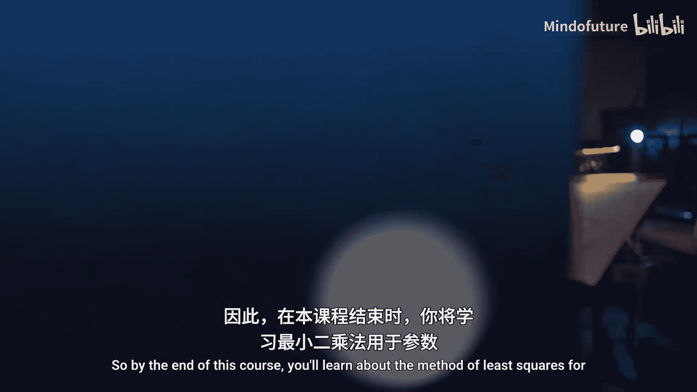
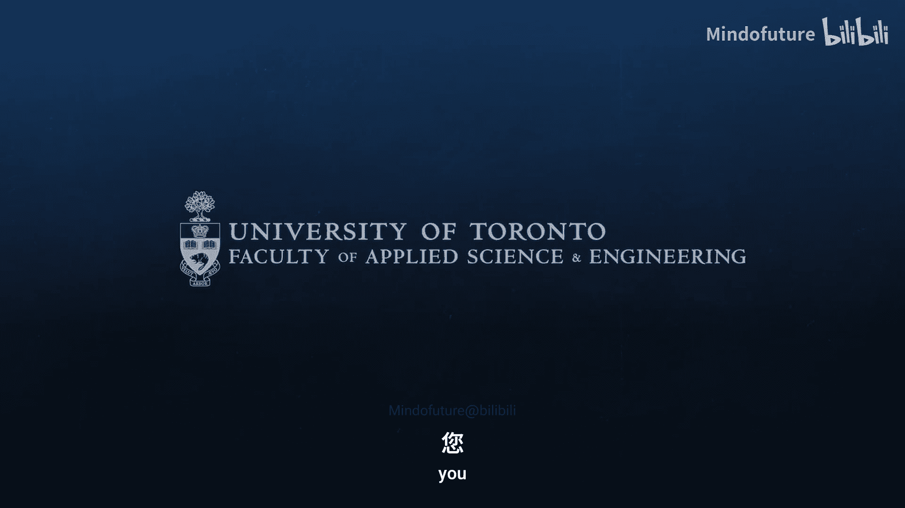

# 【多伦多大学】自动驾驶汽车的状态估计和定位 ｜ State Estimation Localization Self Driving Cars p02 P02_欢迎学习本课程_01_01_02 -BV1WysszdEDx_p2-

。Welcome to the second course of the University of Toronto's Self-driving car specialization。

 My name is Jonathan， and I'll be your instructor for this course。

 If you're just joining us for the first time， I recommend taking the first course in the specialization so that you become familiar with the self-diving car。

 hardware and software stacks and the basics of vehicle models and control。

 If you've already taken the first course。 then you familiarize yourself with autonomous driving architectures。

 vehicle dynamic modeling and longitudinal and lateral control。😊。

You also learned about safety assurance for self driving cars and designed a longitudinal and lateral controller using the carless simulator。

In this course， we're going to dig into the other side of the self driving problem and learn about different types of sensors and how we can use them for state estimation and localization in a self driving car。

State estimation is the process of determining the best value of some physical quantity from what are typically noisy measurements。

We say measurements are noisy because sensors aren't perfect。

And if you repeatedly measure the same quantity， you won't get the same number each time。

 for example， if you dip a thermometer into a cup of tea at 40 degrees Celsius。

 the thermometer might read 39。8 degrees the first time， 40。1 degrees the second time and so on。

State estimation gives us a way to combine all of those noisy temperature measurements to estimate the true temperature of the T。

So state estimation is fundamental to any device with a sensor and self driving cars are no exception。

For self driving， one of the most important types of state estimation is localization。

To the process of determining where the car is in the world and how it's moving。

 localization is extremely important because even if you have the best design controller in the world。

 you won't be able to use it if you don't know the state of the car。So by the end of this course。

 you'll learn about the method of least squares for parameter and state estimation。

Apply the linear common filter and its nonlinear variance。

 the extended and the unscented common filters to state estimation problems。

Develop models for typical localization sensors like GPS， inertial sensors， and lidIDarR units。

Learn about LiDar scan matching and the iterative closest point algorithm。And finally。

 use these tools to fuse multiple sensor streams into a single state estimate for a self driving car。

😊。

For the final project of this course， you'll apply what you've learned by developing a full vehicle state estimator for a self driving car using the carless simulator。

The estimator you'll develop is very similar to what you might find in a self driving car today and will be a very good way for you to develop your intuition and understanding of how these systems work in practice。

Are you ready， Let's get started。

