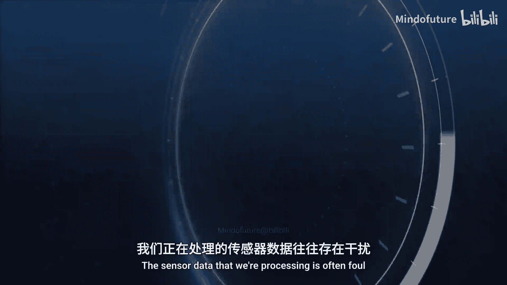

# 【多伦多大学】自动驾驶汽车的状态估计和定位 ｜ State Estimation Localization Self Driving Cars p09 P09_状态估计的重要性_01_02_07 -BV1WysszdEDx_p9-

So why is state estimation so critical for self-driving cars Well a straightforward answers you need to know where you are and all you get is input is sensor data and so one could simply post the state estimation question as given all this incoming sensor data where am I and so your state is an answer to where you are and you've got to estimate that because you're not necessarily been told from a cameras if I had a picture of the world I have to infer from that picture where I am or how Im moving how fast am I turning。

 that's a state estimation question So you need to use that sensor data maybe you've got some prior information we have some prior beliefs about how fast you are going 10 milliseconds ago and you can fold that in but if you can't do state estimation you can't process sensor data I would say at the highest level so it's a pretty fundamental problem so we we've agreed between us that state estimation is important wouldn't it be great if that was also then an easy。

Problem。Unfortunately， it's well hard。Why well， because the center data that we're being asked the process to answer the question。

 for example， where am I， how am I moving， what's that individual over there going to be doing because I've got an idea of their velocity？

The sensor data that we're processing is often foul。

