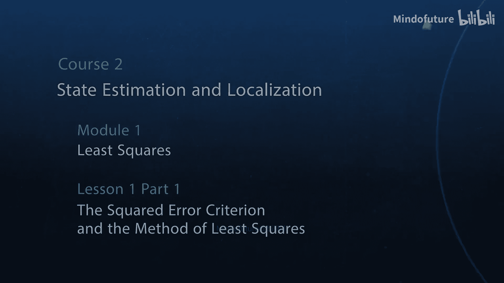
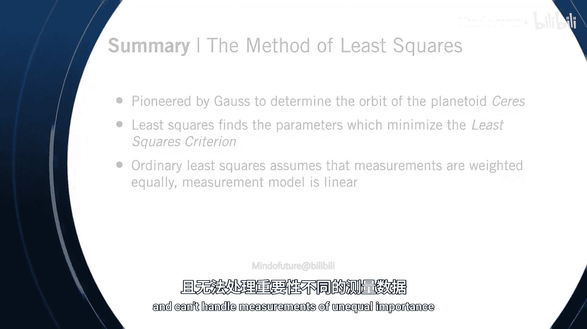

# 【多伦多大学】自动驾驶汽车的状态估计和定位 ｜ State Estimation Localization Self Driving Cars p10 P10_第一课第1部分_平方误差准则与最小二乘法_02_01_01 -BV1WysszdEDx_p10-

Hello and welcome to Cose 2 of the selflf driving car specialization。😊，In this course。

 we'll cover state estimation with a focus on localization。

Let's first begin by defining a few key terms。Localization is the method by which we determine the position and orientation of a vehicle within the world。

As you can probably imagine， accurate localization is a key component of any self driving car software stack。

If we want to drive autonomously， we certainly need to know where we are。To accomplish this。

 we can use state estimation。This is the process of computing a physical quantity。

 like position from a set of measurements。Since any real world measurements will be imprecise。

 we will develop methods that try to find the best or optimal value。

 given some assumptions about our sensors and the external world。

Related to state estimation is the idea of parameter estimation。Unlike a state。

 which we will define as a physical quantity that changes over time。

 a parameter is constant over time。Position and orientation are states of a moving vehicle。

 While the resistance of a particular resistor in the electrical subsystem of the vehicle would be a parameter。

In the first module or week one of the course， we will cover a common technique in state estimation。

 the method of least squares。By the end of this week。

 you'll know a little bit about the history of least squares。

And you'll learn about the method of ordinary least squares and its cousin。

 the method of weighted least squares。Then we'll cover the method of recursive lease squares。

 and finally， discuss the link between least squares and the maximum likelihood estimation technique。

😊，In the first lesson of this module， we'll introduce the method of least squares and something called the squared error criterion。

😊，By the end of the video， you'll be able to describe how the method of least squares was first used by Carl Frederick Gauss in the discovery of the Planetoid series。

😊，Describe the least error criterion and how it's used in estimating the best parameters。

And derive the necessary normal equations that willll need to solve to use the method。Let's begin。

The method of least squares dates to the late 18th century。

 well before anyone had considered the concept of automobiles。On January 1，1801。

 an Italian priest and astronomer， Giuseppe Piazzi。

 discovered a new celestial object in the night sky。 The asteroid or planetoid now called series。😊。

You can see it here next to the moon and to the earth。

Pazzi made 24 telescope observations of this new object over 40 days before it was lost in the glare of the sun。

Since series is only about 900 km in diameter， finding it again was extremely challenging。

This meant that other astronomers could not confirm Piazzi's discovery。To help locate series again。

 Carl Frederick Gaus， who has been called the Prince of mathematicians for his prodigious contributions to many different fields。

Used a method of leastd squares to accurately estimate series orbital parameters based on Piazzi's published measurements。

With Gaus's calculations in hand， astronomers were successfully able to rediscover series nearly a year after Piazzi had made his first observations。

😊，Although he published the method in 1809， Gaus claimed that he developed least squares in 1795。

 predating Lajean's work。Gaus summarized the approach as follows。

The most probable value of an unknown parameter is that which minimizes the sum of squared errors between what we observe and what we expect。

To illustrate how this works， let's take a simple example。

Suppose you are trying to measure the value in ohs of a simple resistor within the drive system of an autonomous vehicle。

To do this， you grab a relatively inexpensive multimeter that's lying around your lab。Now。

 let's say you collect these four separate measurements sequentially。

If you've studied electrical circuits before， you'll probably recall that the type of carbon film resistor shown here is color coded。

 according to its rated resistance value。This resistor is rated at 1 kilom。However。

 due to a number of factors， the true resistance can vary from the rated value。In this case。

 the resistor has a gold band， which indicates that it can vary by as much as 5%。Furthermore。

 let's imagine that our multimeter is particularly poor and that the person making the measurements is not particularly careful。

For now， it's sufficient to treat this noise as equivalent to a general error。

But we'll come back to ways we can interpret the noise from a probabilistic perspective later in the module。

For each of the four measurements。We define a scalar noise term that is independent of the other noise terms。

Statistically， we would say in this case that the noise is independent and identically distributed or IID。

 and we'll discuss this more later。Next， we define the error between each measurement and the actual value of our resistance x。

But remember， we don't yet know what X is。To find x。

 we square these errors to arrive in an equation that is a function of our measurements and the unknown resistance that we're looking for。

😊，With these errors defined， the method of least squares says that the resistance value we are looking for。

 That is the best estimate of x is one which minimizes the squared error criterion。

 Also sometimes called the squared error cost function or loss function。

To minimize the squared error criterion， we'll rewrite our errors in matrix notation。

This will be especially helpful when we have to deal with hundreds or even thousands of measurements。

We'll define an error vector identified as bold E。 That is a function of our observations stacked into a vector Y and a matrix H called the Jacobbian。

And finally， our true resistance X。H has the dimensions M by N。

 where M is the number of measurements， and N is the number of unknowns or parameters that we wish to estimate。

In general， this will be a rectangular matrix， which we can write down quite easily in this linear case。

It will require some more mathematical effort to compute when we discuss non nonlinear estimation in an upcoming lesson。

Note here that x is a single scalar。We'll see later that it can be a vector comprising multiple unknowns。

With these definitions in mind， we can convert our squared error criterion to vector notation as follows。

Expanding out the brackets， we arrived at this somewhat intimidating expression。So what now？Well。

 remember that we need to minimize the squared error with respect to our true resistance x。

From calculus， we know that we can do this by taking a derivative of the error function with respect to the unknown X and setting the derivative to 0。

Let's do exactly that。We'll have to use some standard matrix expressions。Rearranging。

 we arrive at what are called the normal equations， which can be written as a single matrix formula。

We can solve these to find X hat， the resistance， which minimizes our squared error criterion。

This expression has a unique solution。 If and only if H transpose H is not singular。 In other words。

 if the matrix has an inverse。If we have M measurements and n unknown parameters。

 H transpose H will be n by n。The matrix will be invertible if and only if M is greater than or equal to N。

 So we need at least as many measurements as unknowns in order to derive the least squares solution。

This will usually not be a problem。In fact， we'll often face the challenge of dealing with too many measurements。

But nevertheless， you should keep this limitation in mind when working with the formula。

Coming back to our particular resistance problem， let's fill out our variables。

Once we have these quantities， it's just a matter of plug and chug。

The expression is quite straightforward to code up， as you'll see in your module assignment。

Note here that the expression simplifies to the arithmetic mean of our four measurements。

Perhaps this is something you thought of doing all along。 Now。

 we have another justification for using the arithmetic mean。

 It minimizes the simple least squares criteriaion。😊，Finally。

 we should note two important assumptions that we've made。First。

 we have assumed that our measurement model is linear。

This is a very important assumption that is often broken in complex systems。

We'll discuss nonlinear measurement models in later lessons。Second。

 we've assumed that all of our measurements have an equal weight in our error equation。

To put this another way， we've assumed that we care about each of our measurements equally。

To summarize in this video， you've learned that the method of least squares was pioneered by Carlar Frederick Gauss。

 who used it to accurately predict the orbit of a new planet like object called series。

 You saw how we can minimize the least squares criterion to solve for parameter values of interest。😊。

And we noted that the method of ordinary least squares assumes a linear measurement model and can't handle measurements of unequal importance。

In the next video， we'll extend the method of least squares to the method of weighted least squares。

 which can account for measurements of varying importance。

