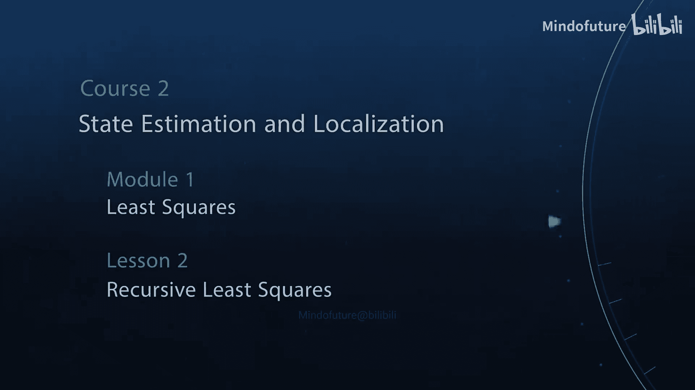

# 【多伦多大学】自动驾驶汽车的状态估计和定位 ｜ State Estimation Localization Self Driving Cars p12 P12_第二课_递归最小二乘法_02_02_01 -BV1WysszdEDx_p12-

In this lesson， we'll discuss recursive least squares。

 a technique to compute least squares on the fly。 By the end of the lesson， you'll be able to。😊。

Extend the Bcheley squares solution we discussed in the previous two videos to one that works recursively。

And use this method of recursive least squares to keep a running estimate of the least squares solution as new measurements stream in。

😊，Let's begin。We've already explored the problem of computing a value for some unknown but constant parameter from a set of measurements。

One of our assumptions was that we had all of the data at hand。That is。

 we assumed that we collected a batch of measurements。

 and we wanted to use those measurements to compute our estimated quantities of interest。

This is sometimes a completely reasonable assumption。

But what can we do if instead we have a stream of data。

 Do we need to recompute the least square solution every time we receive a new measurement。

For example， let's say we have a multimeter that can measure resistance 10 times per second。Ideally。

 we'd like to use as many measurements as possible to get an accurate estimate of the resistance。

If we use the method of least squares， however， the amount of computational resources we will need to solve our normal equations will grow with the measurement vector size。

Alternatively， we can try and use a recursive method。

One that keeps a running estimate of the optimal parameter for all of the measurements that we've collected up to the previous time step and then updates that estimate。

 given the measurement at the current time step。To do this， we use a recursive algorithm。

 incrementally updating our estimate as we go along。

Let's assume that we have our best optimal estimate at time， K -1。And at time K。

 we receive a new measurement that willll assume follows the linear measurement model with additive Gaussian noise。

😊，Our goal is to compute an updated optimal estimate at time， K。

Given our measurement and the previous estimate。A linear recursive estimate is given by the following expression。

Here， K is called an estimator gain matrix。The term in brackets is called the innovation。

 It quantifies how well our current measurement matches our previous best estimate。

Even without knowing the expression for K， we can already see how this recursive structure works。

Our new estimate is simply the sum of the old estimate and a corrective term based on the difference between what we expected the measurement to be and what we actually measured。

In fact， if the innovation were equal to 0， we would not change our old estimate at all。Now。

 how do we compute K。Well， for that。We'll need to use a recursive least squares criterion and some matrix calculus as before。

This time， the math is significantly more involved。

 so we'll only work through a few steps and let the more curious learners refer to the textbook for more information。

😊，Our least squares criterion in this case will be the expected value of our squared errors for our estimate at time K。

For a single scalar parameter like resistance， this amounts to minimizing the estimator state variance。

Sigma squared sub K。For multiple unknown parameters。

 this is equivalent to minimizing the trace of our state covariance matrix at time T。

This is exactly like our former least squares criterion。

 except now we have to talk about expectations。Instead of minimizing the error directly。

 we minimize its expected value， which is actually the estimator variance。 the lower the variance。

 the more we are certain of our estimate。It turns out that we can formulate a recursive definition for this state covariance matrix。

 P sub K。By using matrix calculus and taking derivatives。

 we can show that this criterion is minimized when K has the following value。

The full derivation is a bit beyond the scope of our course that can be found in any standard estimation text。

Finally。😊，By using this formulation， we can also rewrite our recursive definition for P sub K into something much simpler。

Take a second to think about this equation。The larger our gain matrix K。

 the smaller our new estimator covariance will be。Intuitively。

 you can think of this gain matrix as balancing the information we get from our prior estimate。

And the information we receive from our new measurement。Putting everything together。

 our least squares algorithm looks like this。We initialize the algorithm with an estimate of our unknown parameters and a corresponding covariance matrix。

😊，This initial guess could come from the first measurement we take。

And the covariance could come from technical specifications。Next。

We set up our measurement model and pick values for our measurement covariance。Finally。

Every time a measurement is recorded， we compute the measurement gain and then use it to update our estimate of the parameters and our estimator covariance or uncertainty。

😊，Every time we get a new measurement， our parameter uncertainty shrinks。

Why is recursive least squares an important algorithm？As we've seen。

 it enables us to minimize computational effort in our estimation process。

 which is always a good thing。😊，More importantly， recursive lease squares forms the update step of the linear common filter。

 We'll discuss this in more detail in the next module。😊，In your upcoming graded assessment。

 you'll get some hands on experience using recursive lease squares to determine a voltage value from a series of measurements。

😊，To summarize。The recursive least squares algorithm lets us produce a running estimate of a parameter without having to have the entire batch of measurements at hand。

😊，And recursive least squares is a recursive linear estimator that minimizes the variance of the parameters at the current time。

In the next and final video of this module， we'll discuss why minimizing squared errors is a reasonable thing to do by connecting the method of least squares with another technique from statistics。

 maximum likelihood estimation。😊。

