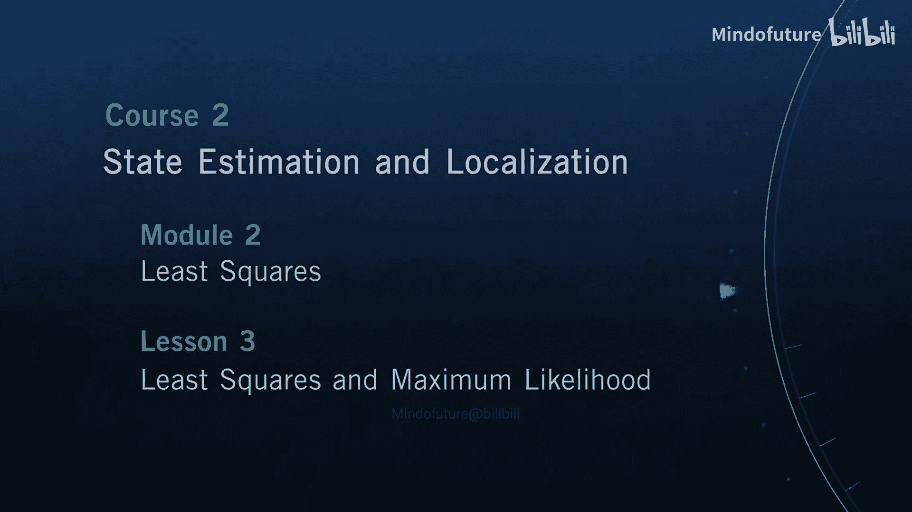
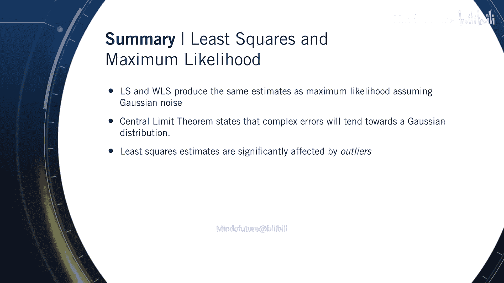

# 【多伦多大学】自动驾驶汽车的状态估计和定位 ｜ State Estimation Localization Self Driving Cars p13 P13_第三课_最小二乘法和最大似然估计法_02_02_03 -BV1WysszdEDx_p13-

Welcome to the final lesson of moduled 1， we'll finish off the module by discussing an important connection that will help to provide further intuition for the method of least squares。

😊，Specifically， by the end of this lesson。You'll be able to state the connection between the method of least squares and maximum likelihood estimation with Gaussian random variables。

😊，Let's begin by recalling the least squares criterion from the very first video in this module。

We found the best estimates of some unknown but constant parameters by determining the values that minimized the sum of squared errors based on our measurements。

But we can ask why squared errors， Why not cubed errors or square root errors or something else。

This is actually a particularly deep question， and there is a whole field of robust statistics dedicated to it。

You can indeed use different error functions， but we'll go over two reasons why squared errors are attractive and relevant。

The first is simple。 Squared errors allow us to solve for the optimal parameters with relatively straightforward algebra。

😊，If the measurement model is linear， minimizing the squared error criterion amounts to solving a linear system of equations。

The second reason has to do with probability and a deep connection between least squares and maximum likelihood estimators under the assumption of Gaussian noise。

As you may have guessed， this connection was first derived in a particular form by Gauss。

 and so it's no surprise that it involves Gaussian random variables or equivalently Gaussian noise。

To understand this fundamental connection， let's first discuss maximum likelihood。

Instead of writing down a loss， we can approach the problem of optimal parameter estimation by asking which parameters make our recorded measurements the most likely。

To keep things simple， we'll stick to a single scalar parameter to build our intuition。For example。

 let's look again at measuring resistance。Given what we know about probability。

 if we have four possible values for this unknown resistance parameter， capital X。

 small X sub A through small X sub D。And each gives rise to the following conditional probability on our measurement y。

Which value would maximize the conditional likelihood， given the measurement Y submes。That's right。

 X sub a。The highest probability density at the measured location is given by the green curve。

 which means that x sub a is our most likely parameter value， given this measurement。😊，Now。

 if we take our simple measurement model， we can convert it to a probability density by assuming a density for our additive noise。

The unknown parameter X becomes the mean of this density。

 and the variance is simply our noise variance。Recall that the probability density of a Gaussian random variable is given by the following equation。

This means that we can express our measurement likelihood for a single measurement， as follows。

If we have multiple independent measurements， each with the same noise variance。

 we can simply take the product of multiple Gaussians， which results in another Gaussian。

We can try to maximize this likelihood with respect to the mean parameter， X hat。To do this。

 we'll use a technique that's often used in optimization。

Instead of maximizing the likelihood directly， will'll take its logarithm and maximize that。

Since the likelihood will always be a positive number。

 And because the logarithm is a monotonically increasing function。

This will not affect the final result， which is very convenient。

Once we apply the logarithm to this likelihood， we see that something pops out that looks a lot like the sum of squared errors。

The constant C in this expression refers to terms that are not a function of X and ones which we can safely ignore。

The last step is now to realize that the arc max of a function F is the same as the argument of the negative of that function。

Using this fact， we can turn our likelihood maximization into a minimization of the sum of squared errors。

And for La， minimizing the sum of squared errors is equivalent to maximizing the likelihood of a set of measurements。

 assuming that the measurements are corrupted by additive。

 independent Gaussian noise that's of equal variance。😊，Furthermore。

 if we maintain the same assumptions， but change the variance of the Gaussian noise for each measurement。

We can arrive at the same criterion as we saw in our weighted least squares video。😊，So in both cases。

 the maximum likelihood estimate gave an additive Gaussian noise。

Is equivalent to the least squares or weighted least squares solutions we derived earlier。

So why is this result so important？Our self driving car will have to deal with many。

 many sources of error， some of which are very difficult to model。However。

 the central limit theorem tells us that when combining all of these errors together。

 they can reasonably be modeled by a single Gaussian error distribution。

We would like to model our system probabilistically and yet maintain simplicity and calculations。

If our errors are Gaussian， then the best maximum likelihood estimate of the parameters of interest is exactly the least square solution we're already familiar with。

 easy。😊，To finish off， let's discuss one important caveat for this method。

When we use the method of least squares， measurement outliers can have a significant effect on our final estimate。

😊，To understand why， consider that under a Gaussian distribution。

 a sample that is two standard deviations away from the mean has less than a 5% probability of occurring。

As a result， if there are some outliers in our measurement data。

 the method of maximum likelihood and equivalently。

 the method of least squares will put significant importance on these measurements。

And so the estimated value of our parameter will be pulled strongly by these outliers。

 Our optimal method will be skewed so that the outlying measurement is more likely。

This can happen to many estimators using sensor data from a self driving vehicle。

Outliers might result from people walking in the middle of a LiDar scan， for example。

 or from a bad GPS signal。Consider our resistor example。

With one outlying measurement that may come from a simple accident。

 the final estimate is pulled significantly away from that of the outlier free case。😊。

We always want to be cognizant about liars and try to quantify the error distribution whenever possible before blindly applying maximum likelihood or least squares。

Now that we've derived this connection between maximum likelihood and least squares。

 we're ready to extend our recursive least squares estimator to the full common filter。

 one of the most famous algorithms of the 20th century。😊，To summarize。

 we've learned that the method of least squares and weighted least squares produce the same estimates as maximum likelihood given Gaussian noise。

This is particularly important because many complex noise sources， when added。

Will tend towards a Gaussian。However， it's always important to be wary of outlier measurements that can significantly affect our final estimate values。

In the next module， we'll take a look at how we can now extend what we've learned about least squares and parameter estimation to continually varying states that may have more complex nonlinear models associated with them。

 See you there。😊。

