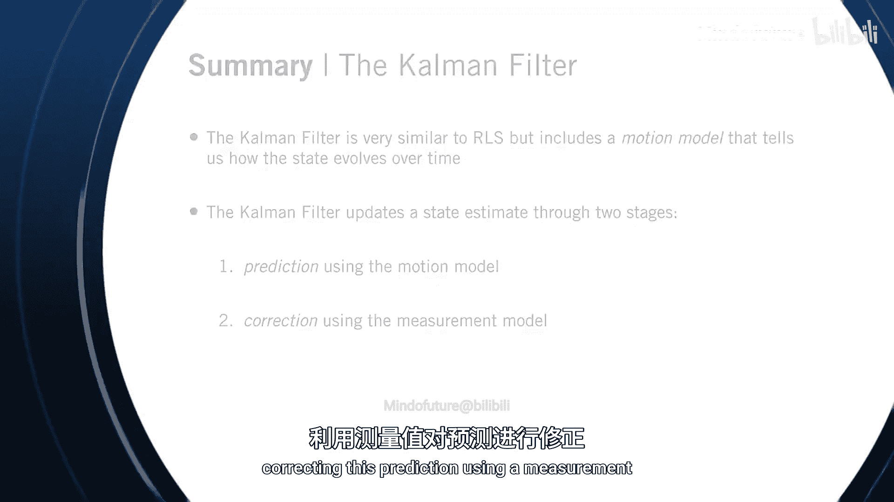
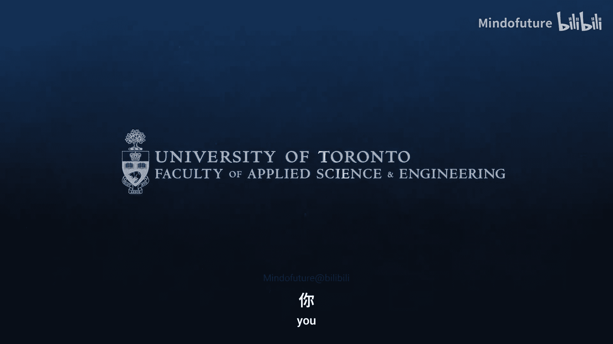

# 【多伦多大学】自动驾驶汽车的状态估计和定位 ｜ State Estimation Localization Self Driving Cars p14 P14_第一课_线性卡尔曼滤波_03_01_01 -BV1WysszdEDx_p14-

And welcome back。In module 2， we'll learn about one of the most famous algorithms in all of engineering。

 the common filter。😊，In today's world of advanced machine learning。

 the common filter remains an important tool to fuse measurements from several sensors to estimate in real time the state of a robotic system。

 such as a self driving car。In this module， we'll learn some of the history of the common filter and introduce its basic linear formulation。

We'll present why the common filter is the best linear unbiased estimator。

 and then extend the linear formulation to nonlinear systems through linearization。

Discuss limitations of this linearization approach。And finally。

 present a modern alternative to linearization through the unscented transform。😊。

By the end of this lesson， you'll be able to。Describe the common filter as a state estimator that works in two stages。

 prediction and correction。Understand the difference between motion and measurement models。

And then use the common filter formulation in a simple 1 D localization example。

Let's begin with a bit of history。The common filter algorithm was published in 1960 by Ruddoph E。

 Kaleman。A Hungarian born professor and engineer who was working at the Research Institute for Advanced Studies in Baltimore。

 Maryland。Years later， in 2009， American President Barack Obama awarded Commonman the prestigious National Medal of Science for his work on the common F and other contributions to the field of control engineering。

After its publication in 1960， the common filter was adopted by NASA for use in the Apollo guidance Comp。

It was this groundbreaking innovation that played a pivotal role in successfully getting the Apollo spacecraft to the moon and to our first steps on another world。

😊，The filter helped guide the Apollo spacecraft accurately through its circumlunar orbit。

The engineers at NASA Ames Research Center adopted Common's linear theory and extended it to nonlinear models。

We'll look at this specific extension in an upcoming module。 But first。

 let's talk about the basic linear common filter。The common filter is very similar to the linear recursive least squares filter we discussed earlier。

While recursive least squares updates the estimate of a static parameter。

 the common filter is able to update an estimate of an evolving state。😊。

The goal of the common filter is to take a probabilistic estimate of this state and update it in real time using two steps。

 prediction and correction。To make these ideas more concrete。

 let's consider a problem of estimating the1 D position of a vehicle。

Starting from an initial probabilistic estimate at time， K -1。

Our goal is to use a motion model which could be derived from wheel oometry or inertial sensor measurements to predict our new state。

Then we'll use an observation model derived from GPS， for example。

To correct that prediction of vehicle position at time K。Each of these components。

 the initial estimate。Predicted state and the final corrected state are all random variables that we will specify by their means and covariances。

In this way， we can think of the common filter as a technique to fuse information from different sensors to produce a final estimate of some unknown state。

 taking into account uncertainty in motion and in our measurements。For the common filter algorithm。

 we have been able to write the motion model in the following way。

The estimate at time step K is a linear combination of the estimate at time step K -1。

 a control input， and some zero mean noise。The input is an external signal that affects the evolution of our system state。

 In the context of self driving vehicles， This may be a wheeltorrque applied to speed up and change lanes。

 for example。Next， we will also need to define a linear measurement model。And finally。

 we'll need a measurement noise as before， and a process noise that governs how certain we are that our linear dynamical system is actually correct or equivalently。

 how uncertain we are about the effects of our control inputs。😊，Once we have our system in hand。

 we can use an approach very similar to that we discussed in the recursive lease squares video。

 except this time， we'll do it in two steps。First， we'll use the process model to predict how our states remember though we're now typically talking about evolving states and not state parameters。

Evolved since the last time step and will propagate our uncertainty。Second。

 we'll use our measurement to correct that prediction based on our measurement residual or innovation and our optimal gain。

😊，Finally， we'll use the gain to also propagate the state covariance from our prediction to our corrected estimate。

😊，In our notation， the hat indicates a corrected prediction at a particular time step。

 whereas a check indicates a prediction before the measurement is incorporated。

If you've worked with the common filter before， you may also have seen this written with plus and minus signs for the corrected and predicted quantities respectively。

Let's recap。We start with a probability density over our states and also maybe parameters at time step k minus1。

 which we represent as a multivariate Gaussian。We then predict the states at times step K using our linear prediction model and propagate both the mean and the uncertainty。

 the covariance forward in time。Finally， using our probabilistic measurement model。

 we correct our initial prediction by optimally fusing the information from our measurement。

 together with the prior prediction through our optimal gain matrix， K。😊。

Our end result is an updated probabilistic estimate for our states at time step K。

The best way to become comfortable with the common filter is to use it。

Let's look at a simple example。Consider again the case of a self driving vehicle estimating its own position。

Our state factor will include the vehicle position and its first derivative velocity。

Our input will be a scalar acceleration that could come from a control system that commands our car to accelerate forward or backwards。

For our measurement， we'll assume that we're able to determine the vehicle position directly using something like a GPS receiver。

😊，Finally， we'll define our noise variances as follows。Given this initial estimate and our data。

 what is our corrected position estimate after we perform one prediction step and one correction step using the common filter？

Here is how we can use these definitions to solve for our corrected position and velocity estimates。

Pay attention to the fact that our final corrected state covariance is smaller。That is。

 we are more certain about the car's position after we incorporate the position measurement。

This uncertainty reduction occurs because our measurement model is fairly accurate。That is。

 the measurement noise variance is quite small。Try increasing the measurement variance and observe what happens to the final state estimate。

To summarize， the common filter is similar to recursive least squares。

 but also adds a motion model that defines how our state evolves over time。

The common filter works in two stages。 First， predicting the next state using the motion model。

 And second， correcting this prediction， using a measurement。

But how can we be sure that the common filter is giving us an accurate state estimate。

In the next video， we'll discuss a few appealing theoretical properties of the common filter that have made it such a staple in the engineering field。

