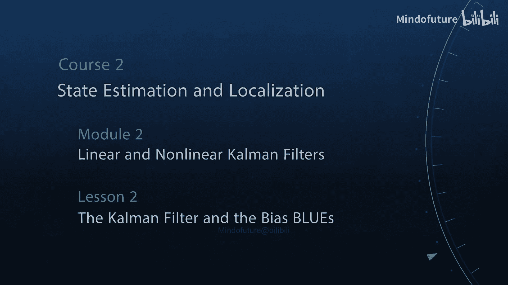
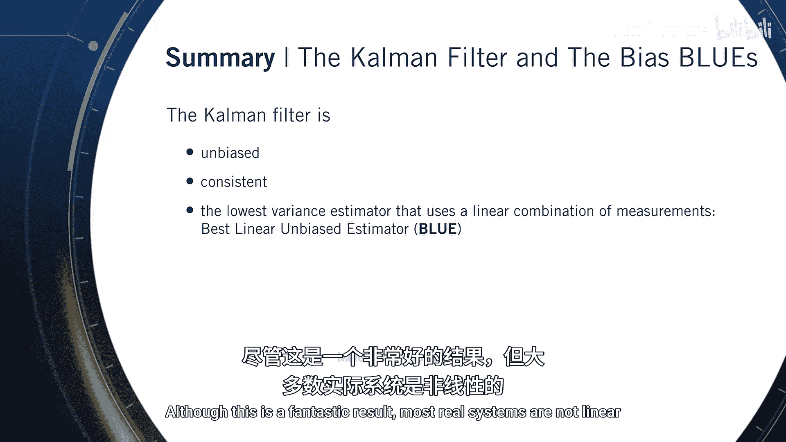

# 【多伦多大学】自动驾驶汽车的状态估计和定位 ｜ State Estimation Localization Self Driving Cars p15 P15_第二课_卡尔曼滤波与偏差问题_03_01_03 -BV1WysszdEDx_p15-

Now that we've introduced the common filter， let's discuss a little bit about what makes it such an appealing estimation method。

By the end of this lesson， you'll be able to define a few terms that are important in state estimation。

First， the concept of。Bas。And second， consistency。Finally。

 you'll use these definitions to show why the common filter is the best linear。

 unbiased estimator or blue。 Let's dive in。😊，First， let's discuss bias。

Let's consider our common filter from the previous lesson and use it to estimate the position of our autonomous car。

If we have some way of knowing the true position of the vehicle， for example， an oracle tells us。

We can then use this to record a position error of our filter at each time step K。

 Since we're dealing with random noise， doinging this once is not enough。

We'll need to repeat this same process over and over and record our position error at each time step。

Once we've collected these errors， if they average to 0 at a particular time step K。

 then we say the common filter estimate is unbiased at this time step。Graphically。

 this is what the situation may look like。 Sa at a particular time step。

 we know that the true position is the following。We build a histogram of the positions that are filter reports over multiple trials and then compute the difference between the average of these estimates and the true position。

If this difference does not approach 0， then our estimate is biased。However。

 if this difference does approach 0 as we repeat this experiment many more times。

And if this happens for all time intervals， then we say that our filter is unbiased。

Although we could potentially verify this lack of bias empirically。

 what we really like are some theoretical guarantees。Let's consider the aerodynamics of our filter。

Defining our predicted and corrected state errors， we can then use the common filter equations to write the following relations。

For the common filter， we can show the expectation value of these errors is equal to 0， exactly。

For this to be true， we need to ensure that our initial state estimate is unbiased and that our noise is white。

 uncorrelated and zero mean。While this is a great result for linear systems。

 Remember that this doesn't guarantee that our estimates will be error free for a given trial。

 only that the expected value of the error is 0。Common filters are also what is called consistent。

By consistency， we mean that for all time steps K， the filter covariance P sub K matches the expected value of the square of our error。

😊，For scalar parameters， this means that the empirical variance of our estimate should match the variance reported by the filter。

Practically， this means that our filter is neither overcondent nor underconfident in the estimate it has produced。

A filter that is overconfident and hence inconsistent will report a covariance that is optimistic。

That is， the filter will essentially place too much emphasis on its own estimate and will be less sensitive to future measurement updates。

 which may provide critical information。It's easy to see how an overconfident filter might have a negative or dangerous effect on the performance of a self driving car。

 showing that consistency property formally is outside of the scope of the course。

 You can take my word that it is indeed true for a common filter。

So long as our initial estimate is consistent and we have white，0 mean noise。

 then all estimates will be consistent。 Pu everything together。

 We've shown that given white uncorrelated zero mean noise。

 the common filter is unbiased and consistent。Because of these two facts。

 we say that the common filter is the blue。 the best linear unbiased estimator。

 It produces unbiased estimates with the minimum possible variance。To summarize in this lesson。

 we've defined the terms bias and consistency and show that the common filter is。Unbiased。Consistent。

And the best linear unbiased estimator， or blue。Remember that best here refers to the fact that the common filter minimizes the state variance。

Although this is a fantastic result， most real systems。😊。

Are not linear for self driving cars， willll generally need to estimate non nonlinear quantities like vehicle poses。

 position and orientation in 2D and 3D。To do this， we'll need to extend the linear common filter into the nonlinear domain。

 We'll do this in the next lesson。

