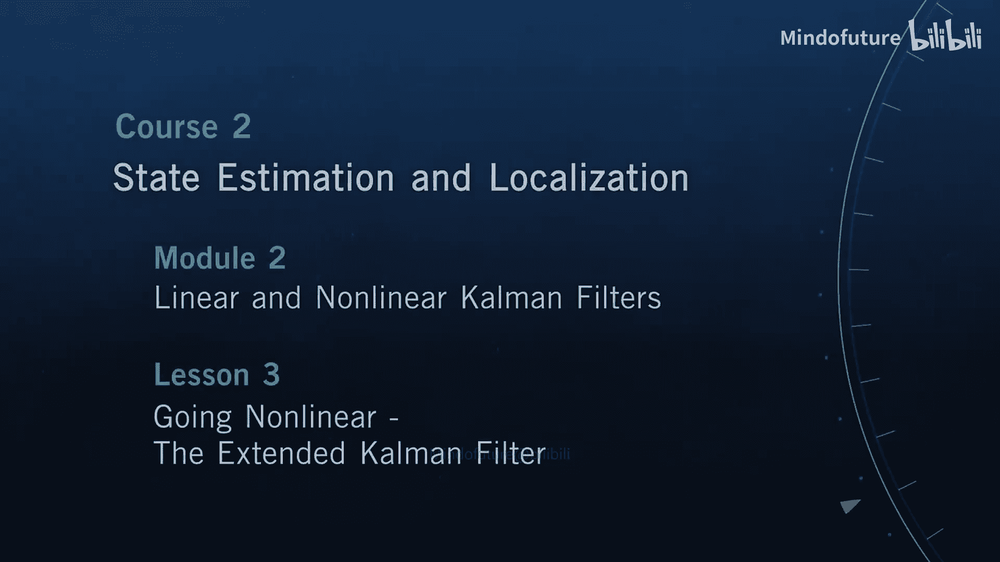
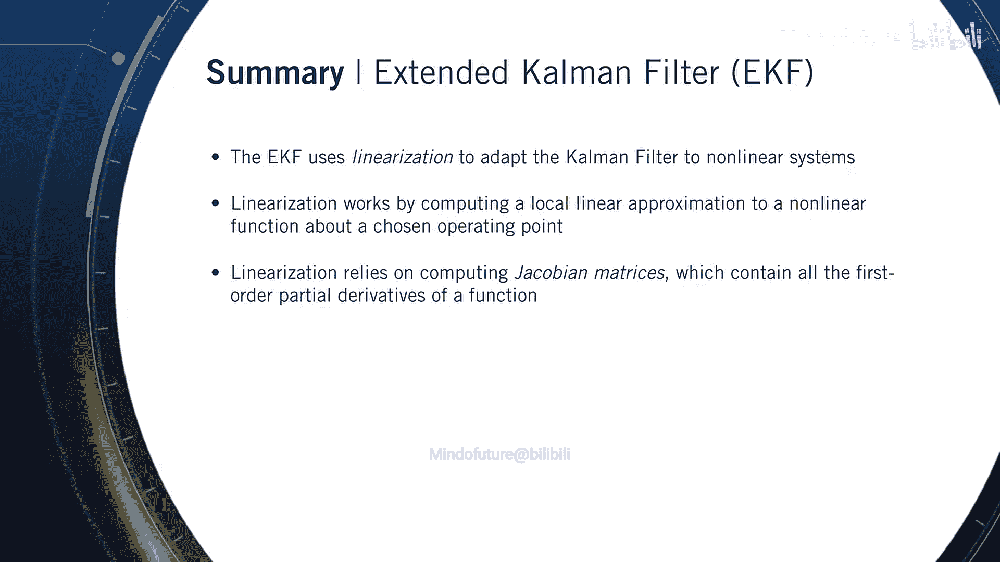
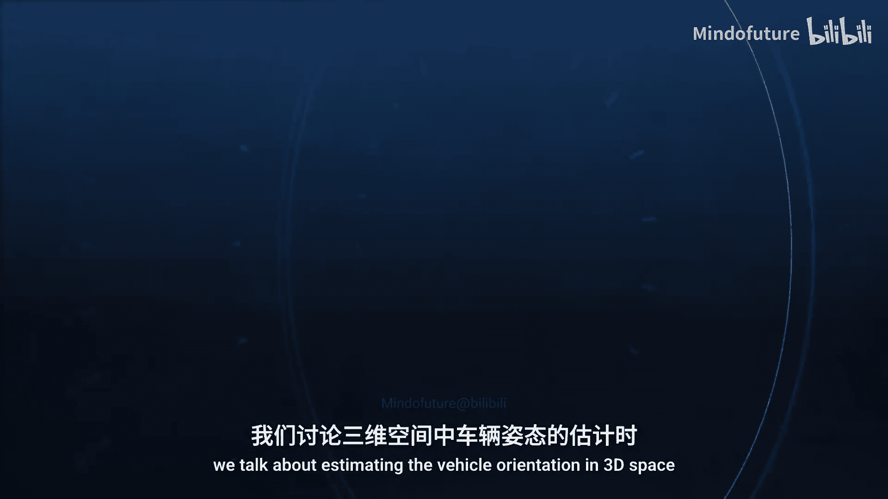

# 【多伦多大学】自动驾驶汽车的状态估计和定位 ｜ State Estimation Localization Self Driving Cars p16 P16_第三课_迈向非线性世界_扩展卡尔曼滤波_03_02_01 -BV1WysszdEDx_p16-

So far in this module， you've learned how to use the linear common filter for state estimation。

 And you also saw that the common filter is the best linear unbiased estimator or blue。 However。

 the linear common filter cannot be used directly to estimate states that are non nonlinear functions of either the measurements or the control inputs。

For example， the pose of the car includes its orientation， which is not a linear quantity。

 Orientations in 3D live on a sphere， in fact。So we need to look for something else。In this video。

 we'll be learning about one important and widely used variation of the common filter called the extended Common filter or E KF。

The E KF is designed to work with nonlinear systems。

 and it's often considered one of the warhors of state estimation because it's used in all sorts of applications。

 including self driving cars。By the end of the video， you'll be able to。

Describe how the EKF uses first order linearization to turn a nonlinear problem into a linear one。

Understand the role of Jacobian matrices in the E KF and how to compute them。And。

Apply the E KF to a simple， nonlinear tracking problem。

The filter works by first predicting the mean and covariance of the updated state estimate at some time step K based on the previous state and any inputs we give to the system。

 such as the position of the accelerator pedal。The filter then uses a measurement model to predict what measurement should arrive based on the state estimate and compares these predictions with the measurements that actually arrive from our sensors。

The common gain tells us how to weight all of these pieces of information so that we can optimally combine them into a corrected estimate。

 That is a new state， and an updated covariance。😊，This is sometimes called a predictor corrector architecture。

As we saw in the last video， the common filter is actually the best of all possible estimators for linear systems。

Unfortunately， there's a catch。 Linear systems don't exist in reality。Even a very simple system。

 like a resistor with a voltage applied， isn't truly linear， at least not all the time。

For a certain range of voltages， the current is a linear function of the voltage and follows Ohm's law。

 But as the voltage gets higher， the resistor heats up。

 which alters the resistance in a nonlinear way。Since the systems that we encounter in practice are nonlinear。

 this raises an important question。Can we still use the common filter for nonlinear systems。

 And if so， how。The key concept in the extended common filter is the idea of linearizing a non nonlinear system。

 For this reason， the E KF is sometimes referred to as the linearized common filter。

Linearizing a system just means picking some operating point。

 A and finding a linear approximation to the nonlinear function in the neighborhood of a。

In two dimensions， this means finding the tangent line to the function F of x when x equals a。

Mathematically， we do this by taking the Taylor series expansion of the function。

 Think back to your calculus courses， you may remember that the Taylor series expansion is a way of representing a function as an infinite possibly Some whose terms are calculated from the functions derivatives at a single point for linearization were only interested in the first order terms of the Taylor series expansion highlighted in red。

😊，Let's return to our general nonlinear motion and measurement models and try to linearize them。

What should we choose as the operating point for our tail expansion， Ideally。

 we would like to linearize the models about the true value of the state。

 but we can't do that because we already knew the true value of the state。

 We wouldn't need to estimate it。 So instead， let's pick the next best thing。

The most recent estimate of the state for our emotion model will linearize about the posterior estimate of the previous state and for the measurement model will linearize about our prediction of the current state based on the motion model。

 So now we have a linear system in state space and the matrices F L H and M。

 are called Jacobbian matrices of the system。 Computing these matrices correctly is the most important and difficult step in the extended common filter algorithm。

 And it's also the most commonplace to make mistakes。😊，But what are these Jacobian matrices exactly？

In vector calculus， a Jacobbian or Jacobbian matrix is the matrix of all first order partial derivatives of a vector valued function。

 Each column of the Jacobian contains the derivatives of the function outputs with respect to a given input。

 For example， if your function takes a three dimensional vector and spits out a two dimensional vector。

 the Jacobbian would be a two by three matrix。 Intuly。

 the Jacobbian matrix tells you how fast each output of your function is changing along each input dimension。

 Just like how the derivative of a scalar function tells you how fast the output is changing as you vary the input。

😊，The Jacobian is really just the generalization of the first derivative to multiple dimensions。

 Here's a simple example of the Jacobian of a two dimensional function， with two inputs。

The Jacobbian matrix captures the first derivatives of each of the two output variables with respect to each of the two input variables。

The best way to get comfortable with drivingriving Jacobians is just practice。

 Try deriving the Jacobian of the vector valued function。Now。

 we know how to compute the Jacobian matrices needed for the EKF。

And all it's left is to plug them into our standard common filter equations。

 There are a couple of differences to notice in the E KF equations compared to the common filter equations we saw in module 2。

 First， in the prediction and correction steps， we're still using the nonlinear models to propagate the mean of the state estimate and to compute the measurement residual or innovation。

😊，That's because we linearized our motion model about the previous state estimate。

 and we linearized the measurement model about the predicted state。By definition。

 the linearized model exactly coincides with the nonlinear model at the operating point。

The second difference is the appearance of the L and M Jacobians related to the process and measurement noise。

In many cases， both of these matrices will be identity， since noise is often assumed to be additive。

 but this is not always the case。So far， this has all been very abstract。

 So let's walk through a concrete example of actually using the E KF。

 We'll use the same example from module 2， but with a twist。

We're going to track the position and velocity of a car moving along a rail。 But now。

 instead of receiving periodic GPS measurements that tell us our position。

 we're going to use an onboard sensor like a camera to measure the altitude of distant landmarks relative to the horizon。

😊，We'll keep the same linear motion model as in the original example and assume we know both the height of the landmark and its position in a global reference frame。

Because our sensor is measuring an angle， our measurement model has a nonlinear dependence on the position of the car。

We're going to need to linearize the measurement model and use it in our extended common filter。

 The Jacobians for this problem look like this。Notice that the F matrix in this problem is exactly the same as the F matrix in the original problem。

That's because our motion model is already linear in the state。Also。

 notice that the noise Jacob' L and M are both identity。

 Since both the motion and the measurement model have additive noise。

Try using the data given here to estimate the position of the vehicle at time1 using the E KF。

 Here is the result of the prediction step for the mean and covariance of the state。

Notice that the result is identical to the linear common filter case。

 because the motion model actually is linear。And for the correction step。

 this is what you should get。Keep in mind that you should use the non nonlinear measurement model to compute the measurement residual。

 not the linearized model。Also， note that in this case。

 even though the corrected mean of the state estimate is different from the predicted mean。

 the corrected covariance didn't change that much from the predicted covariance。

This is because the asziuth angle changes slowly at this distance and doesn't provide much information about the vehicle state compared to a GPS measurement。

So to recap， we saw that the extended common filter or E KF uses linearization to adopt the common filter to non nonlinear systems。

Will encounter several different nonlinear systems to which we can apply to E KF or its cousin。

 the UKF in the upcoming course project。Linearization works by computing a local linear approximation to a nonlinear function using a first order Taylor series expansion about an operating point。

 This requires several Jacobbian matrices， which contain the set of first order partial derivatives。

In the next video， we'll discuss an alternative formulation of the E KF called the Aerostate extended Common filter。

This will be a useful tool later in the course when we talk about estimating the vehicle orientation in 3D space。

