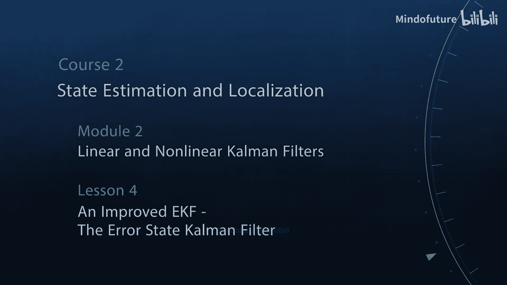
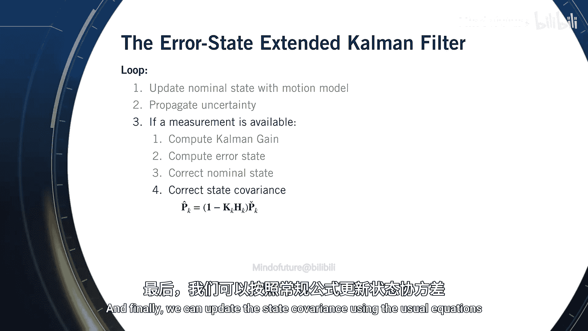
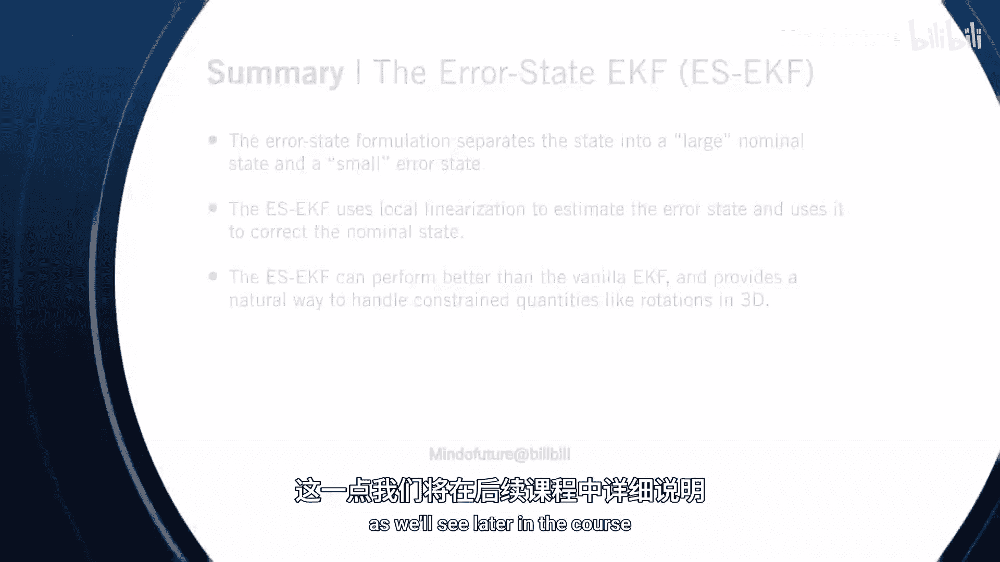

# 【多伦多大学】自动驾驶汽车的状态估计和定位 ｜ State Estimation Localization Self Driving Cars p17 P17_第四课_改进型扩展卡尔曼滤波_误差状态扩展卡尔曼滤波_03_02_03 -BV1WysszdEDx_p17-

In the last video， we introduced the extended common filter。

 which uses local linearization as a way to allow us to apply the common filter equations to nonlinear systems。

In this video， we're going to look at a variant of the E KF called the error state extended common filter or E。

 S E KF， which has a couple of nice properties that will come in handy later in the course。

 By the end of this video， you'll be able to describe the error state formulation of the extended common filter and。

😊，Describe the advantages of the Aerostate E KF over the vanilla E KF that you learned about in the previous video。

The idea behind the error state E KF is really very simple。

 We're going to start thinking about our vehicle state X as being composed of two parts。

 a large part called the nominal state X hat， and a small part called the error state， Delta X。

We can think of a simple example of tracking the position of a car over time。

 The green line shows the true position of the car， which is the quantity we're trying to estimate。

The red line is the nominal state， or our best guess what the true state could be based on what we know about the car's motion model and acceleration and breaking inputs。

Of course， our motion model is never perfect， And there is always some random process noise。

 And these errors build up over time as we integrate the motion model。

 We can think of the error state as the place where all of these modeling errors and process noise accumulate over time。

😊，So that the error state is just the difference between the nominal state and the true state at any given time。

If we can figure out what the error state is， we can actually use it as a correction to the nominal state to bring us closer to the true state。

So in the a state， EKF。Instead of doing common filtering on the full state。

 which might have lots of complicated nonlinear behaviors。

 we're going to use the E KF to estimate the error state instead and then use the estimate of the error state as a correction to the nominal state。

What this means mathematically is that we're going to rearrange our linearized motion model so that we now have an equation that can tell us how the difference between the true state at time K and our predicted state at time K is related to the same difference at time K -1。

 These differences are exactly the error states。 We just talked about Delta x sub K and deelta x sub K -1。

 and the equations related them are called the error state kinematics。😊。

We can also reexpress our linearized measurement model in terms of the error state directly。

We can use this error state formulation of the E KF in a very similar way to the vanilla E KF。

We start off by updating the nominal state using the nonlinear motion model and our current best estimate of the state。

 We could do this a bunch of times before ever getting a measurement for the correction step。

 So the current best estimate might be X check or X hat。

We also need to keep track of the state covariance。

 which grows as we integrate more and more process noise from the motion model。 Note that again。

 the previous covariance estimate could be Pche or P hat。

 depending on whether we used a measurement to do a correction step。 We can repeat the loop。

 updating the nominal state and the error state covariance for as long as we like until we receive a measurement and want to do a correction。

😊，When this happens， we can compute the common gain as usual and then compute the best estimate of the error state using the common gain。

 the measurement and our nonlinear measurement model。Now， here's where things are a little different。

Once we have an estimate for the mean of the error state。

 we want to use this to update the nominal state and correct the error。

We can do that by just adding our estimate of the error state to the nominal state to get the correct state estimate for the full state。

And finally， we can update the state covariance using the usual equations。😊。

那这。This process goes on forever， or at least until the vehicle runs out of gas。

So why would we actually want to use the aero state E KF in practice， Well。

 there are two good reasons to use it。

One reason is that it can often work better than the vanilla E KF。

 because the small error state is more amenable to linear filtering than the large nominal state。

Which we can integrate non nonlinearly。The other reason is that the aero state formulation makes it much easier to work with constrained quantities like rotations。

 which will come in handy a bit later in the course。

The reason for this is that we don't necessarily have to use plain vector addition to break down the state。

 In fact， we could use any generalized composition operation we like as long as it gives us a consistent way of incorporating small perturbations into the nominal state。

If this all sounds a bit abstract right now， don't worry。Later in the course。

 we'll use the Aerostate EKF to help us deal with rotations in 3D space。

Which are a very common type of constrained quantity。Let's recap。

The error state formulation of the EcaF separates the vehicle state into a large nominal state and a small error state。

The nominal state keeps track of what the motion model predicts the state should be。

 While the error state captures the modeling errors and process noise that accumulate over time in the a E KF。

 we estimate this small error state and use it as a correction to the nominal state。

This is the main difference between the aerostate E KF and the vanilla E KF。

 which estimates the full state。Keep in mind that both formulations still rely on local linearization。

The Aerostate E KF has a couple of advantages over the vanilla E KF。

The first is that it simply performs better because the evolution of the error state tends to be closer to linear。

The other is that the aerostate formulation makes it easier to handle special quantities like 3D rotations。

 as we'll see later in the course。

In the next video， we'll discuss some of the shortcomings of the E KF and how local linearization can break down。

 creating a potentially dangerous situation for a self driving car。

