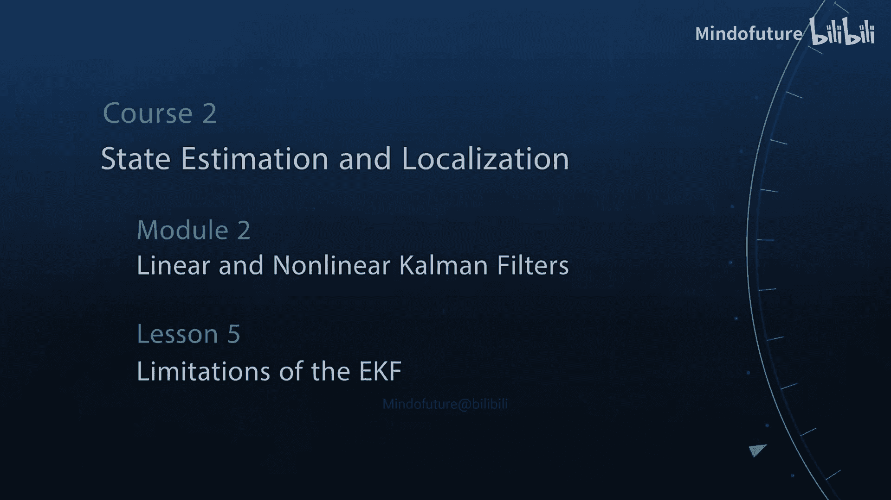
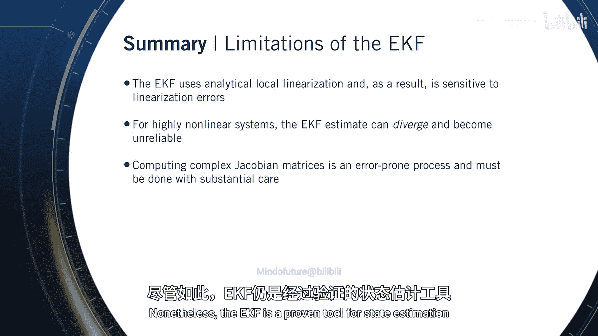
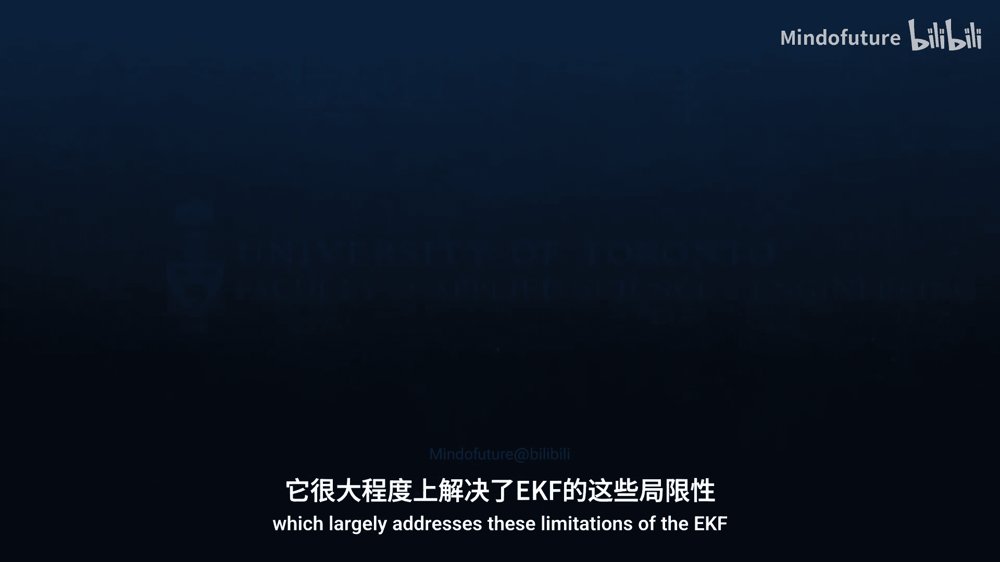

# 【多伦多大学】自动驾驶汽车的状态估计和定位 ｜ State Estimation Localization Self Driving Cars p18 P18_第五课_扩展卡尔曼滤波的局限性_03_02_05 -BV1WysszdEDx_p18-

In the last two videos， we learned about the extended common filter or EKF and how we can use it to adapt the linear common filter to nonlinear systems。

While the EKF works well for many practical problems。

 there are some important limitations to keep in mind when deciding if the EKF is the right algorithm for you。

In this video， we'll discuss some of these limitations。

Recall that the E KF works by linearizing our system' nonlinear motion and observation models to update both the mean and covariance of our state estimate。

 a linearized model is just a local linear approximation of the true nonlinear model。

 And we call the difference between the approximation and the true model， the linearization error。

 In general， the linearization error for any function depends on two things。

The first thing is how nonlinear the original function is to begin with。

If our nonlinear function very slowly or is quite flat much of the time。

 a linear approximation is going to be a pretty good fit。On the other hand。

 if the function varies quickly， a linear approximation is not going to do a great job of capturing the true shape of the function over most of its domain。

The second thing linearization error depends on is how far away from the operating point you are。

 The further away you move from the operating point。

 The more likely the linear approximation is to diverge from the true function。

 These properties of linearization error have important implications for the E KF。

 So let's look at an example of how linearization error affects the mean and covariance of two random variables transformed by a common pair of nonlinear functions。

Specifically， let's look at the nonlinear transformation from polar coordinates。

 R and theta to Cartesian coordinates。 X and Y。 This kind of transformation is commonly used to work with laser scanners。

Or Liars that report range and bearing measurements。

Just as the scanners on many self driving cars do。Let's take a number of samples from a uniform distribution over an interval of polar coordinates and consider what happens when we transform the samples into Cartesian coordinates。

To illustrate what this looks like， we've plotted the random samples from the uniform distribution as blue dots。

 you see on the left。 when we transform each of these sample points into the corresponding cartesian coordinates。

 we see that the transform distribution takes on a banana shape shown on the right。Clearly。

 the shape of the banana distribution is not captured completely by using a mean and a covariance only。

 But let's see what happens to the mean and covariance of the original P， D F。In the left hand plot。

 the true mean of the uniform distribution is shown as the green dot in the middle。

 and the true covariance is represented by the green ellipse。

After transforming the uniform distribution into Cartesian coordinates。

 the mean of the output distribution ends up here。And its covariance looks like this。Now。

 consider what happens if we linearize the polar to Cartesian transformation about the mean of the original distribution and then transform all of the sample points again。

 the linearized transformation gives us an output distribution that looks like another uniform distribution and bears almost no resemblance to the banana shape distribution we saw before。

If we look at the mean of this distribution represented by a red dot。It lands somewhere up here。

And the linearized covariance looks quite different as well。

 Let's compare the linearized and non nonlinear output distributions。

 You can see that the mean of the linearized distribution is in a very different place from the true mean。

And the linearized covariance seriously underestimates the spread of the true output distribution along the Y dimension。

 So in this case， we can see that linearization error can cause our belief about the output distribution to completely miss the mark。

😊，And this can cause big problems in our estimator。For example。

 the estimated position of lane markers produced from a laser scanner might differ significantly from the actual positions。

 leading our car to drive over the center line。 So when is linearization a problem for the E KF。😊。

There are two situations to watch out for。The first is when your system dynamics are highly nonlinear。

If your motion and measurement models are close to linear。

Lineniarization error won't be a big problem。But if they're not。

 your linearized estimator won't do a good job of capturing the true behavior of the system。

 The second situation is related to how far away from the operating point you're trying to use the linearized model。

If your self driving car is moving very fast relative to the sampling time of your sensors。

 you're going to get more linearization error than if it's moving slowly。Mathematically speaking。

 there are two important consequences of linearization error in the E KF。

Both of which we saw in the previous example。1 is that the estimated mean can become very different from the true state。

And the other is that the estimated covariance may not accurately capture the true uncertainty in the state。

 In other words， this means that linearization error can cause our estimator to be overconfident in a completely wrong answer。

In the worst case， the estimator may diverge。 that is become completely lost and fail to provide useful output。

Worse， once an estimator such as the E KF has diverged， it can't be pulled back on track。Often。

 you're forced to re initialitialize， if you can。 This is a huge problem for safety when we're dealing with self driving cars。

If your car's estimator diverges while driving。It could easily drive off the road into a ditch。

Or cause a collision with another vehicle。 So linearization error is the main theoretical limitation of the E KF。

 But there are other common problems that we will encounter in our implementations。

 Probably the most common problem in practice is that it's very easy to make mistakes when we compute Jacobian matrices。

 especially if we're dealing with a complicated nonlinear system。

I cannot tell you the number of times my students and I have missed a minus sign while dering a Jacobian。

 This can lead to many， many hours of debugging。 Some people try to get around this problem by using numerical differentiation at runtime or automatic differentiation at compile time。

 But these have their own pitfalls and can sometimes behave unpredictably。On top of that。

 what happens if one or more of our models isn't even differentiable。

 like the step function response of a stepper motor。 All of these drawbacks lead us to a question。

 do we really need linearization to do non nonlinear common filtering。To summarize this video。

The extended common filter has several limitations based on its use of analytical local linearization。

If the dynamics of the system being modeled are highly nonlinear or the linearization error is large。

 the filter may diverge。 the EKF requires Jacobb and matrices to be computed。

 which is often a tedious and error prone process。Nonetheless。

 the E KF is a proven tool for state estimation， and you will no doubt encounter it often as a self driving car engineer。

In the next video， we'll discuss another common filter variant called the unscented common filter。

 which largely addresses these limitations of the EKF。

