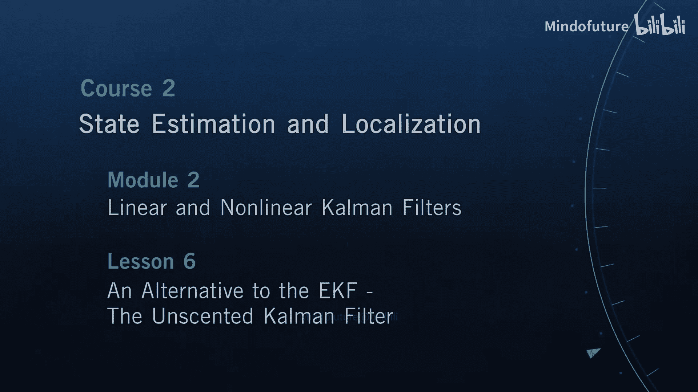
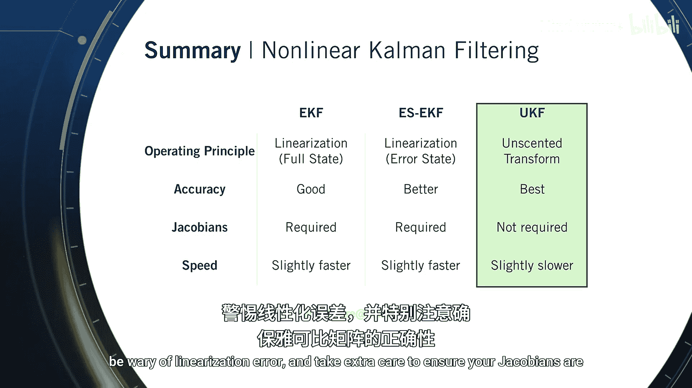

# 【多伦多大学】自动驾驶汽车的状态估计和定位 ｜ State Estimation Localization Self Driving Cars p19 P19_第六课_扩展卡尔曼滤波的替代方案_无迹卡尔曼滤波_03_02_06 -BV1WysszdEDx_p19-

In the previous video， we saw how linearization error can cause the E KF to produce state estimates that are very different from the true value of the state。

And covariances that don't accurately capture the uncertainty in the state。

This can be a big problem when we're relying on the E KF in safety critical applications。

 like self driving cars。In this lesson， you'll learn about the unscented common filter。

 which is an alternative approach to nonlinear common filtering that relies on something called the unscented transform to pass probability distributions through nonlinear functions。

As we'll see， the unscented transform gives us much higher accuracy than analytical E KF style linearization for a similar amount of computation and without needing to compute any Jacobbians。

😊，So by the end of this video， you'll be able to use the uncented transform to pass a probability distribution through a nonlinear function。

😊，Describe how the uncented Kman filter or UKF uses the unscented transform in the prediction and correction steps。

And explain the advantages of the UF over the EKF， as well as apply the UF to a simple nonlinear tracking problem。

The intuition behind the unscented transform is simple。

 It's typically much easier to approximate a probability distribution than it is to approximate an arbitrary nonlinear function。

Let's think about a simple example where a 1D Gaussian distribution， like the one on the left。

 gets transformed through a nonlinear function into a more complicated 1D distribution。

 like the one on the right。We already know the mean and standard deviation of the input Gaussian。

 and we want to figure out the mean and standard deviation of the output distribution using this information and the nonlinear function。

The unscented transform gives us a way to do this。The basic idea in the uncented transform has three steps。

First， we choose a set of sample points from our input distribution。Now， these aren't random samples。

 They're deterministic samples， chosen to be a certain number of standard deviations away from the mean。

For this reason， these samples are called sigma points。

 and the uncented transform is sometimes called the sigma point transform。

Once we have our set of carefully chosen sigma points。

 the second and easiest step is to pass each sigma point through our nonlinear function。

 producing a new set of sigma points belonging to the output distribution。Finally。

 we can compute the sample mean and covariance of the output sigma points with some carefully chosen weights。

 and these will give us a good approximation of the mean and covariance of the true output distribution。

😊，Now that you've seen the basic idea of the unscented transform。

 let's look at each of these steps in detail。The first thing you might be wondering is how many sigma points do we need and which points are。

 in fact， sigma points。In general， for an n dimensional probability distribution。

 we need two n plus  one sigma points。One for the mean and the rest symmetrically distributed about the mean。

The diagrams on the left show the sigma points for one dimensional and two dimensional examples。

In 1 D， we need three sigma points， and in 2 d， we need  five。

The first step in determining where the sigma points should be is taking something called the Clesky decomposition of the covariance matrix associated with the input distribution。

The Clesky decomposition is basically a square root operation that operates on symmetric。

 positive definite matrices， such as covariance matrices。In fact， if the input PF is one dimensional。

 the gilesky decomposition really is just the square root of the variance。

 which is also known as the standard deviation。We won't go into the details of how to compute a Clesky decomposition。

But you can use the Choll function in MATLb or the Chileski function in Numpy。

Once we've decomposed the covariance matrix， we can choose our first sigma point to be the mean of the distribution and the remainder to be the mean plus or minus some factor times each column of the matrix L that we got from the tsky decomposition。

The value of n here again is a number of dimensions of the probability distribution。

The parameter Kappa is a tuning parameter that you're free to set yourself。

For Gaussian distributions， which is what we'll be working with。

Setting n plus Kappa equal to3 is a good choice。First。

 we will need to redraw our sigma points using the predicted covariance matrix。

We need to do this a second time because we added process noise at the end of the last step。

 And this will modify the positions of some of the sigma points。Next。

 we're going to plug these new sigma points1 by one into our nonlinear measurement model to get another set of sigma points for the predicted measurements。

Okay， so now we have our set of sigma points。The next step is straightforward。

 just pass each of the sigma points through our nonlinear function to get a new set of transform sigma points。

Now， all that's left is to recombine the transform sigma points to find our output mean and output covariance。

We do this using the standard formulas for the sample mean and covariance that you would have seen in your introductory statistics courses。

The trick is that each of the points gets a specific weight in the mean and covariance calculations。

 and that weight depends on the parameter Kappa and the dimension of the input distribution n。

And that's really all there is to it。To see the unscented transform in action。

 let's come back to our example from the previous video where we non nonlinearly transformed a uniform distribution in polar coordinates into Cartesian coordinates。

😊，And let's see how the uncented transform compares to the analytical linearization approach。

So here again， we have the true mean and covariance of the two distributions in green。Now。

 let's apply the uncented transform。The dimension of our input distribution is 2。

 So we need five sigma points， which we've shown as orange stars。

Passing these sigma points through our nonlinear function puts them here。

And the mean and covariance we compute from the transform sigma points look like this shown in orange。

Note that our estimate for the mean using the uncented transform is almost exactly the same as the true nonlinear mean。

 and our estimate for the covariance almost exactly matches the true covariance。

Compare that to the analytically linearized transformed mean and covariance in red。

 which are both very different from the true mean and true covariance。

It's easy to see from this example that the uncented transform gives us a much better approximation of the output PF without requiring much more work than the analytical linearization approach。

Now that we've seen how the uncented transform works。

 we can easily use it in our Calvin filtering framework to work with nonlinear models。😊。

This variant of the common filter is called the unscented common filter， or UKF。

You may also hear it called the Sigma point column filter。

The main idea of the UKF is that instead of approximating the system equations by linearizing them。

 like the E KF does， we use the uncented transform to approximate the PFs directly。

Let's look at the prediction step of the UKF。To propagate the state and covariance through the motion model from time K -1 to time K。

 we applied the uncented transform using the current best guess for the mean and covariance of the state。

First， we decompose the estimated state covariance from time K -1。

Then we calculate our sigma points centered around the estimated mean state from time k minus-1。

Second， we propagate our signal points through our nonlinear motion model to get a new set of s points for the predicted state at time K。

😊，And finally， we calculate the predicted mean and covariance for the state at time K。😊。

At this point， it's important to account for the process noise by adding its covariance to the covariance of the transformed sigma points to get the final predicted covariance。

This equation looks a bit different if the process noise is not additive， but most of the time。

 you'll be dealing with additive noise in your models unless there's a good reason not to。

For the correction step， we're going to follow a similar procedure this time with a nonlinear measurement model。

First， we're going to take the set of sigma points we got from our nonlinear motion model and plug them into our nonlinear measurement model to get another set of sigma points for the predicted measurements。

😊，Then we can estimate the mean and covariance of the predicted measurements using the sample mean and covariance formulas。

Again， take note that we're adding in the measurement noise covariance to get the final covariance of the predicted measurements。

 and also remember that this formula only applies to additive noise。😊，To compute the common gain。

 we're also going to need the cross covariance between the predicted state and the predicted measurements。

 which tells us how the measurements are correlated with the state。

You can calculate this using the standard formula for the cross covariance and using the same weights as before。

Then all that's left is to use the common gain to optimally correct the mean and covariance of the predicted state。

 and that's it。The UKF follows the same prediction correction pattern as the EKF。

 but we've just replaced the analytical linearization step with the unscented transform。

Let's try applying the UKF to the same example driving scenario we work through with the EKF。

We're again， trying to track the position and velocity of a moving car that we're controlling by pressing on the gas pedal or the brake。

The car has a sensor on board that measures the angle between a distant landmark and the horizon。

The motion model is linear， but the measurement model is nonlinear。

Try using the data given here to estimate the position of the vehicle at time1， using the UKF。

Here is the Cesky decomposition of the initial covariance matrix。

 and the five sigma points we'll use to represent the state and its covariance。

And here is the result of the prediction step for the mean of the state。And finally。

 the predicted covariance。Notice that the predicted mean and covariance are identical to what we would have found with the linear common filter and the extended common filter。

 This is because the motion model actually is linear。For the correction step。

 these are the sigma points for the predicted measurements and the mean and covariance of that distribution。

And finally， the cross covariance， common and gain and our final answer for the position of the vehicle at time K equals 1。

😊，To summarize this video， we looked at the uncented common filter or UKF。

Which uses the uncented transform to adapt the common filter to nonlinear systems。As we saw。

 the unscented transform works by passing a small set of carefully chosen samples through a nonlinear system and computing the mean and covariance of the outputs。

And it often does a much better job of approximating the output distribution than the local analytical linearization technique used by the E KF for similar computational cost。

Let's recap what we learned in this module。We started off by discussing the linear common filter。

 which is a form of recursive least squares estimation that allows us to combine information from a motion model with information from sensor measurements to estimate the vehicle state。

The common filter follows a prediction correction architecture。

 The motion model is used to make predictions of the state。

 and the measurements are used to make corrections to those predictions。

We also saw that the common filter is the best linear unbiased estimator or blue。 That is。

 the common filter is the best unbiased estimator that uses only a linear combination of measurements。

😊，But， of course， linear systems don't really exist in reality。

 So we needed to develop techniques for handling nonlinear systems。 In this module。

 we looked at three different approaches to nonlinear common filtering。

The extended common filter or EKF。The error state formulation of the E KF and the uncensed common filter。

 or UKF。As we've discussed， the main difference is that the EKF relies on local analytical linearization to propagate PFs through nonlinear functions。

 whether using the full state or the error state formulation。 In contrast。

 the UKF relies on the unscented transform to handle nonlinear functions。

For most systems that are only mildly nonlinear， the EKF will give accurate results。

But the UF will be more accurate in cases where linearization error is a problem for the EKF。

The errorero state column filter performed somewhere in between。

One of the biggest advantages of the UKF over any EKF formulation is that the UKF doesn't require you to compute any derivatives of your nonlinear models。

 which can be prone to human error or numerical instability。Finally， in terms of speed。

 the E KF wins out by a small margin for typical estimation problems。 But in general。

 the E KF and the UKKF require very similar amounts of computation。

Because of its accuracy and simplicity， we recommend using the UKF over the EKF whenever possible in your projects。

If you must use the EKF， our advice is to use the error state formulation， be wary of linearization。

 error， and take extra care to ensure your Jacobians are correct。

A good mantra to repeat。Now that you've learned about the basic tools we need for state estimation。

 we can start thinking about the types of sensors we might find on a self driving car and how we can use them to localize the vehicle。

In the next module， we'll discuss one common pair of sensors。

 the inertial measurement unit or IM U and the global navigation satelliteate system， or G NS S S。

