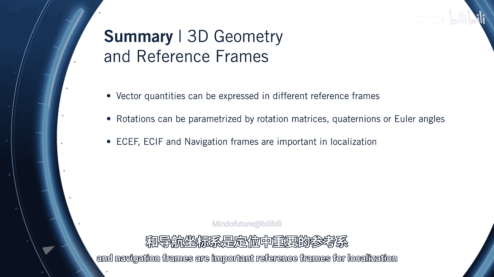

# 【多伦多大学】自动驾驶汽车的状态估计和定位 ｜ State Estimation Localization Self Driving Cars p20 P20_第一课_三维几何与参考坐标系_04_01_01 -BV1WysszdEDx_p20-

Welcome to module 3 of our state estimation course。 In this module。

 we're going to introduce you to two sensors that you can use to help localize our self driving car to do this。

😊，We'll first review some 3D kinematics and several important reference frames。

Then discuss some details about how we can represent rotations。And finally。

 we'll present the inertial measurement unit。😊，And global navigation satellite systems。But first。

 it's useful to review a bit of 3D geometry。To track how our car moves。

 we'll need to know how we can express that motion using mathematical tools and notation。

In this lesson。We'll review how reference frames affect vector coordinates。

Compare and contrast different rotation representations and present several reference frames that will be important in our next lesson on sensors。

Recall that a vector is a geometric object that has a magnitude and a direction。Often。

 we treat the concept of a vector interchangeably with the concept of vector coordinates or the set of numbers that represent the vector's direction and magnitude。

This， however， is not necessarily correct。If we imagine that the vector is fixed in space。

 then its coordinates will change， depending on the way in which we observe it。 More precisely。

 the same vector quantity will have different coordinates。

 depending on which coordinate frame or reference frame we choose to express it in。

We will use the following notation。In frame A， the vector R has notation R sub A。 Likewise。

 in frame B， it has the coordinates R sub B。To convert from one set of coordinates to another。

We will require a rotation matrix that tells us exactly how one frame is rotated with respect to the other。

For this， we will use the notation bold capital C with the subscripts indicating the initial and final reference frames from right to left。

Often， it will also be useful for us to discuss how the coordinates of points change as we move from one reference frame to another。

For example， we may know the position of a building in some frame。

And now we'd like to know its position in our current vehicle frame。To compute this。

 we use vector addition。Making sure to express all of the coordinates in the same reference frame。

We will use superscripts on the coordinates to indicate the start and end point of a 3D vector again。

 from right to left。And a subscript to indicate the frame in which this is expressed。Just as before。

We can manipulate this expression to solve for the coordinates in the vehicle frame or an appropriate inertial frame。

 for example。A critical component of tracking reference frames is tracking their orientation or rotation with respect to some base reference frame。

Rotations are particularly tricky mathematical objects， and they can be the source of major bugs。

 if not dealt with carefully and diligently。There are many different ways to represent rotations。

The most common is to use a three by three rotation matrix， as we've done before。

This matrix defines the relationship between the basis vectors of two reference frames in terms of dot products。

For this reason， it's often called a direction cosine matrix。

An important property to remember is that the inverse of a rotation matrix is just its transpose。

A second way to represent rotations is to use something called unit quaernions。

Quernians are an interesting mathematical topic in their own right。 But for us。

 it's sufficient to note that a unit quatturnion can be represented as a four dimensional vector of unit length。

The parameterizes a rotation about an axis defined by the vector U and an angle phi about that vector。

We can convert a quaternion to a rotation matrix by using this somewhat tedious but straightforward algebraic expression。

Why would we ever want to use Quaternians？Well， they don't suffer from singularities。

 and they only need four parameters instead of 9。In module5 of the course。

 we will need to multiply two quaternions together。Importantly。

 Queternian multiplication differs from ordinary multiplication。

This is because a quaternion is a type of complex number or a hyper complexplex number， in fact。

 and so different rules apply。We won't delve into the details of why this is the case in this course。

But interested learners can find out more information in any good textbook that deals with Quaternians。

The Quaternian multiplication operator is often denoted as a circle with an X through it。

And the multiplication can be expressed using matrix operations involving the scalar and vector parts of each quaternion。

We show this here for two arbitrary quaternions， P and Q。Just like matrix multiplication。

 Queternion multiplication is associative， but is not commutative in general。

 that is the order of multiplication matters。Sequential rotations can be expressed by taking advantage of quaternum multiplication。

Consider converting the product of two unit quaternions again， P and Q here to a rotation matrix。

This rotation matrix is the same as the product of two consecutive rotations involving matrices defined by P and by Q separately。

We'll make use of this important property in the final module of the course。Finally。

 another way of representing a rotation is using three numbers called oiluler angles。

These angles represent an arbitrary rotation as the composition of three separate rotations about different principal axes。

Or other angles are attractive in part because they are a parsimonious representation。

Requiring only three parameters。Instead of 9， for a full rotation matrix。Unfortunately。

 oiler angle representations are subject to what are called singularities。

Singularities complicate state estimation because they represent particular rotations from which two oiluler angles are indistinguishable。

Neither quaternians nor rotation matrices suffer from this problem at the expense of using more parameters。

So which of these representations do self driving vehicle engineers use？Well， it depends。

Each has advantages and disadvantages。A rotation matrix can represent any rotation。

 but requires 9 parameters and has six constraints。

A unit quaternion can also be used to represent any rotation。But it also has a constraint。

To use a unit quaternion to actually rotate a vector。

 we also require some additional algebra beyond simple matrix multiplication。Finally。

 Oer angles are unconstrained， intuitive to visualize and use only three parameters。

 but are subject to singularities。😊，Finally， let's look at four important reference frames that we'll use when localizing our vehicle。

😊，The first frame is the Earth centered inertial frame， or E， IF。

This frame has its origin at the center of the earth。 The Z axis points true north。

 and the X and Y axes are fixed with respect to the very distant stars。

This means that although the earth rotates about the Z axis， the X and Y axes do not move。Next。

 the Earth centered Earth fixed frame or ECEF。Is just like E I F。

 except that its X axis is aligned with the prim meriian and spins with the earth。

The Y axis is determined by the right hand rule。Here。

 you can see an animation that shows the difference between the E， EF， which is fixed to the earth。

And the E IF， which is fixed with respect to the distant stars。

Although the ECEF and ECIF are useful when we discuss satellites and inertial sensing onboard aircraft。

For practical car applications， we'll usually want to use a frame that is fixed with respect to the ground。

In this case， we'll make use of what we're refer to as the navigation frame or local tangent frame。

A very common navigation frame is one that is attached to some known starting point and aligns the X axis pointing north。

 the Y axis pointing east and the Z axis pointing down。

 This is called an N E D frame for northern easting down。

A closely related frame is the E and U frame， which aligns the X axis pointing east。

 the Y axis pointing north， and the Z axis pointing up where E and U stands for easting north up。

Finally， we'll also often need to think about a sensor frame that is rigidly attached to a sensor like a liddar。

 A GPS receiver or an inertial measurement unit。😊，This frame will typically be distinct from the general vehicle frame。

 which can be placed anywhere on the vehicle that is convenient。At the center of mass， for example。

For localization， we will often ignore the distinction between the vehicle and sensor frame and assume that if we can track the sensor。

 we should be able to track any point on the vehicle， given proper calibration。

 a topic we investigate later。😊，To summarize。Vectctor quantities can be expressed in different reference frames。

 through rotations and translations。Rotations can be parameterized by rotation matrices。

 quaternions or euler angles， each of which has advantages and disadvantages。And the earth centered。

 Earth fixed， Earth centered inertial and navigation frames are important reference frames for localization。

In the next video， we'll discuss how we can use the tools we learned about in this lesson to track motion by using an inertial measurement unit。

😊。

