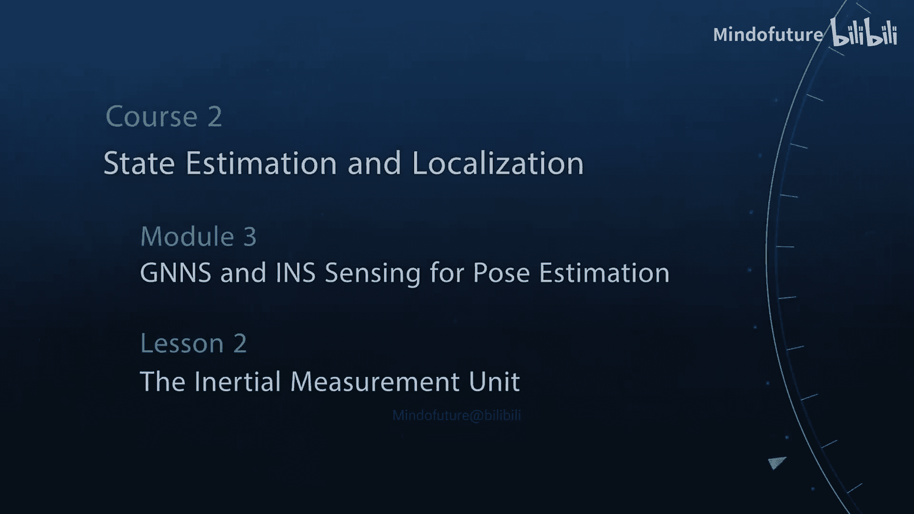
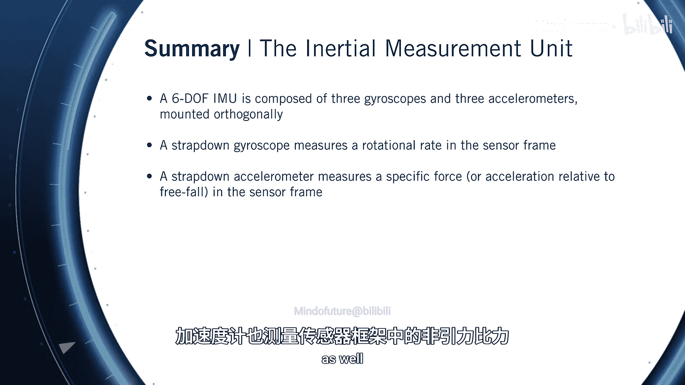

# 【多伦多大学】自动驾驶汽车的状态估计和定位 ｜ State Estimation Localization Self Driving Cars p21 P21_第二课_惯性测量单元（IMU）_04_01_03 -BV1WysszdEDx_p21-

In this lesson， we're going to discuss the inertial measurement unit or IMU。

 By the end of this lesson， you'll be able to describe the operating principles of the two sensors that make up a basic IMU。

 an accelerometer and a gyroscope。 You will also be able to model each of these sensors and account for things like sensor noise and bias。

This will be crucial when we incorporate an IMU into a full state estimator， let's begin。

The inertial measurement unit， or IM U， measures the movement of a body in inertial space。Today。

 a certain type of cheap mass manufactured IMU is found in nearly every smartphone。

 such as the iPhone X pictured here。IMUs are often used for tasks。

 including step counting for health tracking， and more recently。

 to enhance augmented reality devices。Despite their ubiquity today。

 the development of a sensor that could accurately track the motion of a moving body was a significant achievement of the 20th century。

😊，The IMU aided transocic flights long before GPS。And was crucial to the Apollo missions as part of the onboard guidance。

 navigation and control system。The Apollo spacecraft relied on an IMU to accurately track both the position and orientation of the vehicle on the long voyage to the moon。

In space， there are few landmarks to rely on for guidance。One can track the fixed stars。

 but this is not easy。The onboard IMU， which operated without the need for such landmarks。

 enabled safe navigation to the moon's surface。😊，In modern self driving cars。

 IUs play a very similar role， filling in during periods when navigation information from other sensors is either unavailable or unreliable。

So what is an IMU？Well， generally， an inertial measurement unit is a composite sensor suite that combines three gyroscopes and three accelerometers to track the 60 degree freedom movements of a rigid body。

😊，Some IMUs also incorporate magnetoomes or a compass to help track orientation。

IMUs come in many shapes and forms。The sensors found in modern smartphones are relatively cheap。

 often costing less than a few dollars when purchased in bulk。

They are lightweight and require relatively little power， but produce quite noisy measurements。

More expensive IMUs use more complex components and have more accurate calibration models that can remove the effects of temperature fluctuations。

 for example。Let's discuss the components of an IMU。

 the gyroscopes and the accelerometers in more detail。The gyroscope has a long history。

The term gyroscope can be quite confusing because it refers to several concepts all relating to the idea of measuring orientation or change in orientation。

The word itself comes from the Greek words， Uos for circle and Scopio to look。Historically。

 a gyroscope was a spinning disc that due to its angular momentum， resisted changes in orientation。

In the late 19th and early 20th century， engineers realized that this spinning wheel could be used as an orientation reference for marine and aeronautical navigation。

This required precise machining and a set of gimbals that used high quality jewel or pneumatic bearings。

Although this type of spinning disk gyroscope can be very accurate， it's quite heavy。

 bulky and often very expensive to manufacture。Nevertheless。

 it is still used in aeronautics and in ballistic applications and can spin it up to 24，000 RPM。

In a modern gyroscope， the spinning meal is typically replaced by a micro electrolectromechanical system that consists of a small silicon tuning fork that changes its resonance properties based on an applied rotation or orientation change。

These sensors are much cheaper and can fit in a tiny package。 However。

 they produce noisy measurements and are sensitive to temperature based fluctuations。What's more。

 they measure rotation rates and not orientation directly。

 and so the output signal must be numerically integrated to determine orientation change。

This process can introduce additional errors into the final orientation estimate。

A self drivingiving car engineer should be aware that the need to account for issues such as drift and performance variations with temperature introduces substantial additional complexity in the sensor modeling process。

One would normally think that a spinning mechanical device would be inferior to a silicon component。

 but this is not always the case。An accelerometer measures linear acceleration along a single axis。

Chheeaper mes based accelerometers use a miniature canilever beam with a proof mass attached to it。

When the sensor is accelerated， the beam deflects。This deflection can be measured through a capacitive circuit。

 for example， and converted into an acceleration value。

More expensive sensors may also use pieazzoelectric materials。

It's important to note that an accelerometer measures what's called proper acceleration or specific force。

This is the total non gravitational force per unit mass。

The proper acceleration is acceleration with respect to a reference frame in free fall。

When you're sitting in your chair， stationary relative to the ground。

 the proper acceleration you feel will be the value of the gravitational acceleration at your location。

 but upwards。Another way to say this is that the only non gravitational force acting on you。

 the normal force， must be equal to the force of gravity。However， of course， for navigation purposes。

 we often don't care about our proper acceleration。

 What we care about is acceleration with respect to some fixed reference frame。

To compute this acceleration， we need to use the fundamental equation for accelerometers in a gravity field。

The second derivative of position computed in a fixed frame is the sum of the specific force and the acceleration due to gravity。

Sometimes this can be a somewhat unintuitive concept。 So let's explore it here。

An accelerometer in a stationary car measures G upwards because the coordinate acceleration is zero。

 ignoring the rotation of the Earth。Since the force of gravity acts downwards。

 its negative is the scalar constant G in the upward direction。

Let's look at an example of this on the International Space Station or ISS。

Is the value of G less in low earth orbit？Well， it is。

 but only by about 10% when compared to the value on the surface of the earth。

The reason why we often hear the term 0 G is because the entire I S S is in free fall together with the astronauts inside it。

An accelerometer rigidly attached to the station will have a coordinate acceleration equal to G。

This means that the specific force measured by an accelerometer will be 0。

Another way of saying this is that the proper acceleration with respect to free fall is zero。

The ISS is in free fall。In reality， residual atmospheric drag and structural vibrations will create some measured accelerations。

 but they are typically as low as 10 to the -6 G's。

Now that we know about the basic principles of gyroscopes and accelerometers。

 let's discuss the measurement models we'll need to know in order to incorporate them into a state estimator。

Using the notation we discussed in the previous lesson。

 let's define an expression for what a gyroscope measures。

The angular rotation rate derived from all three gyroscopes is the angular velocity of the body frame relative to an inertial frame expressed in the body frame。

To it， well add a slowly varying bias term and a white Gaussian additive noise term to model sensor errors。

😊，Although gyroscopes do measure the rotation of the Earth。

It's often safe to ignore this for applications where we care only about motion over a short duration。

Our accelerometer measurement model will have similar noise and bias terms。But now。

 instead of measuring body accelerations directly， as we could do with rotational rates。

We need to explicitly remove the effect of gravity using our fundamental equation for accelerometers in a gravity field。

Since the accelerometers measure acceleration in the IMU body frame。

 we will need to keep track of the orientation at all times in order to be able to perform the necessary subtraction。

Finally， let's discuss a few important limitations of our models。First。

 an accurate orientation estimate is critical for accurate position estimates。

When we convert the measured specific force into an acceleration。

 we have to make sure the direction of gravity is correct。Otherwise。

 even a small error in orientation can cause us to think that we are accelerating when we're not。

Second。Both of the models we derived ignore the effects of the Earth's rotation。

For longer distance navigation， this is in fact important。Finally。

 the models we have derived are for strap down IMUs。

These are I M Us that are physically strapped down to the vehicle and do not incorporate a spinning wheel on gimbals。

Although the latter can be much more accurate， they are rarely used in automotive applications because of their bulk and their cost。

To summarize， in this video， we learned that a six degree of freedom IMU is composed of three gyroscopes and three accelerometers。

The gyroscopes measure rotational rates in the sensor frame。

And accelerometers measure the non gravitational specific force in the sensor frame， as well。

Since strap down IMUs are tricky to calibrate and drift over time。

 we'll need another sensor to periodically correct our pose estimates。For this。

 we can use the modern system of global navigation satellites。

We'll talk more about this in the next lecture。

