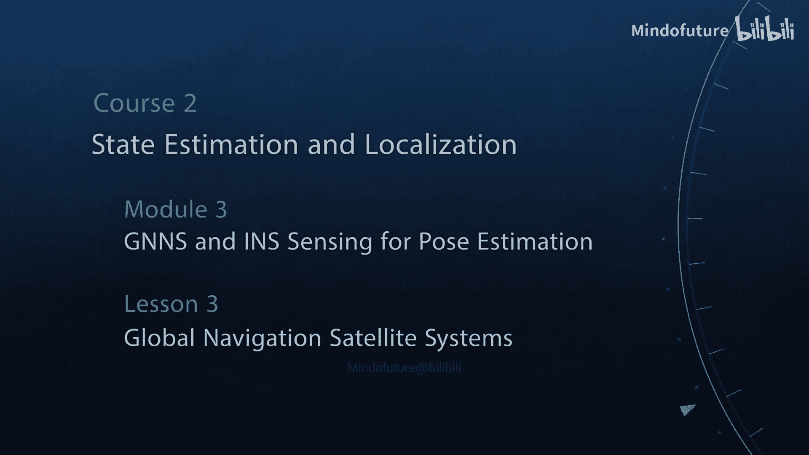
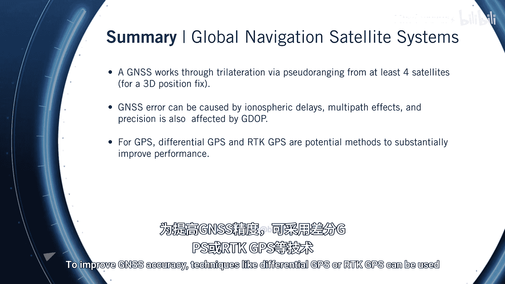

# 【多伦多大学】自动驾驶汽车的状态估计和定位 ｜ State Estimation Localization Self Driving Cars p22 P22_第三课_全球导航卫星系统（GNSS）_04_01_05 -BV1WysszdEDx_p22-

Welcome back。In this video， we'll talk about a particular type of sensor that most of you will be very familiar with。

The global navigation Satellite System or GNSS receiver。

We'll learn about why this navigation sensor is so important for a self driving car。

 It's able to provide a position fix anywhere in the world with bounded error， which is key。😊。

Specifically， we'll develop a model for GNSS based on the principles of pseudoraning and trilateeration。

We'll then familiarize ourselves with sources of GNSS positioning error。

And talk about some ways to improve one type of GNSS。

Just like the IMU discussed in the previous lecture。

 nearly every modern smartphone has at least one type of GNSS receiver。

Although we take them for granted now， the first modern system of global positioning satellites。

 GPS was built for military use during the 1980s。By the time the second version of the system was fully operational in 1995。

 GPS was made available to the public for free。This was。

 in part due to the highly publicized crash of Korean Airlines Flight 0，0，7 in 1983。Flight 0，0。

7 was a 7，47 passenger jet that flew from New York City to Seoul with refueling stop in Anchorage。

 Alaska。As it flew from anchorage to Seoul， it deviated from its planned flight path and was shot down by a fighter jet after spending several hours in Soviet airspace。

To cross the North Pacific Ocean， Flight 007 relied on an inertial navigation system for guidance。

The pilots failing to properly initialize the system mistakenly maintained the aircraft on a specific magnetic heading。

In turn， plane deviated by more than 300 kilometers from its planned course。

Shortly after F 007 was shot down， then President Ronald Reagan issued a directive to allow the US global positioning system to be freely available to the public once it was fully developed。

Although GPS was the original system of navigation satellites used for global positioning， today。

 the term global navigation satellite system is used as a catch all for several such satellite constellations that exist。

The two that are fully operational as of 2018 are GPS and Gs， the Russian equivalent。

Several other systems are nearing completion， including the European Galileo constellation。

For this video， we'll look at GPS more closely， though other GNS systems operate on similar principles。

The GPS constellation is composed of 24 to 32 satellites that are in six orbital planes。

Satellites are decommissioned and replaced periodically。

Each satellite is in medium Earth orbit at an altitude of roughly 20000 km。

 with an orbital period of just under 12 hours。The constellation is designed such that at least four satellites are visible at any surface point on earth at all times。

Each satellite broadcasts on two frequencies， one for civilian and one for military use。

Each broadcast signal contains a pseudo random code that identifies the satellite position and the time of transmission of the signal。

The basic principle behind GPS is time of arrival ranging。

The receiver computes a distance to each visible satellite by comparing its own internal clock with that of the time of transmission。

The time difference is converted to a distance using knowledge that electromagnetic signals propagate at the speed of light。

To compute a 3D position， the ranging equations require at least four visible satellites。

If altitude is known and only a 2D position is required， only three satellites are needed。

The process of recovering position from several distances to known landmarks is called trilateeration。

Note that this is different from triangulation， where we compute positions based off of angle measurements。

A GPS receiver measures the pseudo range to each satellite using the following measurement model。

The model accounts for receiver clock error， atmospheric propagation delays， and measurement noise。

The term pseudorange refers to the fact that the range information is corrupted by the error sources above。

Each pseudorange measurement defines a circle in 2D or a sphere in 3D。

If we have exactly four satellites， we can solve for the receiver position and the receiver clock error explicitly。

If we have more than4， we can use the method of least squares to find the maximum likelihood position。

 assuming Gaussian noise。GPS suffers from multiple error sources。First。

 charged ions in the ionosphere can delay the signal by an unknown amount。

Surrounding terrain and buildings may cause reflections that increase the distance traveled by the signal before reaching the receiver。

These are called multipath errors。Any small error in clock synchronization or satellite position information can have catastrophic consequences。

Even a one microcond timing error can lead to a significant error in position of 300 M。

Both ephemerous data and satellite clocks are updated and recalibrated often。

 but the calibration can be out of date。Finally， the geometric configuration of visible satellites can also lead to variations in positioning accuracy。

😊，This is known as the geometric dilution of precision。For higher accuracy。

 a configuration with satellites spread across the sky is preferable。Luckily， for some applications。

 we can improve GNSS accuracy by augmenting the system in various ways。

Differential GPS can correct receiver positioning estimates by making use of the more accurately known positions of one or more fixed base stations。

Corrections are broadcast on separate frequencies to the GNS S receiver in the moving vehicle。

Real time kinematic or RTK GPS makes use of carrier phase information to improve positioning accuracy down to two centimeters in some cases。

Although both of these techniques can significantly improve the accuracy of GPS。

 they're typically quite costly to implement。As we mentioned in the previous video。

 inertial sensors are very useful for navigation。 However。

 they drift or accumulate unbounded error over time。The GPS system in contrast。

 provides bounded error positioning updates。A self drivingiving car equipped with GPS will maintain a guaranteed level of positioning accuracy at all times unless the GPS receiver fails or loses track of at least four satellites。

So to summarize this video。Global navigation satellite systems work by combining pseudoranges from at least four satellites to determine a 3D position。

GPS or GNS S error can come from several different sources， including ionospheric delays。

 multipath effects， and also possibly from the geometric dilution of precision。

To improve GNSS accuracy， techniques like differential GPS or RTK GPS can be used。

That's the end of this module。In module 4， we'll describe how we confuse inertial measurements from IMU with position measurements from a GPS to produce an accurate localization estimate for a self-driving car。

 The sensors are complementary and they're used together in practically all self-driving cars。

 See you in the next module。😊。

