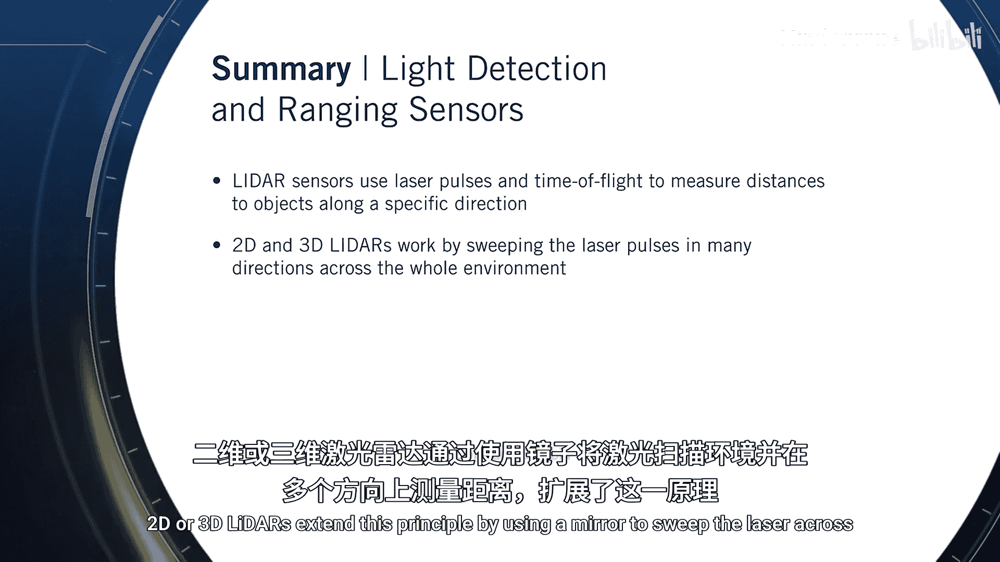

# 【多伦多大学】自动驾驶汽车的状态估计和定位 ｜ State Estimation Localization Self Driving Cars p24 P24_第一课_激光探测与测距（激光雷达）传感器_05_01_01 -BV1WysszdEDx_p24-

Welcome to Module4 of the course。In this module， we'll be talking about Ldar or light detection and ranging sensors。

 Liar has been an enabling technology for selfdiv cars because it can see in all directions and is able to provide very accurate range information。

😊，In fact， with few exceptions， most cell driving cars on the road today are equipped with some type of Lidar sensor。

In this module， you'll learn about the operating principles of LDar sensors。

Basic sensor models used to work with liddar data and Lidar point clouds。

Different kinds of transformation operations applied to point clouds and how we can use Lidar to localize a self driving car using a technique called point cloud registration。

In this video， specifically。We'll explore how a liddar works。

And take a look at sensor models for 2D and 3D LDAs。We'll also describe the sources of measurement。

 noise and errors for these sensors。In future lessons。

 we'll discuss in more detail how we can use lidar data for state estimation of self driving vehicles。

If you've ever seen a self driving car like the Waymo vehicle or an Uber car。

 you've probably noticed something spinning on the roof of the car。

That something is a liddar or light detection and ranging sensor。

And its job is to provide detailed 3D scans of the environment around the vehicle。In fact。

 Lidar is one of the most common sensors used on self driving cars and many other kinds of mobile robots。

Lars come in many different shapes and sizes and can measure the distances to a single point。

 A 2D slice of the world， or perform a full 3D scan。😊。

Some of the most popular models used today are manufactured by firms such as Vlaine in， California。

 Hokuyo in Japan and Zic in Germany。In this video， we'll mainly focus on the vadine sensors as our example of choice。

 But the basic techniques apply to other types of liddars as well。

Before we get into the nitty gritty of Lidar sensing。

 let's take a quick look at the history of this important sensor。

LidarR was first introduced in the 1960s， not long after the invention of the laser itself。

The first group to use LIdarR were meteorologists at the US National Center for Atmospheric Research。

 who deployed LIDarR to measure the height of cloud ceilings。

These ground based ceomes are still in use today， not only to measure water clouds。

 but also to detect volcanic ash and air pollution。

Airborne Lidar sensors are commonly used today to survey and map the Earth's surface for agriculture。

 geology， military and other uses。But the application that first brought Lidar into the public consciousness was Apollo 15。

 The fourth man mission to land on the moon and the first to use a laser altimeter to map the surface of the moon。

So we've seen that Liar can be used to measure distances and create a certain type of map。

But how do they actually work。And how can we use them on board a self driving car。

To build a basic lidar in one dimension， you need three components。A laser， a photo detector。

 and a very precise stopwatch。The laser first emits a short pulse of light。

 usually in the near infrared frequency band along some known ray direction。😊，At the same time。

 the stopwatch begins counting。The laser pulse travels outwards from the sensor at the speed of light and hits a distant target。

Maybe another vehicle in front of us on the road or a stationary object like a stop sign or a building。

As long as the surface of the target isn't too polished or shiny。

 the laser pulse will scatter off the surface in all directions。

 And some of that reflected light will travel back along the original ray direction。

The photo detector catches that return pulse， and the stopwa tells you how much time has passed between when the pulse first went out and when it came back。

That time is called the round trip time。Now， we know the speed of light。

 which is a bit less than 300 million meters per second。

So we can multiply the speed of light by the round trip time to determine the total round trip distance traveled by the laser pulse。

Since light travels much， much faster than cars， it's a good approximation to think of the lidar and the target as being effectively stationary during the few nanoseconds that it takes for all of this to happen。

😊，That means that the distance from the lider to the target is simply half of the round trip distance we just calculated。

This technique is called time of flight ranging。And although it's not the only way to build a liddar。

 it's a very common method that also gets used with other types of ranging sensors like radar and sonar。

It's worth mentioning that the photo detector also tells you the intensity of the return pulse relative to the intensity of the pulse that was emitted。

This intensity information is less commonly used for self driving。

 but it provides some extra information about the geometry of the environment and the material the beam is reflecting off of。

So why is intensity data useful。Well， in part， it turns out that it's possible to create 2D images from Liar intensity data that you can then use with the same computer vision algorithms you'll learn about in the next course。

 And since LiDar is its own light source， it actually provides a way for self-driving cars to see in the dark。

Okay。So now we know how to measure a single distance to a single point using a laser。

 a photo detector， a stopwatch， and the time of flight equation。 But obviously。

 it's not enough to stay laser focused on a single point ahead。

So how do we use this technique to measure a whole bunch of distances in 2D or in 3D？

The trick is to build a rotating mirror into the liddar that directs the emitted pulses along different directions。

As the mirror rotates， you can measure distances at points in a 2D slice around the sensor。

If you then add an up and down nodding motion to the mirror， along with the rotation。

 you can use the same principle to create a scan in 3D。For vlone type liddars。

 where the mirror rotates along with the entire sensor body。

 it's much harder to use a nodding motion to make a 3D scan。Instead。

 these sensors will actually create multiple 2D scan lines from a series of individual lasers spaced at fixed angular intervals。

Which effectively lets you paint the world with horizontal stripes of laser light。

Here's an example of a typical raw lidar stream from a Vadine sensor attached to the roof of a car。

The black hole in the middle is a blind spot where the sensor itself is located。

And the concentric circles spreading outwards from there are the individual scan lines produced by the rotating vadne sensor。

Each point in the scan is colored by the intensity of the return signal。

The entire collection of points in the 3D scan is called a point cloud。

 and we'll be talking about how to use point clouds for state estimation in the next few videos。

But before we get to point clouds， we need to think about individual points in 3D。Now， typically。

 lidDars measure the position of points in 3D using spherical coordinates。

 range or radial distance from the sensor origin to the 3D point。

Elevation angle measured up from the sensor's X， Y plane。

An asziuth angle measured counterclockwise from the sensor's X axis。

This makes sense because the aziuth and elevation angles tell you the direction of the laser pulse。

 and the range tells you how far in that direction the target point is located。

The asuth and elevation angles are measured using encoders that tell you the orientation of the mirror。

 and the range is measured using the time of flight， as we've seen before。For vadine type liddars。

 the elevation angle is fixed for a given scan line。Now。

 suppose we want to determine the Cartesian X， Y， Z coordinates of our scan point in the sensor frame。

Which is something we often want to do when we're combining multiple Liar scans into a map。

To convert from spherical to Cartesian coordinates。

 we use the same formulas you would have encountered in your mechanics classes。

This gives us an inverse sensor model。We say this is the inverse model because our actual measurements are given in spherical coordinates。

And we're trying to reconstruct the Cartesian coordinates of the points that gave rise to them。

Note that we haven't said anything about measurement noise yet。We'll come back to that。

 in just a moment。To go the other way， from cartesian coordinates to spherical coordinates。

We can work out the inverse transformation， given here。

This is our forward sensor model for a 3D Lidar， which， given a set of Cartesian coordinates。

 defines what the sensor would actually report。Now， most of the time。

 the self driving cars we're working with use 3D Lidar sensors like the Vedine。

But sometimes you might want to use a 2D lighter on its own。

Whether for detecting obstacles or for state estimation in more structured environments such as parking garages。

Some cars have multiple 2D lidars strategically placed to act as a single 3D Liar。

 covering different areas with a greater or lesser density of measurements。😊，For 2D LiDAs。

 we use exactly the same forward and inverse sensor models。

But the elevation angle enhanced the Z component of the 3D point in the sensor frame are both 0。

In other words， all of our measurements are confined to the X Y plane of the sensor。

And our spherical coordinates collapsed to the familiar 2D polar coordinates。

We've seen now how to convert between spherical coordinates measured by the sensor and the Cartesian coordinates that will typically be interested in for state estimation。

 But what about measurement noise。For LidAar sensors。

 there are several important sources of noise to consider。First。

 there is uncertainty in the exact time of arrival of the reflected signal。

 which comes from the fact that the stopwatch we use to compute the time of flight necessarily has a limited resolution。

Similarly， there is uncertainty in the exact orientation of the mirror in 2D and 3D Liars。

 since the encoders used to measure this also have limited resolution。

Another important factor is the interaction with the target surface。

 which can degrade the return signal。For example， if the surface is completely black。

 it might absorb most of the laser pulse。Or if it's very shiny， like a mirror。

 the laser pulse might be scattered completely away from the original pulse direction。

In both of these cases， the Ldar will typically report a maximum range error。

 which could mean there is empty space along the beam direction。

 or that the pulse encountered a highly aorptive or highly reflective surface。In other words。

 you simply can't tell if something is there or not。

 And this can be a problem for safety if your self driving car is relying on Lidar alone to detect and avoid obstacles。

And finally， the speed of light actually varies depending on the material it's traveling through。

The temperature and humidity of the air can also subtly affect the speed of light in our time of flight calculations。

 for example。These factors are commonly accounted for by assuming additive zero mean Gaussian noise on the spherical coordinates。

With an empirically determined or manually tuned covariance。As we've seen before。

 the Gaussian noise model is particularly convenient for state estimation。

 even if it's not perfectly accurate in most cases。

Another very important source of error that can't be accounted for so easily is motion distortion。

Which arises because the vehicle the Liar is attached to is usually moving relative to the environment it's scanning。

Now， although the car is unlikely to be moving at an appreciable fraction of the speed of light。

It is often going to be moving at an appreciable fraction of the rotation speed of the sensor itself。

Which is typically around 5 to 20 Hz when scanning objects at distances of 10 to 100 m。

This means that every single point in a lidar sweep is taken from a slightly different position and a slightly different orientation。

And this can cause artifacts such as duplicate objects to appear in the LDA scans。

This makes it much harder for a self driving car to understand its environment and correcting this motion distortion usually requires an accurate motion model for the vehicle provided by GPS and I N S。

 for example。To recap， LiDar sensors measure distances by emitting pulsed laser light and measuring the time of flight of the pulse。

2D or 3D Liars extend this principle by using a mirror to sweep the laser across the environment and measure distances in many directions。

In the next video， we'll look more closely at the point clouds created by 2D and 3D LiDars and how we can use them for a state estimation on board our self driving car。

