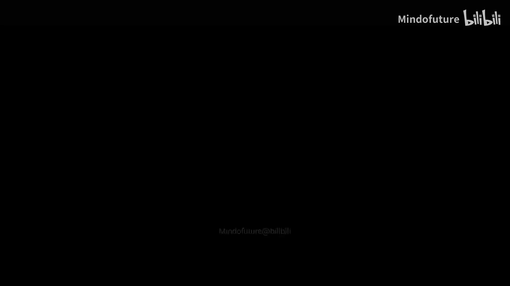
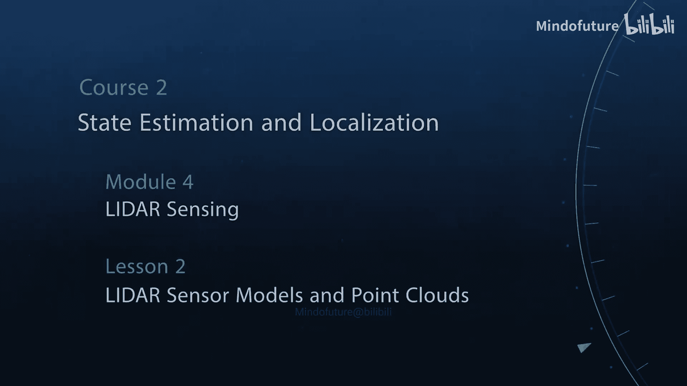
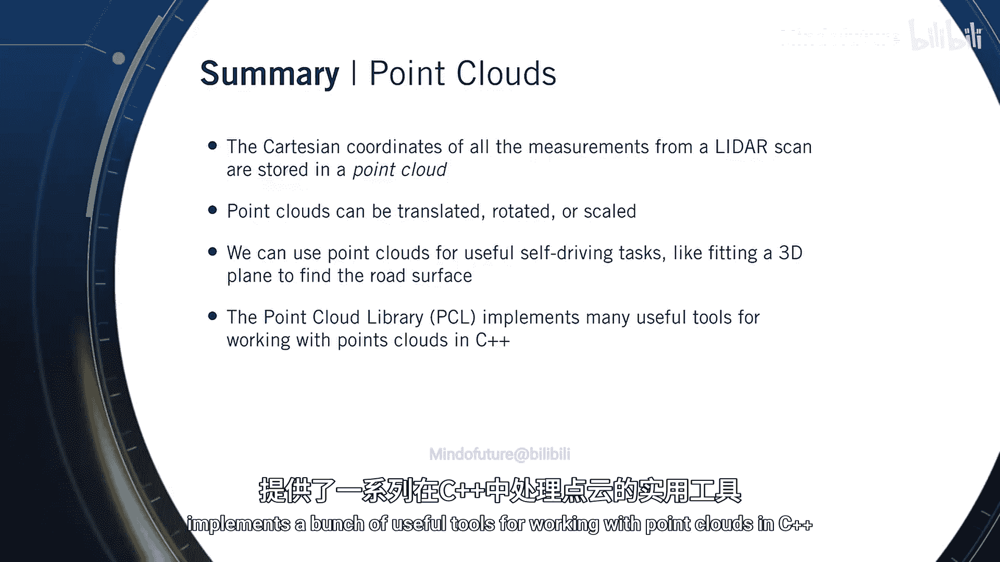
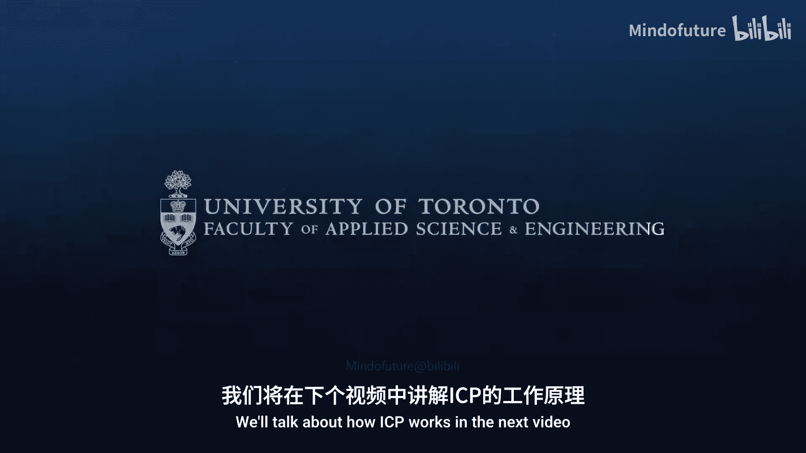

# 【多伦多大学】自动驾驶汽车的状态估计和定位 ｜ State Estimation Localization Self Driving Cars p25 P25_第二课_激光雷达传感器模型与点云_05_01_03 -BV1WysszdEDx_p25-

In the last video， we talked about the basic operating principles of LDar。

 one of the most popular sensor choices for self driving cars。 In the next two videos。

 we'll learn how we can use the point clouds generated by LiDar sensors to do state estimation for our self driving car。

😊，By the end of this video， you'll be able to describe the basic point cloud data structure used to store Lidar scans。

Describe common spatial operations on point clouds， such as rotation and scaling。

And use the method of least squares to fit a plane to a point cloud in order to detect the road or other surfaces。

To start us off， recall that a 3D LiDarR sensor returns measurements of range， elevation angle。

 and asziuth angle for every point that it scans。We know how to convert these spherical coordinates into Cartesian X。

 Y， Z coordinates using the inverse sensor model so we can build up a large point cloud using all of the measurements from a Lar scan。

😊，For some Liar setups， it's not uncommon for these point clouds to contain upwards of a million points or more。

So what can we do with these massive point clouds？Let's consider an example of a point cloud we might encounter in the real world。

Let's say our liddar scans a nearby tree off on the side of the road and produces a point cloud that looks like this。

We only see points on the part of the tree that's facing us because the tree and the leaves reflect infrared light。

The first question you might ask is， how do we keep track of all of these points？

What kinds of data structure should we use to work with them？

One common solution is to assign an index to each of the points， say point1 through point n。

And store the X， Y Z coordinates at each point as a 3 by one column vector。From there。

 you can think about storing each of these vectors in a list。

 or you could stack them side by side into a matrix that we'll call big P。

Doing it this way makes it easier to work with the standard linear algebra libraries like the Python Numppyy Library。

 which lets us take advantage of fast matrix operations。

 rather than iterating over a list and treating each vector independently。😊。

So what kind of operations are we talking about？There are three basic spatial operations that are important for carrying out state estimation with point clouds。

Translation， rotation and scaling。We'll talk about each of these in turn。

When we think about spatial operations on point clouds。

 our intuition might be to think in terms of physically manipulating the point cloud while our reference frame stays fixed。

But for state estimation， it's more useful to think about things the other way around。

Objects in the world mostly stay put， while the reference frame attached to the vehicle moves and observes the world from different perspectives。

So let's think about how translating our reference frame， say by driving forward 10 M。

 will affect our perception of a single point in the point cloud。

We can start by drawing the vector from the origin of our sensor frame S to a point P。Now。

 consider a second frame S prime， whose origin has been translated relative to S due to motion of the vehicle。

Note that the basis vectors of frame S prime are the same as the basis vectors of frame S。

 Only the origin has moved。We can draw another vector from the origin of S prime to the point P。

Immediately， we noticed that the resulting vector indicated here is just the tip to sum of the other two vectors。

Now， these vectors are just geometric objects until we express them in a coordinate system。

 And what we're after are the coordinates of the point P in frame S prime。

We can get these easily by just subtracting the frame to frame translation vector from the coordinates of P in frame S。

This extends easily to a batch operation on the full point cloud by simply tiling the frame to frame translation in a big matrix R and subtracting it from the point cloud matrix。

😊，Depending on the language or linear algebra library you're using。

You probably won't need to build this R matrix explicitly。In Python， for example。

 the Ni library is smart enough to repeat the frame to frame translation implicitly using broadcasting semantics。

Now， let's think about what happens if we rotate our reference frame instead of translating it。Again。

 keep in mind that we're not changing the physical point P， only our view of it。So in this case。

 we only have to think about one vector from the origin of frame S to P。

What does change in this case is actually the set of basis vectors we use to express the coordinates of the vector S to P。

Remember that the rotation matrix C tells us how to find the coordinates of a vector in a rotated frame from the coordinates of the vector in the original frame。

So if we know the rotation matrix from frame S to frame S prime。

 all we have to do is multiply it against the coordinates of P and frame S to get the coordinates of P and frame S prime。

To determine the coordinates of the entire rotated point cloud。

 the operation is exactly the same thanks to the properties of matrix multiplication。

The last spatial operation to think about is scaling， which works very similarly to rotation。

 but instead of changing the direction of the basis vectors in our coordinate system。

 we're changing their lengths。Mathematically， this just means pre multiplying the coordinates of each point by a diagonal matrix S whose non zero elements are simply the desired scaling factors along each dimension。

Often， but not always， these scaling factors are the same。

 and the matrix multiplication is equivalent to multiplying by a scalar。In these cases。

 we say that the scaling is isotropic or equal in every direction。

We can use the same matrix multiplication for individual points or for the entire point cloud。

 just like we did for rotations。Usually， the transformations we're interested in are a combination of translation and rotation。

 and some time scaling。😊，For example， we're often interested in estimating the translation and rotation that best aligns two point clouds so that we can estimate the motion of our self driving car。

We'll talk about how we can do this in the next video。Fortunately for us。

 it's easy to combine all three operations into a single equation。😊，By first。

 translating each vector。Then rotating into the new frame。And finally， applying any scaling。

And of course， this operation extends to the batch case as well。

So we've seen how to apply basic spatial operations to point clouds。

 And we'll see in the next video how we can use these concepts to do state estimation for self driving cars。

😊，But before we get there， there's one more important operation to discuss。 and that's plane fitting。

One of the most common and important applications of plane fitting for self driving cars is figuring out where the road surface is and predicting where it's going to be as the car continues driving。

If you think back to your high school geometry classes。

 you might remember the equation of a plane in 3D。 Z equals a plus B， X plus C， Y。

This equation tells you how the height of the planes Z changes as you move around in the x and y directions。

 and it depends on three parameters， A， B， and C， which tells you the slope of the plane in each direction and where the Z axis intersects the plane。

So in our case， we have a bunch of measurements of X， Y and Z from our Lidar point cloud。

 and we want to find values for the parameters A， B and C that give us the plane of best fit through these points。

😊，To do this， we're going to reach back to module1 for our tool of choice。 least squares estimation。

We'll start by defining a measurement error E for each point in the point cloud。

 And E is just going to be the difference between the predicted value of our dependent variable Z hat and the actual observed value of Z。

We get Z hat simply by plugging our current guests for the parameters， A hat， B hat and C hat。

 and the actual values of X and Y in。In this case， the error E that we are considering is for a bumpy road surface。

 for example， that is a surface which is not exactly par。For the moment。

 we're ignoring the actual errors in the lidar measurements themselves， which also have an effect。

We can stack all of these error terms into matrix form so that we have a big matrix of coefficients called a。

Multiplied by our parameter vector x。Minus our stacked measurements B。

You can work out the matrix multiplication yourself to see that we get back the same measurement error equations we started out with。

Now， all we have to do is minimize the square of this error， and we'll have our solution。

This works exactly the same way as the resistor problem we worked through in module 1。

We can start by multiplying out the square to get a matrix polynomial in the parameter vector X。

From there， we take the partial derivative of the squared error function with respect to the parameter vector x and set it to0 to find the minimum。

This gives us the linear system we'll need to solve to obtain the final least squares estimate。

We can solve this linear system using an efficient numerical solver like Python Nmpy's solve function。

Or just use the pseudo inverse to get our final answer for the plane parameters。

One important thing to notice here is that we did not account for sensor noise in our X， Y。

Z measurements。All we've done is to find the plane of best fit through a set of points。

It's certainly possible to set this problem up in a more sophisticated way that does account for sensor noise。

You could use a batch approach similar to what we just discussed。

Or you could even think about including the road parameters in the common filter to estimate them on the fly as the sensor data comes in。

The best solution for your self driving application will depend on how much you trust your lidar data and how much thought you want to give to uncertainty in the road surface。

Now， although all of the operations we've described here can be easily implemented with NumpI or any other linear algebra library。

 there is a fantastic open source tool called the Point Cloud Library or PCL that provides all sorts of useful functions for working with point clouds。

😊，In fact， it's so useful that you'll find it almost everywhere in industry。

 The core library is built with C plus plus， but there are unofficial Python bindings available as well。

😊，If you want to learn more about the features of PCL， I highly recommend visiting pointclouds。

 org and having a look around。So to recap， we've seen that point clouds are a way of capturing all of the measurements from a Liar scan that they are often stored as a big matrix。

😊，We saw how we can use linear algebra to do useful operations on point clouds， like translating。

 rotating， and scaling。And we also saw how we can use the least squares algorithm to fit a 3D plane to a point cloud to find the road surface。

The Point cloud library or PCL implements a bunch of useful tools for working with point clouds in C++。

One of the most useful algorithms in PCL is called the iterative closest point algorithm or ICP。

 which is a common method for estimating the motion of a self-ding car using two LiDAR point clouds。

We'll talk about how ICP works in the next video。

