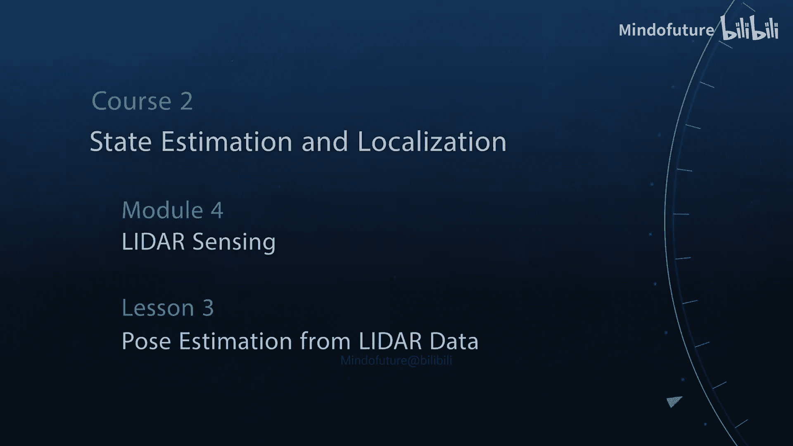
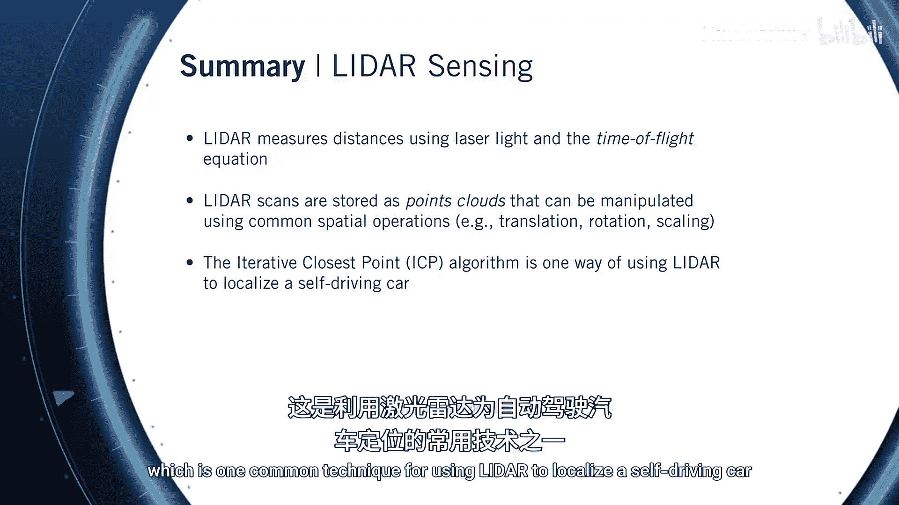

# 【多伦多大学】自动驾驶汽车的状态估计和定位 ｜ State Estimation Localization Self Driving Cars p26 P26_第三课_基于激光雷达数据的姿态估计_05_01_05 -BV1WysszdEDx_p26-

Now that you've learned how to translate， rotate， and scale point clouds。

 it's time to talk about how we can actually use these operations with real point clouds to estimate the motion of a self driving car。

The way that we do this in general is by solving something called the point set registration problem。

 which is one of the most important problems in computer vision and pattern recognition。

By the end of this video， you'll be able to describe the point set registration problem and how it can be used for state estimation。

Describe and implement the iterative closest point or ICP algorithm for point set registration and understand some common pitfalls of using ICP for state estimation on self driving cars。

Let's explore this problem by returning to our example of a self driving car observing a tree from a lidar mounted on the car's roof。

At time T equals1， say the lidar returns a point cloud that follows the contour of the tree as before。

The coordinates of every point in the point cloud are given relative to the pose of the lidDAR at the time of the scan。

We'll call this coordinate frame S。At time t equals 2， the car has driven a bit further ahead。

 but the LDarR can still see the tree and returns a second point cloud whose coordinates are again specified relative to the pose of the LIDar at time t equals 2。

We'll call this coordinate frame S prime。Now， the point set registration problem says given two point clouds in two different coordinate frames。

 and with the knowledge that they correspond to or contain the same object in the world。

How shall we align them to determine how the sensor must have moved between the two scans。

More specifically， we want to figure out the optimal translation and the optimal rotation between the two sensor reference frames that minimizes the distance between the two point clouds。

We'll describe what we mean by distance shortly。To keep things simple。

 we're going to pretend that we have an ideal LiarR sensor that measures the entire point cloud all at once so that we can ignore the effects of motion distortion。

Now， if we somehow knew that each at every point in the second point cloud corresponded to a specific point in the first point cloud。

 and we knew ahead of time which points corresponded to which we could solve this problem easily。

All we would have to do is find the translation and rotation that lines up each point with its twin。

In this example， our ideal rotation matrix would be the identity matrix。 That is no rotation at all。

 and our ideal translation would be along the car's forward direction。The problem is that in general。

 we don't know which points correspond with each other。In the course on computer vision。

 you'll learn about feature matching， which is one way of determining correspondences between points using camera data。

But for now， let's think about how we might solve this problem without knowing any of the correspondences ahead of time。

The most popular algorithm for solving this kind of problem is called the iterative closest point algorithm or ICP for short。

The basic intuition behind ICP is this。 When we find the optimal translation and rotation。

 or if we know something about them in advance。And we use them to transform one point cloud into the coordinate frame of the other。

 The pairs of points that truly correspond to each other will be the ones that are closest to each other in a Euclidean sense。

This makes sense if you consider the simplified case where our LiDarR sensor scans exactly the same points。

 just from two different vantage points。In this case。

 there's a one to one mapping between points in the two scans。

 and this mapping is completely determined by the motion of the sensor。

So that's the ideal case for when we found the best possible translation and rotation。

But what if we don't have the optimal translation or rotation？

How do we decide which points actually go together？Well， with ICP。

 we use a simple heuristic and say that for each point in one cloud。

 the best candidate for a corresponding point in the other cloud is the point that is closest to it right now。

The idea here is that this heuristic should give us the correspondences that let us make our next guess for the translation and rotation that's a little bit better than our current guests。

And as our guesses get better and better， our correspondences should also get better and better until we eventually converge to the optimal motion and the optimal correspondences。

This iterative optimization scheme using the closest point heuristic is where ICP gets its name。

It's important to note that the word closest implies that we will find points that lie close together after applying the frame to frame transformation only。

 that is because the vehicle is moving， it's almost never the case that a laser beam will hit exactly the same surface point twice。

So let's talk about the steps in the ICP algorithm。

First and most important is that we need an initial guess for the transformation。

We need this because there's no guarantee that the closest point heuristic will actually converge to the best solution。

It's very easy to get stuck in a local minimum in these kinds of iterative optimization schemes。

 so we'll need a good starting guess。Now the initial guess can come from a number of sources One of the most common sources for robotics applications like self-driving is a motion model。

 which could be supplied by an IMU， as we saw in the previous module or by wheelometry or something really simple。

 like a constant velocity or even a zero velocity model。

 how complex the motion model needs to be to give us a good initial guess really depends on how smoothly the car is driving if the car is moving slowly relative to the scanning rate of the LiDAR sensor。

 one may even use the last known pose as the initial guess。For our example。

 let's say we use a very noisy IMU and emotion model to provide the initial guess。

 and the model tells us that the sensor translated forward a bit and also pitched upwards。

In step two， we'll use this initial guess to transform the coordinates of the points in one cloud into the reference frame of the other。

 and then match each point in the second cloud to the closest point in the first cloud。

Here we've shown the association for the first four points and the last four points。

Note that there's nothing stopping two points in one cloud from being associated with the same point in the other cloud。

Step three is to take all of those match points and find the transformation that minimizes the sum of squared distances between the corresponding points。

We'll talk about the math behind this step in a minute。

 but you can visualize it as wrapping an elastic band around each pair of matched points and then letting go and waiting for the system to find its lowest energy configuration。

The translation and rotation associated with this minimum energy configuration are the optimal solutions。

And then we repeat the process using the translation or rotationation we just solve for as our new initial guess。

We keep going until the optimization converges。So in the next iteration。

 we use the new translation and rotation to transform the point cloud and then find the closest matches。

Soll for the optimal transformation and keep going until we reach the optimum after a few iterations。

So how do we actually solve for the optimal transformation in step 3。

Maybe you've already guessed that we're going to use our favorite tool， least squares。

Our goal here is to find the rotation and translation that best aligns the two point clouds。

Specifically， we want to minimize the sum of squared Euclidean distances between each pair of matched points。

 which is one of the lost functions we've defined here。

This least squares problem is a little bit more complex than the ones we've encountered so far。

 And that's because the rotation matrix is inside the loss function。

It turns out that rotation matrices do not behave like vectors。If you add two vectors together。

 you get another vector。 But if you add two rotation matrices together。

 the result is not necessarily a valid rotation matrix。In reality。

3D rotations belong to something called the special orthogonal group or S O3。

 We won't dig into what that means in this course， but it's important to remember that rotations need special treatment。

It turns out that there's a nice closed form solution to this least squares problem。

 which was discovered in the 1960s。We won't go through the derivation here。

 but the good news is that there is a simple four step algorithm you can follow to solve this problem。

The first two steps are easy。First， we compute the centroid to each point cloud by taking the average over the coordinates of each point。

This is exactly like calculating the center of mass and physics。Second。

 we work on a three by three matrix capturing the spread of the two point clouds。

You can think of this W matrix as something like an inertia matrix you might encounter in mechanics。

The W matrix is the quantity we're going to use to estimate the optimal rotation matrix。

Step  three is actually finding the optimal rotation matrix。This step is the most complex。

 and it involves taking something called the singular value decomposition or S VD of the W matrix。

If you've never seen the SVD before， this step might look a bit magical。

 So let's spend a moment talking about what the singular value decomposition actually does。

The SVD is a way of factorizing a matrix into the product of two unitary matrices， U and V。

 and a diagonal matrix S， whose nonze entries are called the singular values of the original matrix。

There are several ways to interpret the SVD， but for us it's easiest to think about U and V as rotations and the S matrix as a scaling matrix。

Since we're dealing with rigid body motion in this problem。

 we don't want any scaling in our rotation estimate。

 So we'll replace the S matrix with something like the identity matrix to remove the scaling。

There's a trick， though， in the way we choose the bottom right entry of the new scaling matrix。

It turns out that in some cases， the SVD will give us rotation matrices that are not proper rotations。

 that is， they also have a reflection about the axis of rotation。

To make sure that we get a proper rotation， we choose the bottom right term to be the product of the determinants of U and V。

This number will be either plus 1 or -1 and will cancel out any reflection。Once we have this。

 all we have to do is multiply out the three matrices。

 and this gives us back the optimal rotation matrix。Now that we have a rotation estimate。

 the last step is to recover the translation。This part is very straightforward and only involves rotating the centroid of one point cloud into the reference frame of the other。

 and then taking the difference of the coordinate vectors to find the translation that will best align the two point clouds。

One other important thing to think about， both from a safety standpoint。

 and when we start talking about sensor fusion in a later module。

Is how confident we should be in the output of the ICP algorithm？

There are a number of different ways to estimate the uncertainty or the covariance of the estimated motion parameters。

An accurate and relatively simple method is to use this equation here。

This expression tells us how the covariance of the estimated motion parameters is related to the covariance of the measurements in the two point clouds。

Using certain second order derivatives of the least squares cost function。

While its expression is accurate and fast to compute。

 it's a little tricky to derive these second order derivatives when there's a constrained quantity like a rotation matrix in the mix。

So for our purposes， we're generally going to hand tune the ICP Covariance matrix to give us acceptable results。

You've now seen the basic vanilla algorithm for the iterative closest point method。

 but it's not the only way of solving the problem。In fact。

 this algorithm is just one variant of ICP called point to point ICP。

 which derives its name from the fact that our objective function or loss function minimizes the distance between pairs of corresponding points。

Another popular variant that works well in structured environments like cities or indoors is called Point to Pla ICP。

Instead of minimizing the distance between pairs of points。

 we fit a number of planes to the first point cloud and then minimize the distance between each point in the second cloud and its closest plane in the first cloud。

These planes could represent things like walls or road surfaces。

And the challenging part of the algorithm is actually figuring out where all the planes are。

We won't talk about how to do this in detail， but you can check out the documentation for point to plane ICP in the Point cloud Library for more information。

Now， up until this point， we've been assuming that the objects seen by our Lidar are stationary。

What if they're moving？A common example of this is if our car is driving in traffic down a busy highway and scanning the vehicle in front of it。

Both vehicles are traveling at the same speed， while our self driving car is happily collecting lidIar data points。

We ask ourselves， again。What motion of the car best aligns the two point clouds。

The answer we get is that we haven't moved at all， but， of course。

 we did move just not relative to the vehicle directly ahead of us。Now。

 this is obviously a contrived example。 And in reality。

 the point cloud would also include many stationary objects like roads and buildings and trees。😊。

But naively using ICP in the presence of moving objects will tend to pull our motion estimates away from the true motion。

So we need to be careful to exclude or mitigate the effects of outlying points that violate our assumptions of the stationary world。

One way to do this is by fusing ICP motion estimates with GPS and IN S estimates。

 and we'll talk about how to do this later in the course。

Another option is to identify and ignore moving objects。

 which we could do with some of the computer vision techniques you'll learn about in the next course。

But an even simpler approach for dealing with outliers like these is to choose a different loss function that is less sensitive to large errors induced by outliers than our standard squared error loss。

The class of loss functions that have this property are called robust loss functions or robust cost functions。

 and there are several to choose from。We can write this out mathematically by generalizing our least squares loss function so that the contribution of each error is not simply the square of its magnitude。

 but rather some other function row。Some popular choices for robust loss functions include the absolute error or L1 norm。

 the khi loss， and the Huber loss shown here。The key difference is that the slope of the loss function does not continue to increase as the errors become larger。

 but rather， it remains constant or it tapers off。Robust loss functions make the ICP problems slightly more difficult because we can no longer derive a nice closed form solution for the point cloud alignment step。

 And this means we need to add another iterative optimization step inside our main loop。However。

 the benefits can outweigh the added complexity。So to recap。

 the iterative closest point or ICP algorithm is a way to determine the motion of a self driving car by aligning point clouds from LiDar or other sensors。

ICP works by iteratively minimizing the Euclidean distance between neighboring points in each point cloud。

 which is where the algorithm gets its name。Moving objects can be a problem for ICP since they violate the stationary world assumption that ICP is based on。

Outlier measurements like these can be mitigated with a number of techniques。

 including robust loss functions， which assign less weight to large errors than the usual squared error loss。

Let's recap what we learned in this module。Ldar or light detection andanging is a way of measuring distances by observing the time of flight of laser pulses。

2D and 3D Liar sensors can scan large swaths of the environment around the car。

 and the collection of points returned from each scan is stored as a point cloud。

 which can be manipulated using standard spatial operations such as translation。

 rotation and scaling。😊，These operations are an important part of the iterative closest point or ICP algorithm。

 which is one common technique for using LiDar to localize a self driving car。

In the next module， we'll discuss some practical aspects of state estimation and talk about how we can use LiDAR and ICP in conjunction with other sensors like IMUs and GPS to get an accurate and reliable state estimate for the vehicle。

