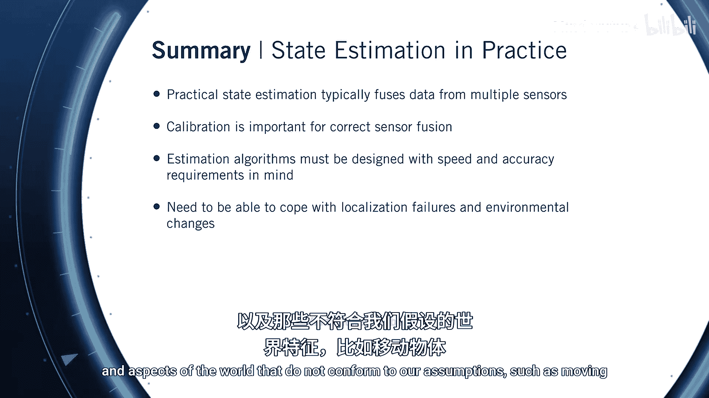

# 【多伦多大学】自动驾驶汽车的状态估计和定位 ｜ State Estimation Localization Self Driving Cars p28 P28_第一课_实践中的状态估计_06_01_01 -BV1WysszdEDx_p28-

Now that you've learned the basics of estimation theory。

 3D geometry and some common sensing modalities， it's time to put into practice and think about how we can use all of these tools together to build an estimator we can use on a real self driving car。

 A real self- driving car like the autonomous will be equipped with many different kinds of sensors。

😊，For example， the autonomous is equipped with five cameras， a 3D Liar， an IM U，4 radar units。

 A GPS or G NSSS receiver， and a wheel encoder。All of these sensors give us different types of data at different rates。

For example， the IMU might report accelerations in angular velocities 200 times per second。

 while the lidDAar completes a full scan only 20 times per second。So in this module。

 we're going to talk about how we can combine all the different information to get the best possible estimate of the vehicle state。

This process is called sensor fusion， and it's one of the most important techniques for self driving cars。

But in order to do sensorri fusion， we also need to calibrate our sensors to ensure that the sensor models are accurate and so that we know how the reference frames of all of the sensors are related to each other。

We'll also discuss what happens when one or more sensors fails。

And give you an overview of the final project where you'll have an opportunity to implement a full vehicle state estimator using sensors in the carless simulator。

In this first video， we'll give you a bird's eye view of some practical considerations you should take into account when designing systems for self driving cars。

😊，What kind of considerations？Well we've already touched on sensor fusion and calibration。

 but we'll also need to think about speed and accuracy requirements。

 as well as localization failures and how to cope with parts of the environment that are moving and changing around us。

😊，Let's start with sensoror fusion。If we have a car like the autonomousose that's equipped with a number of different sensors。

 what we would like to do is figure out how to combine all of this different information to get the best possible estimate of the vehicle state。

It might seem like a daunting task to use all of this data， but in fact。

 we already have the tools to do this。In lesson two of this module。

 we'll discuss exactly how we can use the familiar tools like the extended common filter to combine all of the sensor data into a single consistent estimate of the vehicle state。

But in order to do sensor fusion， we first need to know some things about our sensors and how they're configured on board the vehicle。

For one thing， our sensor models might depend on parameters that are specific to the car or to the sensor itself。

A good example of this is using wheel encoders to measure the forward speed of the car。

A wheel encoder measures the angular velocity of the axle。

But if we want to use that to get the forward velocity of the vehicle。

 we also need to know the radius of the tire。Another thing we need to know about the vehicle is the pose or position and orientation of each sensor relative to the vehicle reference frame。

Because we're combining information from sensors located in different places。

 we need to know how to transform all of the measurements。

 So they're expressed in a common reference frame。Finally。

 we need to think about how well our sensor measurements are synchronized so that we confuse them all properly。

 Intuitively， you might expect that directly combining a LiDarR scan you just received with a GPS measurement you received。

 say5 seconds ago won't produce as good of a result as if the LiDarR scan and the GPS measurement were taken at the same time。

😊，So the more accurately you can synchronize your sensors， the better your state estimate will be。

And a part of this involves determining the time offset between when the sensor records a measurement and when the estimator receives it for processing。

All of these factors are critical forms of calibration。

 which we'll discuss in more detail in lesson 3。How accurate does our estimator need to be for a self driving car to drive safely on the road。

Well， it depends on the size of the car， the width of the lanes and the density of traffic。

 But to get a ballpark estimate， you might consider the margin of error available for a task like lane keepinging。

A typical car is about 1。8 m wide， and an average highway lane might be about 3 m wide， give or take。

So our estimator would need to be good enough to position the car within 60 cm or so on either side of the lane。

 And that's assuming we know exactly where the lanes are and that there's no traffic。For comparison。

 an optimistic range for GPS accuracy is between 1 and 5 m， depending on the specific hardware。

 the number of satellites that are visible and other factors。So clearly。

 GPS alone is not enough even for lanekeeping。And this is one important reason why we'll need to combine information from many different sensors。

What about speed。How fast do we need to update the vehicle state so that the car can react to rapidly changing environments or unexpected events。

Well， this all depends on what kind of environment the car is operating in。

Imagine that you're driving a car with your eyes closed and you open your eyes exactly once every second to take a look at what's around you and make some adjustments。

This corresponds to an update rate of 1 Hz。If you're driving down a straight country road with no traffic in sight。

 maybe you'll feel relatively safe doing this。What if you're driving through a busy city intersection with dozens of other cars and buses and cyclists and pedestrians around you。

You would probably feel much less safe， opening your eyes once a second。As a rule of thumb。

 an update rate of 15 Hz to 30 Hz is a reasonable target for self driving。But， of course。

 there's a trade off to think about here。A self driving car will only have so much onboard computing power available。

 and the computer will need to juggle many different processes like control and path planning and perception。

 in addition to state estimation。What's more， the total amount of compute power available on board may be limited by restrictions on how much power the computer is actually allowed to consume。

For doing state estimation with fixed computational resources。

 there's a trade off between how complicated our algorithms can be and the amount of time we're allowed to spend computing a solution。

It's up to you as a self drivingring car engineer to decide where your car is going to be on this trade off curve。

Even if we have a fast and accurate estimation algorithm。

 there are going to be cases where our localization might fail。How could this happen， Well。

 for one thing， we might have one or more of our sensors report bad data or maybe even fail entirely。

A good example of this is GPS， which doesn't work at all in tunnels。

 and which can have a difficult time coping with reflected signals in cities with a lot of tall buildings。

We might also encounter errors in our state estimation algorithm itself。For example。

 if we're using an extended common filter with a highly nonlinear sensor model。

 we might find that the inherent linearization error in the estimator means that we can lose accuracy in our state estimate。

 even though the estimator is pretty confident in its output。

Or maybe our estimator is not very confident at all。Thinking back to the common filter equations。

 you might remember that the uncertainty in our state grows as we propagate forward through the motion model。

 and it only shrinks once we incorporate outside observations from Ldar or GPS， for example。😊。

If our liddar is broken and we're driving in a tunnel without GPS。

 how long can we rely on an IM U and emotion model before our state uncertainty grows too large and it's no longer safe to drive。

We'll talk about strategies for detecting and coping with localization failures like these in lesson 4。

Finally， we need to think about the world the car lives in。 For the most part。

 we've developed our models for sensors like Lidar under the assumption that the world is static and unchanging。

😊，But， of course， in reality， the world is always moving and changing。 For example， other cars。

 pedestrians and cyclists are probably moving。😊，Lighting changes over the course of a day。

 and even the geometry of the world can change with the seasons。

One of the big challenges for self driving cars is finding ways to account for these kinds of changes。

 whether by modeling them or by finding ways of identifying and ignoring objects that violate our assumptions。

In fact， this is still a very active area of research。So to summarize this video。

State estimation and practice will typically rely on sensor fusion to combine information from many different kinds of sensors like IMUs。

 LiDar， cameras， and GPS or GNSS receivers。In order for sensor fusion to work as intended。

 we need to calibrate the sensors by determining the parameters of our sensor models。

The relative positions and orientations of all of the sensors and any differences in polling times。

We also need to consider trade offs between speed and accuracy in our algorithms。

 which may be different depending on the type of self driving car you're working on。Ask yourself。

 how accurately do I need to know the vehicle state and how often do I need to update it for my particular use case？

And finally， we need to think about how to safely cope with localization failures and aspects of the world that do not conform to our assumptions。

 such as moving objects。

In the next three videos， we'll dig into some of these topics in more detail。

 starting with multisensor fusion in the next video。

