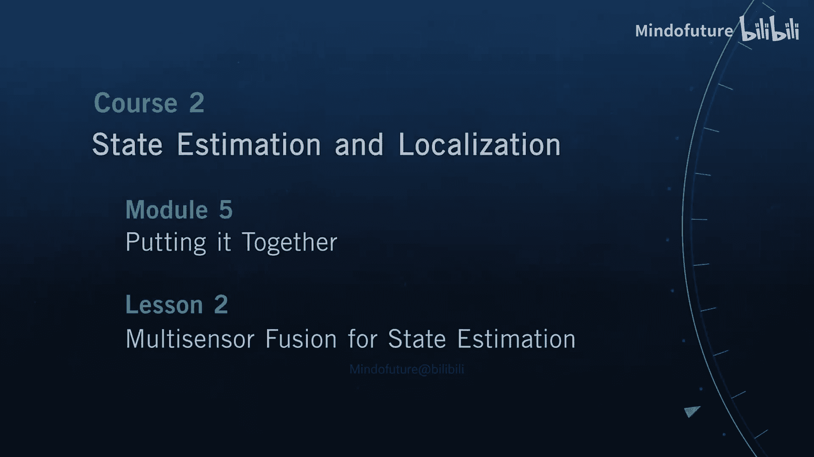
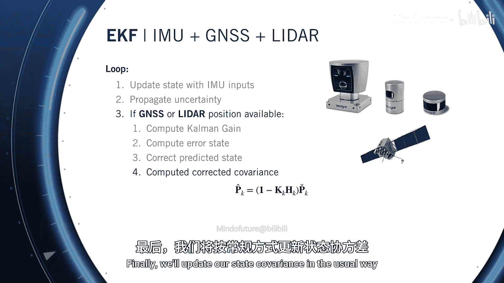
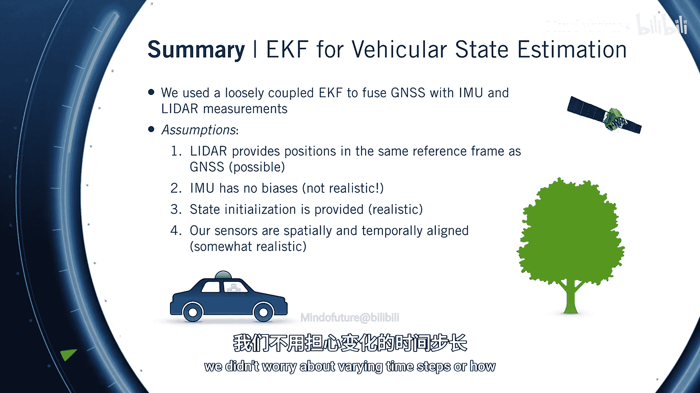

# 【多伦多大学】自动驾驶汽车的状态估计和定位 ｜ State Estimation Localization Self Driving Cars p29 P29_第二课_多传感器融合在状态估计中的应用_06_01_02 -BV1WysszdEDx_p29-

Welcome back。Now that we've discussed the basic hardware and software that we'll need for localization。

 let's put everything together。In this lesson will'll derive an aero state extended common filter that estimates position。

 velocity and orientation of a self driving car using an IM U。A GNS receiver。And a lidar。

Although we'll make some simplifications， the basic structure of our pipeline will resemble one used in modern self driving vehicles。

Before we dive into the algorithm details， it's always useful to take a step back and ask why use these sensors。

 And can we do something more simple。In our case， we'll be using an IMU with a GNSS receiver and a LiIDarR for several reasons。

First， whenever wefuse information for the purpose of state estimation。

 one important factor to consider is whether or not the errors from different sensors will be correlated。

In other words， if one fails， is the other likely to fail as well。In this case。

 all three of our sensors use different measurement methods and are unlikely to fail for the same reason。

Second， we should try our best to choose sensors that are complementary in nature。In our case。

 the IMU acts as a high rate smoother of GPS or GNSS position estimates。

 and GNSS data can mitigate errors that are due to IMU drift。

It's also possible to use wheel oometry for this purpose。 In this lecture。

 we'll stick to IMUs as they can provide full position and orientation information in three dimensions。

 whereas wheel oometry is limited to two dimensions。Finally。

 Lidar can complement GNSS information by providing very accurate position estimates within a known map and in sky obstructed locations。

😊，Conversely， GN S can tell Lidar which map to use when localizing。

For the purposes of E KF state estimation， we can implement either what's called a loosely coupled estimator or a tightly coupled one。

In a tightly coupled D KF， we use the raw pseudo range and point cloud measurements from our G NSS and Lidar as observations。

😊，In a loosely coupled system， we assume that this data has already been pre processcessed to produce a noisy position estimate。

Although the tightly coupled approach can lead to more accurate localization。

 it's often tedious to implement and requires a lot of tuning。For this reason。

 we'll implement a loosely coupled E KF here。Here you can see a graphical representation of our system。

We will use the IMU measurements as noisy inputs to our emotion model。

This will give us our predicted state， which will update every time we have an IM U measurement。

 This can happen hundreds of times a second。At a much slower rate。

 we'll incorporate GNSS and lidDarR measurements whenever they become available。

 say once a second or slower and use them to correct our predicted state。So what is our state？

For our purposes， we'll use a 10 dimensional state vector that includes a 3D position， a 3D velocity。

 and a 4D unit quaternion that will represent the orientation of our vehicle with respect to a navigation frame。

We'll assume that our IMU output specific forces and rotational rates in the sensor frame and combine them into a single input vector U。

It's also important to point out that we are not going to track accelerometer or gyroscope biases。

These are often put into the state vector， estimated and then subtracted off of the IM U measurements。

For clarity， we'll o them here and assume our IMU measurements are unbiased。

Our motion model for the position， velocity and orientation will integrate the proper accelerations and rotational rates from our IMU。

The position update looks like this。Next is the velocity update。And finally。

 the orientation or Quaternian update。Will need to use several definitions， as shown below。

Remember that our Quaternion will keep track of the orientation of our sensor frame s with respect to our navigation frame N。

Notice that the incremental orientation updates are applied via Queternian multiplication。

Where the orientation change， that is the quaternion form of small omega times deelta t。

 appears on the right hand side because the orientation change is measured in the local sensor frame。

Because of the orientation parameters， which we express as a rotation matrix。

Our motion model is not linear。To use it in our EKF。

 we'll need to linearize it with respect to some small error or perturbation about our predicted state。

To do this。Willll define an error state that consists of Delta P， Delta v and Delta phi。

 where Delta phi is a 3 by one orientation error。There are some advantages to representing the orientation error in the global or navigation frame。

 rather than in the local frame， so we'll proceed accordingly。

This choice will impact the derivation of our Jacobian matrices and also the exact form of the error state update。

Using this error state， we can derive the aerodynamics with the appropriate Jacobians。

For our measurement model， we'll use a very simple observation of the position。

 plus some additive Gaussian noise。😊，We'll define a covariance。 R sub G。

 NSSS for the GNS S position noise。And R sub Liar for our liddar position measurement noise。

It's important here to note that we've assumed that our Lidar and GNS will supply position measurements in the same coordinate frame。

In a realistic implementation， the G NSS position estimates may serve as a way to select a known map against which the Lidar data can then be compared。

With these definitions in mind， we can now describe our extended common filter。

Our filter will loop every time an IM U measurement occurs。

We'll first use the motion model to predict a new state based on our last state。

The last state may be a fully corrected state or one that was also propagated using the motion model only。

Depending on whether or not we received a GNSS or liDar measurement at the last time step。Next。

 we'll propagate the state uncertainty through our linearized motion model。 again。

 accounting for whether or not our previous state was corrected or uncorrected。At this point。

 if we don't have any GN S S or liddar measurements available， we can repeat steps 1 and 2。If we do。

 we'll first compute the common gain that is appropriate for the given observation。

We'll then compute an error state that we will use to correct our predicted state。

This error state is based on the product of the common gain and the difference between the predicted and observed position。

We will then correct our predicted state， using our error state。

This correction is straightforward for a position of velocity。

 but some more complicated algebra is required to correct the quaternion。

We'll need this special update because the quaternion is a constrained quantity that is not a simple vector。

We have chosen to use a global orientation error。This means that the orientation update involves multiplying by the error state Queternion on the left。

This is different from the propagation step， where we multiplied by the incremental quaternion defining the orientation change on the right。

You should pay careful attention to this when completing the final project for this course。Finally。

 we'll update our state covariance in the usual way。 And that's it。 There you have it。😊。

Your very own localization pipeline。

If you followed everything up until now， congratulations。

You're well on your way to becoming a localization guru。Before we end this lesson。

 let's review a few of the assumptions we've made when putting our pipeline together。

We used a loosely coupled extended common filter framework to fuse inertial measurements from an IMU together with position measurements from a GNSS receiver and a LDar。

We assume that the GN S S and Lidar provided us with position estimates in the same coordinate frame。

 which requires some pre processingcess， but is possible to do in a realistic implementation。Second。

 we did not account for accelerometer or gyroscope biases in our IM U measurements。

 This simplified our algebra， but is not a realistic assumption。Luckily。

 if you follow along with what we've done here， adding biases is not a significant leap。Next。

 we didn't discuss filter state initialization。This is often taken to be some known state at the start of the localization process。

And finally， we also assumed that our sensors were all spatially and temporally aligned。😊。

We assumed that our sensors were calibrated in the sense that we didn't worry about varying time steps or how we could get several sensor measurements all aligned into one coordinate frame。

Performing this latter step is a very important part of constructing an accurate localization pipeline。

 We'll discuss it next。

