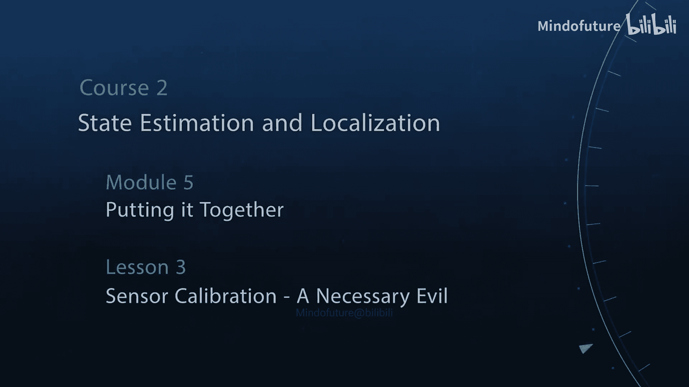
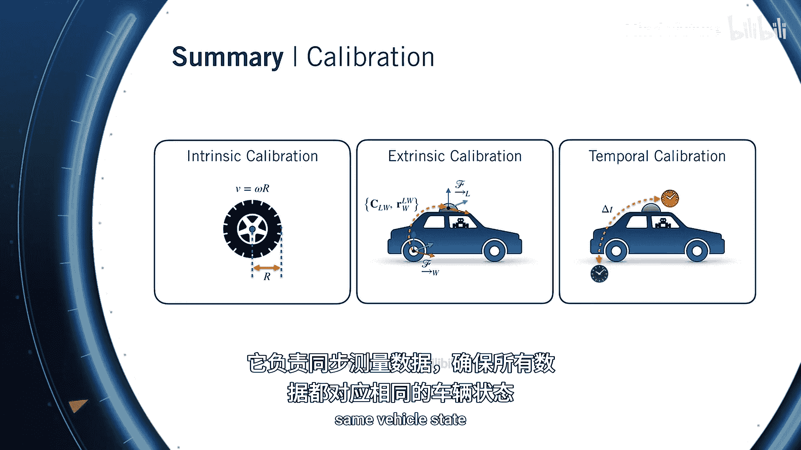

# 【多伦多大学】自动驾驶汽车的状态估计和定位 ｜ State Estimation Localization Self Driving Cars p30 P30_第三课_传感器标定_必要之恶_06_01_04 -BV1WysszdEDx_p30-

Now that we've seen how we can combine multiple sources of sensor data to estimate the vehicle state。

 it's time to address a topic that we've so far been sweeping under the rug。

That topic is sensor calibration。 And it's one of those things that engineers don't really like talking about。

 but is absolutely essential for doing state estimation properly。 Personal。

 calibration is near and dear to me since my doctoral research focused on calibration for cameras and I M Us。

 And it's a topic that my students are continuing to research today In this video will'll discuss the three main types of sensor calibration and why we need to think about them when we're designing a state estimator for a self-driving car。

 The three main types of calibration we'll talk about our intrinsic calibration。

 which deals with sensor specific parameters。😊，Extrinsic calibration。

 which deals with how the sensors are positioned and oriented on the vehicle。

And temporal calibration， which deals with the time offset between different sensor measurements。

Let's look at intrinsic calibration， first。In intrinsic calibration。

 we want to determine the fixed parameters of our sensor models so that we can use them in an estimator like an extended common filter。

😊，Every sensor has parameters associated with it that are unique to that specific sensor and are typically expected to be constant。

For example， we might have an encoder attached to one axle of the car that measures the wheel rotation rate。

 omega。If we want to use omega to estimate the forward velocity V of the wheel。

 we would need to know the radius R of the wheel so that we can use this in the equation。

 V equals omega times R。 In this case， R is a parameter of the sensor model that is specific to the wheel the encoder is attached to。

 and we might have a different R for a different wheel。

Another example of an intrinsic sensor parameter is the elevation angle of a scan line in a lidar sensor like the Vlone。

The elevation angle is a fixed quantity， but we need to know it ahead of time so that we can properly interpret each scan。

So how do we determine intrinsic parameters like these， Well。

 there are a few practical strategies for doing this。

The easiest one is to just let the manufacturer do it for you。Often。

 sensors are calibrated in the factory and come with a spec sheet that tells you all the numbers you need to plug into your model to make sense of the measurements。

😊，This is usually a good starting point， but it won't always be good enough to do really accurate state estimation because no two sensors are exactly alike。

 and there will be some variation in the true values of the parameters。

Another easy strategy that involves a little more work is to try measuring these parameters by hand。

This is pretty straightforward for something like a tire。

 but not so straightforward for something like a liddar。

 where it's not exactly practical to poke around with a protractor inside the sensor。

A more sophisticated approach involves estimating the intrinsic parameters as part of the vehicle state。

 either on the fly or more commonly as a special calibration step before putting the sensors into operation。

This approach has the advantage of producing an accurate calibration that's specific to the particular sensor and can also be formulated in a way that can handle the parameters varying slowly over time。

😊，For example， if you continually estimate the radius of your tires。

 this could be a good way of detecting when you have a flat。Now。

 because the estimators we've talked about in this course are general purpose。

 we already have the tools to do this kind of automatic calibration。To see how this works。

 let's come back to our example of a car moving in one dimension。

And say we've attached an encoder to the back wheel to measure the wheel rotation rate。

If we want to estimate the wheel radius， along with position and velocity。

 all we need to do is add it to the state vector and work out what the new motion and observation model should be。

For the motion model， everything is the same as before。

 except now there's an extra row and column in the matrix that says that the wheel radius should stay constant from one time step to the next。

For the observation model， we're still observing position directly through GPS。

 but now we're also observing the wheel rotation rate through the encoder。

 So we include the extra nonlinear observation in the model。From here。

 we can use the extended or unscended common filter to estimate the wheel radius。

 along with the position and velocity of the vehicle。

So intrinsic calibration is essential for doing state estimation with even a single sensor。

But extrinsic calibration is equally important for fusing information from multiple sensors。

In extrisic calibration， we're interested in determining the relative poses of all of the sensors。

 usually with respect to the vehicle frame。For example。

 we need to know the relative pose of the IM U and the Ldar so that the rates reported by the IM U are expressed in the same coordinate system as the Ldar point clouds。

Just like with intrinsic calibration， there are different techniques for doing extrinsic calibration。

If you're lucky， you might have access to an accurate cad model of the vehicle like this one。

 where all of the sensor frames have been nicely laid out for you。If you're less lucky。

 you might be tempted to try measuring by hand。Unfortunately。

 this is often difficult or impossible to do accurately。

 since many sensors have the origin of their coordinate system inside the sensor itself。

 And you probably don't want to dismantle your car and all of the sensors。Fortunately。

 we can use a similar trick to estimate the extrinsic parameters by including them in our state。😊。

This can become a bit complicated for arbitrary sensor configurations。

 And there is still a lot of research being done into different techniques for doing this reliably。

Finally， an often overlooked but still important type of calibration is temporal calibration。😊。

In all of our discussion of multisor fusion， we've been implicitly assuming that all of the measurements we've combined are captured at exactly the same moment in time。

 or at least close enough for a given level of accuracy。😊。

But how do we decide whether two measurements are close enough to be considered synchronized。Well。

 the obvious thing to do would just be to timest each measurement when the onboard computer receives it and match up the measurements that are closest to each other。

For example， if we get Lidar scans at 15 Hz and IM U readings at 200 Hz。

 we might want to pair each Lidar scan with the IM U reading whose timetamp is the closest match。

But in reality， theres an unknown delay between when the Lidar or IM U actually records an observation and when it arrives at the computer。

These delays can be caused by the time it takes for the sensor data to be transmitted to the host computer or by preprocess steps performed by the sensor circuitry。

 and the delay can be different for different sensors。

So if we want to get a really accurate state estimate。

 we need to think about how well our sensors are actually synchronized。

 And there are different ways to approach this。The simplest and most common thing to do is just to assume the delay is 0。

You can still get a working estimator this way， but the results may be less accurate than what you would get with a better。

 temporal calibration。Another common strategy is to use hardware timing signals to synchronize the sensors。

 But this is often an option only for more expensive sensor setups。As you may have guessed。

 it's also possible to try estimating these time delays as part of the vehicle state。

 but this can get complicated。In fact， an entire chapter of my PhD dissertation was dedicated to solving this temporal calibration problem for a camera I M U pair。

😊，So we've seen the different types of calibration we should be thinking about when designing an estimator for a self driving car。

 But how much of a difference does good calibration really make in practice。

Here's a video comparing the results of good calibration and bad calibration for a Lidar mapping task。

😊，You'll notice in the video that the point cloud in the calibrated case is much more crisp than the point cloud in the uncalibrated case。

😊，In the uncalibrated case， the point cloud is fuzzy。 It's smeared。

 and you may see objects that are repeated or objects that are， in fact。

 entirely missed because the lidar is not correctly aligned with the inertial sensor。To summarize。

 sensor fusion is impossible without calibration。In this video。

 you learn about intrinsic calibration， which deals with calibrating the parameters of our sensor models。

😊，Extrinsic calibration， which gives us the coordinate transformations we need to transform sensor measurements into a common reference frame。

And temporal calibration， which deals with synchronizing measurements to ensure they all correspond to the same vehicle state。

While there are some standard techniques for solving all of these problems。

 calibration is still very much an active area of research。 In the next video。

 we'll take a look at what happens when one or more of our sensors fails and how we can ensure that a self-driving car is able to continue to operate safely in these cases。

😊。

