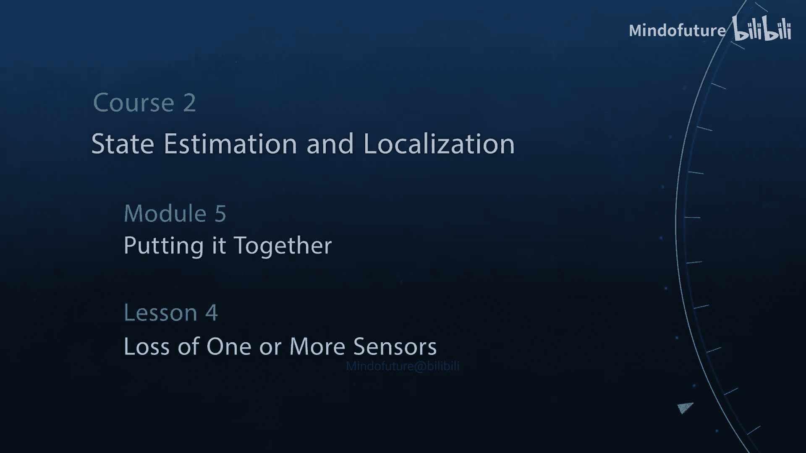
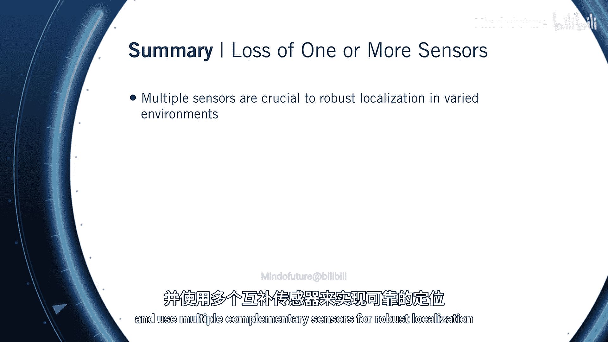
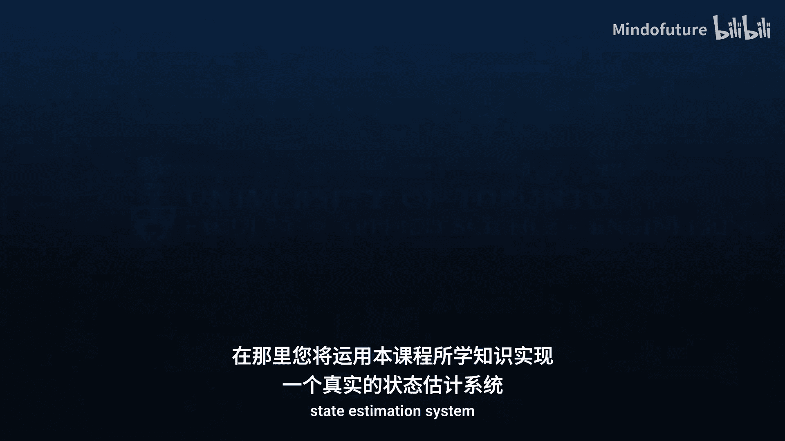

# 【多伦多大学】自动驾驶汽车的状态估计和定位 ｜ State Estimation Localization Self Driving Cars p31 P31_第四课_单传感器或多传感器失效应对_06_01_06 -BV1WysszdEDx_p31-

If you've ever had to create any sort of moving robotics platform。

 you'll probably recall how finicky any piece of hardware can be。Sensing hardware is no different。

In long term autonomy applications like self driving vehicles。

 sensors can malfunction or drop out for a number of different reasons， like weather damage。

 firmware failures or something as simple as a loose wire。

 We've seen in this module that even if all of our sensors are working normally。

 it's still beneficial to have multiple complementary sensors to provide robust。

 accurate localization estimates。But what happens if one of the sensors fails。So far。

 we've discussed G NSS receivers， IM Us and Lars， but most modern autonomous vehicles also include sensors like wheel encoders。

 radar， sonar and multiple cameras。😊，In order to build a safe vehicle。

 it's crucial to understand and characterize what happens when one or more sensors malfunctions and the minimal sensing we need to maintain safe operation。

In this lesson， we'll discuss the importance of sensor redundancy for robust localization。

And explore several examples of sensing failures in localization。

One important consideration for this type of analysis is sensor range and operating limitations。

A GNSS receiver will not work under a bridge and may have reduced accuracy between tall buildings。

An IM U may be sensitive to temperature and may require periodic recalibration。

What's more for sensors that observe the external world like Liars， Soar， cameras or radars。

 their sensing range plays a very important role in safe operation。😊，Most cars have long。

 medium and short range sensing。 If one of these malfunctions。

 it's often important to restrict movement so that the malfunction doesn't affect safety。For example。

 in localization， we may use short range sensors for parking and to ensure we're not colliding with nearby vehicles。

Medium range sensors may help in pedestrian and cyclist detection and in lane keeping。

Longer range sensors can help us detect and predict the motion of approaching distant obstacles。

If one of these fails， we have to take appropriate action to ensure that the safety of the car occupants or the people around us is not compromised。

This means that a self driving car engineer will have to consider the minimal allowable sensing equipment necessary to perform each of these steps。

For this type of redundant system design， we can look at examples from an industry known for its rigorous safety standards。

 commercial aviation。As an example of a redundant system。

 consider the primary flight computer of the Boeing triple 7。

The triple 7 operates on a triple redundancy principle。All major systems。

 including this flight computer， have two backups， each with independent power and separate programming and specifications。

Here， you can see that each of the flight computers has a different processor to ensure that a bug in the architecture itself doesn't affect all three computers。

If one of the computers fails or malfunctions， the triple 7 uses a consensus algorithm to seamlessly switch to another one。

Although self driving technology has come a long way。

 we're still only a decade beyond some of the first self driving challenges。

 like the 2007 DARPpa Urban challenge。Here you can see how a lack of safety redundancy leads the M I T and Cornell teams to crash into each other。

If this crash occurred at higher speeds， the results may have been much worse。

Taking a more recent example， here's a car from the 2015 International driverless Vehicle Conference that fails to apply its autonomous braking appropriately and crashes into a blown up kangaroo。

Finally， consider this now infamous recording of a Tesla model S driving almost straight into a dividing barrier on a freeway in California。

😊，This was a sobering reminder that it is crucial for the engineers and architects who designed self driving vehicles to carefully consider and characterize the different failure modes of the different sensing paradigms used in order to show that one malfunctioning component。

😊，Doesn't cause tragedy。To summarize， it's always important to consider the limitations of any set of sensors and use multiple complementary sensors for robust localization。

That's it for this module。 Next， you'll start your course project。

 where you'll use everything you've learned in this course to implement a realistic state estimation system。

😊。

