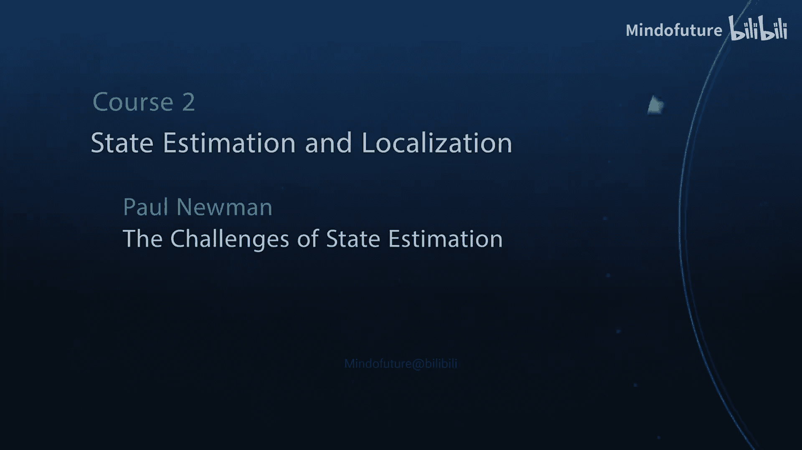
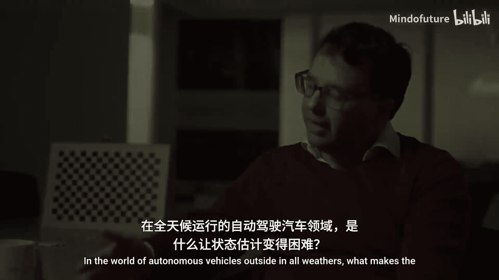

# 【多伦多大学】自动驾驶汽车的状态估计和定位 ｜ State Estimation Localization Self Driving Cars p32 P32_状态估计面临的挑战_06_02_01 -BV1WysszdEDx_p32-

We've agreed between us that state estimation is important。

 wouldn't it be great if that was also then an easy problem？😊，Unfortunately， it's well hard。Why well。

 because the center data that we're being asked the process to answer the question， for example。

 where am I， how am I moving， what's that individual over there going to be doing because I've got an idea of their velocity？

The sensor data that we're processing is often foul。It's really difficult， it's confusing。

 we've got shadows， we might have things blowing across the street。

 I actually don't know where I am as I'm moving， but I've got to be tracking and identifying someone moving in front of me the laser data might be sparse。

 the sun might be out and part of the image might be not properly exposed maybe there's rain on it it's just really。

You know what sometimes people say it's noisy data and I'm trying to move away from that This there is noise and sensor data。

 but very often it's just really complex data， So for example。

 if you're processing radar people say radar is really noisy。

 No it's just really complicated because I've got EMways bouncing off everything and eventually coming back to me maybe yeah so that' must makes it hard So processing GPS data is you might say a state estimation that's a lot easier because you've almost been given position and it's a bit cluttered and you get bouncers off buildings and that's an easier case but try to do that of radar or laser that's a lot more complex So the thing that makes data estimation hard so often is the processing of complex signals and there's one topic in particular that can make it hard and that's data association So that is associating some elements and attribute that you see in the data to an entity in the world。

Example of that might be， I'm seeing， I want to estimate the state of a crowd of individuals and I've got lots of velocity measurements that I'm getting coming back which measurement belongs to which entity in the world that's a hard problem or I've got a laser that scanning and it's seeing say lots of maybe creases points。

 corners Imagine you're doing something simple you sort of tracking corners in laser data。😊。

And people are moving or vehicles are moving。 How do I associate a subset of the laser returns from a scanning laser to a car。

 How many cars are there， No one told me to start with， there may be some cars。

 or maybe that was actually the corner of a building。 And it was never moving in the first place。

 but to start with it looked like a bus。 So the thing that kills me again and again is this state association problem。

 And and many times if I was able to know my state。 So I knew where I was and what was around me。

 the data association problem becomes trivial。😊，The problem is you've got to solve the data association problem to solve the state estimation problem and you're getting this sort of hideous recursion and that's fun and hard and it seems to come up day after day after day in a different guysise in the world of autonomous vehicles outside in you all weathers what makes state estimation hard It's when the input stream。

 the camera images or the laser stream it's influenced by very challenging condition So when using a camera it's torrential rain with a low sun you know so in the UK the sun sort of just skirts over the horizon。

 it seems most of the time in the winter that can be really， really hard because everything's very。

 very shiny and the world changes appearance or you can be in the case where you're in really。

 really very heavy traffic and using a laser and two giant trucks pull up beside you and you basically can't see anything because the world just turned。

😊。

Into truck okay so you know so when your world gets obscured。

 the things you're looking for and the world get obscured or they're appearing to changes。

 that can be confusing。 or when they're moving very slowly past you and you're actually still and maybe you don't have an autoitory signal at that point So again。

 it's the data association problem。 So when the data association problem becomes hard and it becomes hard to relate what you are seeing with respect to what you wish you could infer that becomes hard。

 in fact， you can you can think about the state estimation problem is if I if I could write down an equation that explains what I'm seeing in terms of what I wish to understand about my state estimation。

 So can I explain a measurement in terms of my state we have tools that can invert that。

 But if you can't write down that explanation， you can't explain why the whole pictures gone white and there's rangerops on it in terms of your angular acceleration。

 then that becomes quite difficult。So it's always the complexity of the input signal that makes that confusing otherwise we would just run a vanilla optimization and would be running home happy so none of the sensors really that we're using at the moment are good enough for we want。

😊，So let's just split cameras。 So compared to our eyes， Oh boy， Yeah。

 so in terms of the dynamic range that they can see。

 know the fact that I can be coming out of a car park and simultaneously see the detail in the dark and also the bright road that I'm moving out into。

 So we need to make progress on those on those cameras as well。

 there's lots of stuff being done on cameras's sort of like edge cameras there's high dynamic range cameras what I'd like to make programmable。

 So there's a lot of work to be done there。 the lasers need to be better。 there's still waste bass。

 So know we throw a few photons out there but nothing nothing like as many as we need and they don't go far enough。

 so that's not good enough。 radar is like Gene zero know it's nothing like good enough to what they'll be。

 but here's a really cool thing that's just gonna to get better anyway， just like computers are。

 So you know so we'll start making the first generation of Avs with the sensors。

We got with the vehicles that we got with the software that we got。

 with the algorithms that we' got with the data that we got on the machine learning that we know now。

😊，And that will be all be better in three years and all be better in six years。

 just like in computers， we had better RAm， better hard disks， better processor， better screens。

 better internet， better networks。 They all evolve together。 And because of that。

 we have better software now。 So it's a similar sort of ecosystem of hardware。

 software and applications moving forward。😊。

