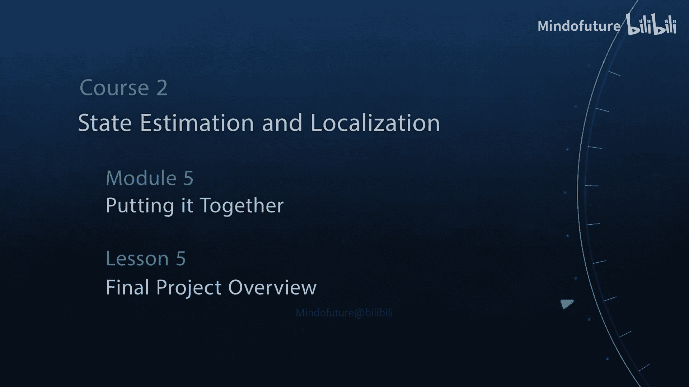

# 【多伦多大学】自动驾驶汽车的状态估计和定位 ｜ State Estimation Localization Self Driving Cars p33 P33_最终课程项目概述_06_03_01 -BV1WysszdEDx_p33-

All right。Now that you've learned about least squares， linear and nonlinear common filters。

 GPSN and INS sensing for Po estimation， and LiDAs。

 it's time to put everything together for the final project in this course。By this point。

 you should have a solid grasp of the methods commonly used for vehicle state estimation and be ready to test your knowledge in a more realistic scenario。

For this project， you will have an opportunity to apply much of what you've learned throughout this course。

 as well as observe the inner workings and interactions of various components found in a full state estimation pipeline。

For the project， you'll be provided with a data gathered during a test drive in the carless simulator。

The data set contains measurements from a sensor array on a moving， self driving car。

The sensor array consists of an I M U， A GN S receiver， and a lidar。

 all of which provide measurements of varying reliability and at different rates。While driving。

 the vehicle is subject to various dynamic effects caused by the environment。

 the drive train and the suspension。These effects are difficult to accurately model。Therefore。

 in a self driving scenario， the vehicle controller will rely on measurements acquired by the sensors。

Your goal is to implement a state estimator that fuses the available sensor measurements to provide a reasonable estimate of the vehicle's pose and velocity。

Specifically， you will be implementing the error state extended common filter。

 as described in module 2， since it provides a high degree of robustness and is a staple in state estimation。

We provide you with a skeleton for the estimator pipeline。

 which you will fill out using your own implementation at each individual step。

In the main filter loop， you will first update the state and the uncertainty using IMU readings。

Whenever a GNS or Lidar measurement becomes available。

 you will execute the appropriate common gain computation， astate and covariance updates。

You will have access to the actual pose and velocity values from Kla for a large section of the trajectory。

 so you will be able to compare your trajectory estimates to the ground truth data。

The project will be graded based on the accuracy of the trajectory estimate on a section of the trajectory for which you do not have access to ground truth。

By the end of this project， you should have a good understanding of the main components that make up a standard state estimation pipeline for an autonomous vehicle。

😊，If you have any questions that I didn't answer in this video。

 there are further instructions in the programming assignment itself。

 and you can always ask for more information in the discussion forums as well。

I hope you have fun with the final project， and I'll see you again once it's completed。😊，Good luck。

