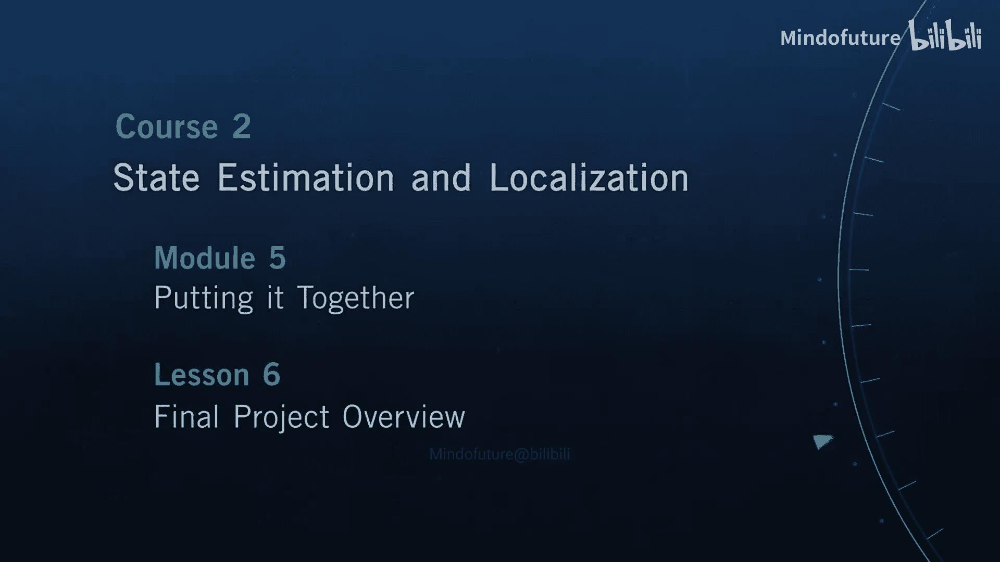
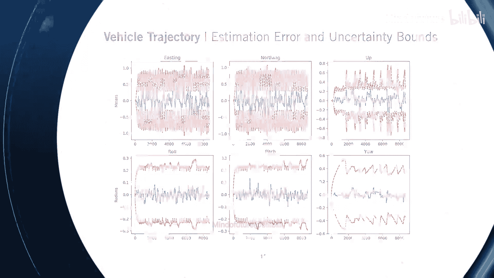

# 【多伦多大学】自动驾驶汽车的状态估计和定位 ｜ State Estimation Localization Self Driving Cars p34 P34_最终项目解决方案（已锁定）_06_03_02 -BV1WysszdEDx_p34-

Congratulations on submitting your course to final project。😊，Hopefully。

 you were able to produce an accurate estimate of the vehicle's trajectory using the measurements from the carless simulator。

Now you'll have a chance to compare your implementation to our project solution。

Let's first review the general structure of the error state EKF estimator。

IMU measurements are used to drive the motion model forward in time at a high update rate。

 producing the predicted state estimate。Whenever a position measurement from either the GNSS receiver or the LiIDAar unit arrives。

 we incorporate the measurement by performing the common filter update step。

The result is the corrected state estimate。This prediction correction loop continues as long as the vehicle is driving。

Let's now examine portions of our solution code， starting with the lines that allocate space for the state vector that is the position。

 velocity and orientation of the vehicle at each time step。

Note that we also allocate space for a9 by9 covariance or uncertainty matrix at each time step。

The inputs to our motion model will be the specific force and angular rotation rate measurements from the IMU。

Throughout this video and on the slides we'll highlight code blocks on a light gray background。

The code on this slide was already provided for you。

We set our initial vehicle pose that is position an orientation to be equal to the ground truth pose at the start of the trajectory。

Here we have also set the initial pose covariance to be0 since the ground truth pose is exact。

In the code provided to you， we initialized the state with a non zero covariance。

Primarily to illustrate how the relatively accurate GNSS and LiDar measurements can rapidly reduce the pose uncertainty。

Let's now look at the main loop of the aerostate extended Common filter。As part of the loop。

 we iterate over each IMU measurement， propagating the state estimate forward in time。

Our solution uses the nonlinear motion model defined in module 5 lesson 2。

 which takes the specific force and angular rotation rate measurements from the IM U as inputs and outputs an updated state estimate。

 That is the pose and velocity of the vehicle。Note that we make use of the pose and velocity estimate at the previous time step to predict our current state。

Over time， this dead reckoning approach accumulates error。

The motion model equations shown on the slide translate directly and fairly easily into Python code。

We assume that the vehicle undergoes constant linear acceleration and a constant angular rate of rotation over the short time interval Delta T。

There is one difference in our solution code compared to the equations shown on the slide。

Instead of computing the 4 by 4 matrix big omega from the incremental rotation quaternion。

 which defines the vehicle rotation over the time interval deelta T。

We have chosen to use Quaternian multiplication。The Queternian class already supports Queternian multiplication and in fact。

 computes this 4 by four matrix internally。This code was provided to you。

We've now propagated the nominal state。 that is our prediction forward in time。However。

 the nominal state ignores noise and perturbations。

The error state extended common filter algorithm captures these deviations in the error state vector。

 which incorporates a minimal three parameter orientation error。

Our next step is to consider the linearized aerodynamics of the system。

The formula and relevant matrices are shown on this slide。

Derriving these Jacobbian matrices is reasonably complicated。

 and so we'll use them here without working through the full derivation。The matrix L is constant。

 in fact， and so we can pre allocatecate it in advance。As an important note。

 the Jacobian matrixtri F has its specific form because we have chosen to make use of a global orientation error representation rather than a local orientation error。

Learners who are interested in the details of this derivation can find out more by reading the extensive technical report by Sola。

 a link is provided in the resources section of the module。Next。

 we'll propagate the state uncertainty forward in time。

We'll use the Jacobbian matrix F sub K minus-1 that we computed previously。The matrix L is constant。

 as we said， and can be precomputd。The result of the covariance computation is the updated covariance matrix at time step K。

Note that we may perform this propagation step multiple times before a measurement arrives from either the GNSS receiver or the LiDar sensor。

After completing the prediction step within the filter。

 we check to determine if a GNSS receiver or LiIDAR measurement is available。

If a measurement from either sensor has arrived， we carry out the appropriate measurement update。

 That is the correction step。Remember that the IMU update rate is substantially faster than that of the GNSS unit or the LDar scanner。

 so we may perform multiple prediction steps between measurement updates。For convenience。

 we've defined a new function to perform the measurement update。

The function accepts the current state and current state covariance。In our case。

 both the GNSS receiver and the Lidar sensor provide position updates directly。

 and so the measurement Jacobian matrix， capital H is constant and can be pre computeutd。

The only difference between a GNSS update and a lidDar update is the variance of the measurement noise。

 as indicated on the slide。To perform a measurement update or correction。

 we first compute the common gain matrix， capital K， sub small K for this time step and measurement。

The equation for the common game can be easily translated into Python code。

We use the common gain matrix to compute the error state。

 considering the innovation or difference between our predicted vehicle position， Pche sub K。

And the measured position， Y sub K。The errorero state vector is then used to update the nominal state vector。

For the position and velocity states， the update involves simple addition。For the orientation update。

 however， we need to use quaternian multiplication。Also。

 note that we have chosen to represent our orientation error in the global frame。

And so the quaernian multiplication is carried out with the error state quaternion on the left。

Finally， we compute the corrected nominal state covariance matrix。Capital P hat subK。

The corrected state and state covariance are returned by the function。And that's essentially it。

We have completed the implementation of the full error state extended common filter for vehicle navigation。

Although we've used sensor models that are simplified to some extent。

The filter you've built is essentially the same as one that would run on board a real self driving car。

The resulting trajectory estimate can then be compared to the ground truth。

Looking at the ground truth and at our estimate， we see that the vehicle was following a curved path with several turns。

We've only plotted ground truth for the portion of the trajectory provided to you in advance。

The remaining trajectory used to test your code has been held back to allow for validation。However。

 you can see what the full trajectory looks like by examining the estimator output。

 which is really quite accurate。Now let's look at our estimator error relative to the ground truth。

On these plots， the dashed red lines represent three standard deviations from the ground truth。

 according to our estimator。This gives an indication of how well our model fits the actual dynamics of the vehicle。

And how well the estimator is performing overall。The estimation error should remain within the three sigma bounds at all times。

 as it does here。This is the solution for Part one of the final project。In parts 2 and3。

 you examine the implications of sensor miscaibration and of sensor dropout。However。

 the filter code you wrote should not have changed for these cases。

You should have just needed to make some small adjustments to certain parameters。

There are other estimators you could have implemented to solve this problem。

 like the vanilla E KF or the uncented common filter。

You're welcome to compare these implementations to the E， S， E KF and let us know how they do。 Again。

 congratulations on finishing your course 2 final project。

 State estimation is a vital part of any self driving car software stack。 A from G。

 NS S S and liddar measurements， Many other sensors and sources of information are often used to produce reliable estimates for self driving cars。

 You'll learn more about a very important sensor in the next course of the specialization。

 The camera and how to use it for visual perception。 Keep up the great work。😊。

