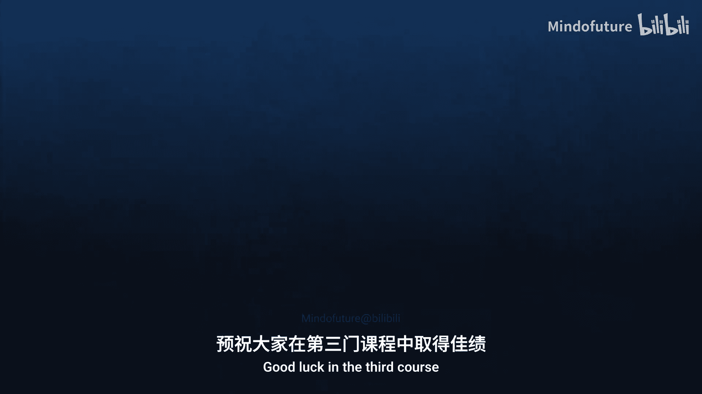
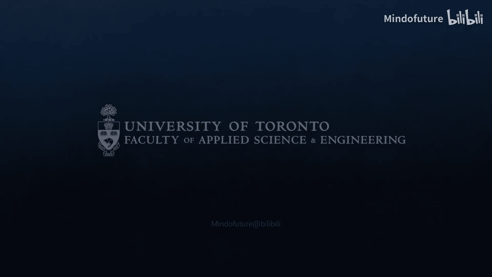

# 【多伦多大学】自动驾驶汽车的状态估计和定位 ｜ State Estimation Localization Self Driving Cars p35 P35_恭喜完成第二门课程_06_04_01 -BV1WysszdEDx_p35-

Wow， what a journey。 Congratulations on finishing the second course in our self driving car specialization。

 Let's take a moment to reflect on and summarize what you've learned in this course。😊。

You learn how to apply state estimation and localization techniques to a selfdriving car。

 You should now be familiar with the method of least squares for estimating vehicle。

 state and other parameters， as well as its relationship to the linear common filter for doing state estimation recursively。

 You should also now know about three different ways of adapting the linear common filter to nonlinear state estimation。

 The error state extended common filter， which estimates small corrections to a nominal state。

 rather than estimating the full state， and the unscented common filter。

 which uses the unscented transform to pass probability distributions through nonlinear functions by operating on a small number of carefully chosen samples。

😊，You learned about different types of sensors commonly found on self driving cars。

 including GPS or GNSS receivers， inertial sensors and LiDar units。

You now know how to model these sensors and use them for state estimation。

 either separately or together in a sensor fusion pipeline by developing a full vehicle state estimator for a self-driving car。

 Hopefully， you now have an appreciation for why sensor fusion and calibration are so important。

 as well as an understanding of how the performance of a self-diving car is affected by sensor dropouts。

 In the next course， Stephen is going to teach you about another common sensor that we didn't cover in this course。

 The camera。😊，As you'll learn， we use visual perception in so many aspects of self driving that it deserves its own course。

 You're in good hands with Stephen。 Good luck in the third course。😊。

