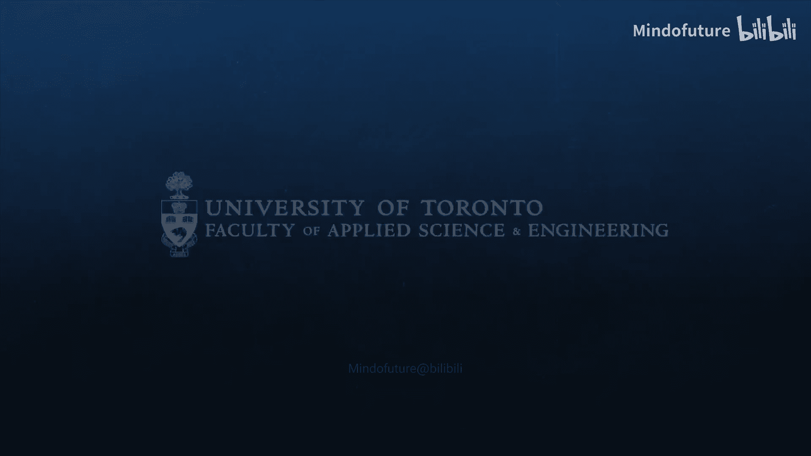
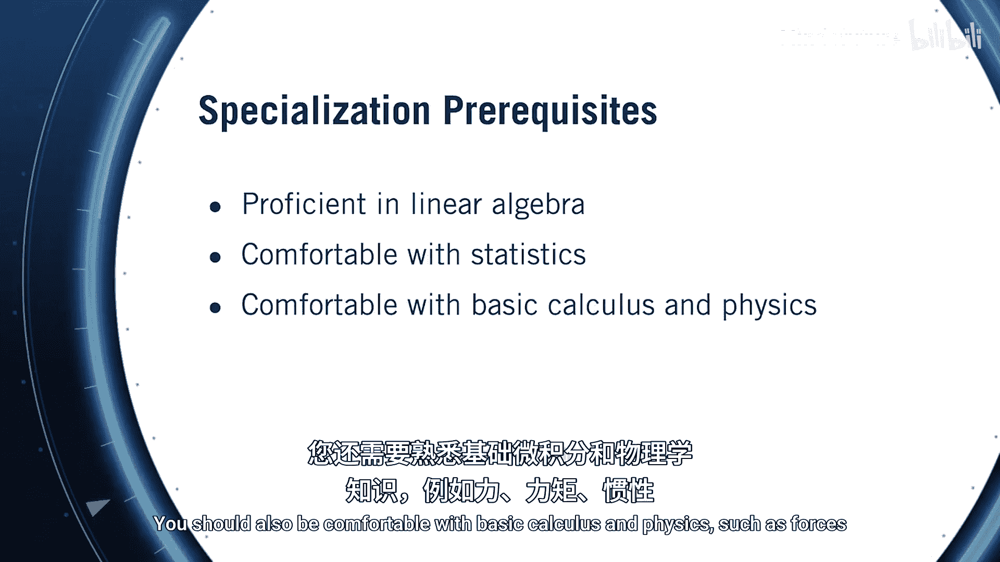

# 【多伦多大学】自动驾驶汽车的视觉感知 ｜ Visual Perception Self Driving Cars p01 P01_欢迎学习自动驾驶汽车专项课程_01_01_01 -BV1nDsszQEdf_p1-

嗯。

啊。Hello and welcome to the University of Toronto's Self driving car specialization。My name is Steven。

And my name is Jonathan and we'll be your instructors throughout this specialization the self-driving car is the sleeping giant which can change everything。

 road safety， mobility for everyone while dramatically reducing the costs of driving this specialization will teach you what you need to know to kickstart a career in the autonomous driving industry。

Whether you're coming from academia or industry， these courses will provide you with the foundational knowledge and practical skills you need to help build a new future with self-driving cars Throughout the courses we'll show you real world data and scenarios from our research。

And from our own self driving car or what we call the autonoousose。

After decades of applied and award winning research。

 we at the University of Toronto are excited to show you the nuts and bolts of autonomous driving there are a total of four courses in this specialization。

In the first course， I'll introduce you to the self driving Car software and hardware architectures by the end of this course you'll be able to design a basic hardware system for a self driving car。

Identify the main components of the autonomous driving software stack and create a safety assessment strategy for a self-driving car program you'll then learn to develop the complete model of a vehicle's motion define a PI controller for longitudinal control define a path following controller for lateral vehicle control and test out your control designs in the carless simulator in the second course of the specialization I'll teach you about state estimation sensing and localization for autonomous vehicles by the end of this course you'll understand the key methods for parameter and state estimation。

Develop and use models for typical vehicle localization sensors。

Apply extended and unscented columnman filters to a vehicle state estimation problem。

And register point clouds created from LiDar scans to a 3D map of a static environment。

In the third course I'll teach you about visual perception for self driving cars After completing this course you'll be able to project 3D points onto the camera image plane。

Caalibrate the pinhole camera model。Apply feature detection。

 description and matching algorithms for localization and mapping。

Develop and train neural networks for both object detection and semantic segmentation。

You'll apply these methods to vehicle tracking and drivable surface estimation。

 and in the fourth and final course I'll teach you about motion planning for self driving cars。

By the end of this course， you'll be able to devise a trajectory rollout motion planning method。

 calculate the time to collision with static and constant velocity objects。

Plan routes over complex road networks。Define high level vehicle behaviors and transitions for vehicles navigating through intersections around parked cars and merging。

And develop kinematically feasible paths through an environment with static obstacles。

Compute velocity profiles that satisfy speed， curvature。

 and moving object motion planning constraints。Plan behaviors and execute maneuvers to navigate safely through the world。

And gain valuable experience in debugging and testing self driving algorithms in the Carlos simulator。

So by the end of the specialization， you will have a detailed understanding of the architecture and components of the autonomous driving software stack。

And we'll program your own self driving car。Since we're teaching you how to program your own self driving car。

 the courses in this specialization have several prerequisites。First。

 you should be proficient in linear algebra and be familiar with matrices， vectors。

 matrix multiplication， rank， eigenvalues in vectorctors and inverses this background will help you with control。

 state estimation， perception and planning algorithms throughout the courses。

You should also be comfortable with statistics and in particular working with Gaussian probability distributions。

This knowledge will be important for state estimation and for perception when we're estimating vehicle speed and heading from GPS and inertial measurements。

 for example， you should also be comfortable with basic calculus in physics such as forces， moments。

 inertia and Newton's laws。

It's certainly helpful to know how to drive a car， but since the cars will be self driving。

 it's not a hard requirement for this specialization。If you don't have these necessary prerequisites。

 there are excellent robotics， AI， deep learning and other courses that you can take on Coursera to prepare you for this specialization Autonomous driving is a constantly evolving and changing field。

 so keeping up not only with self-driving knowledge but also robotics AI and deep learning will help you keep your technical skills sharp。

There's a long way to go and we need pioneers to help us get there。So are you ready for the ride？

🎼Yeah。

