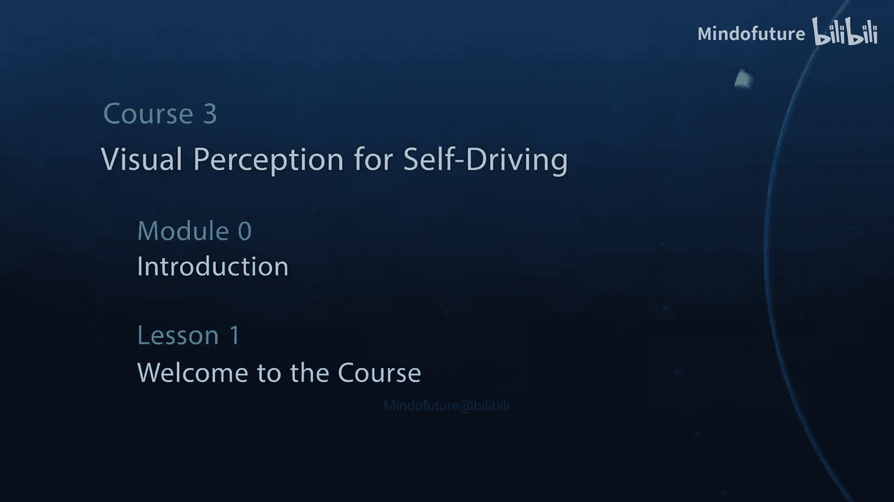
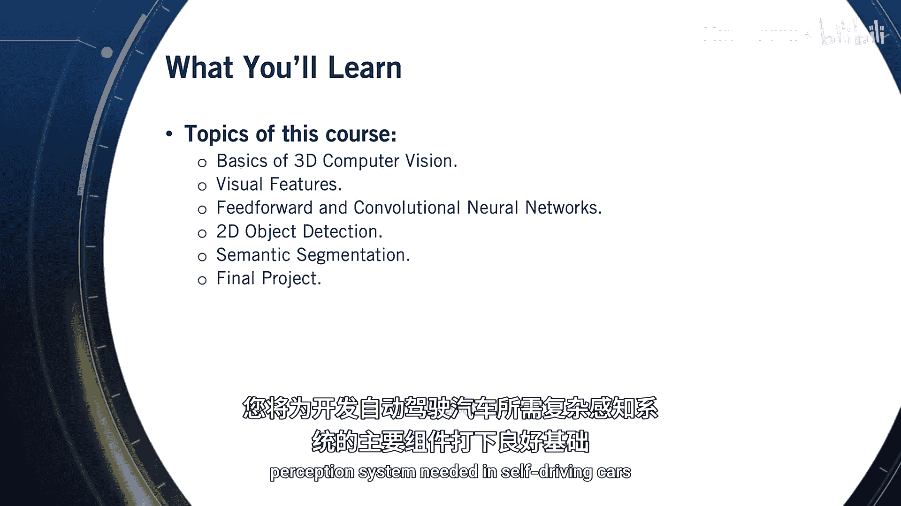
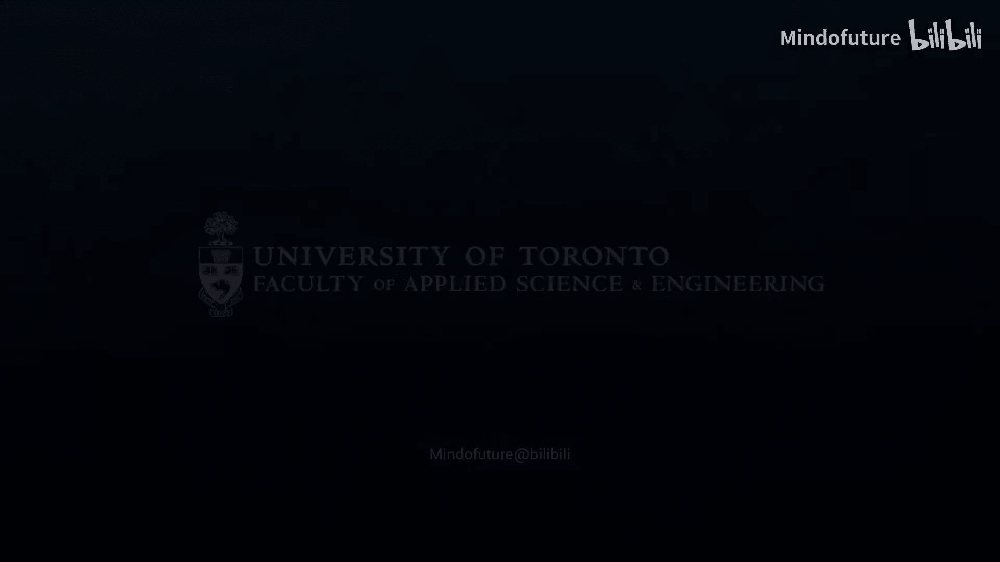

# 【多伦多大学】自动驾驶汽车的视觉感知 ｜ Visual Perception Self Driving Cars p02 P02_欢迎学习本课程_01_01_02 -BV1nDsszQEdf_p2-

嗯。哦。

Welcome to the visual perception course of the University of Toronto' Self drivingiving car specialization。

 My name is Steve， and I'll be your instructor once again throughout this course。 By now。

 you should have completed the first two courses in the self driving car specialization。

 In these two courses， you learned how to build model control and localize the self drivingriv car。

 using a variety of sensors， including GPS， IM U and Lidar sensors。

 This course will focus on one of the most versatile sensors for the self drivingiv car。 The camera。

😊，Cameras act as the eyes of the self driving car。The cars use cameras to detect agents on the road。

Model their movement and model their behaviors。 Images from the camera can also be used to detect and localize road markings。

 signals and signs to allow for safe and lawful driving behavior。

 We can use cameras for localization， similar to the Liar sensors。By the end of this course。

 you will be able to use and calibrate these cameras to build baseline perception stack for self driving cars。

 So now let's go through the course syllabus to see what you will learn about each week。😊。

The first module of this course will introduce the basics of 3D computer vision。

You will learn how images are formed。The camera projective geometry。

How to calibrate cameras and how to generate 3D point clouds from the cameras through stereo vision。

Finally， you'll learn how to process images with common image filters。In the second module。

 you will learn how to extract useful information from images through hand engineered features。

You will learn how to extract these features， provide them with descriptors。

 and learn how to match these features with each other。Finally。

 we'll use these matched features to localize a camera， a process known as visual odoometry。

In the third module， we will cover neural networks。

 a concept that has changed how we think of perception for self driving cars。During this module。

 you will learn about the building blocks of feed forward neural networks。

 how to train these networks， and how to evaluate their performance。Also。

 you will learn about a special type of feed forward neural network。

 convolutional neural networks that are tailored to process images from cameras。In the fourth module。

 you will use neural networks to perform 2D object detection。

 a joint classification and regression task。You will learn how to formulate the 2D object detection problem。

 how to evaluate 2D object detection models。How to build neural networks that perform the 2D object detection task。

And how to use the output of 2D object detectors in the context of self driving cars。Specifically。

 you will use 2D object detection results to predict 3D position and track objects of interest in road scenes。

 the fifth week of the course will cover semantic segmentation。

 another important component of a self-driving car's perception stack。

Similar to the 2D detection module， you will learn to formulate the semantic segmentation problem。

Evaluate semantic segmentation models and perform semantic segmentation tasks using convolutional neural networks。

Finally， you will learn how to use semantic segmentation output to perform drivable space estimation and lane boundary detection。

For the final week of the course， you will apply everything you've learned to the final course project。

This project will require you to implement a self driving car obstacle avoidance system using only camera data as your input。

By finishing this course， you will have a good starting point for developing the major elements of the complex perception system needed in self driving cars。

Hopefully you will find this course enjoyable and beneficial for your career。

 whether you want to become a self driving car researcher， perception developer。

 or a system integrator， it's a great day to build self driving cars。

