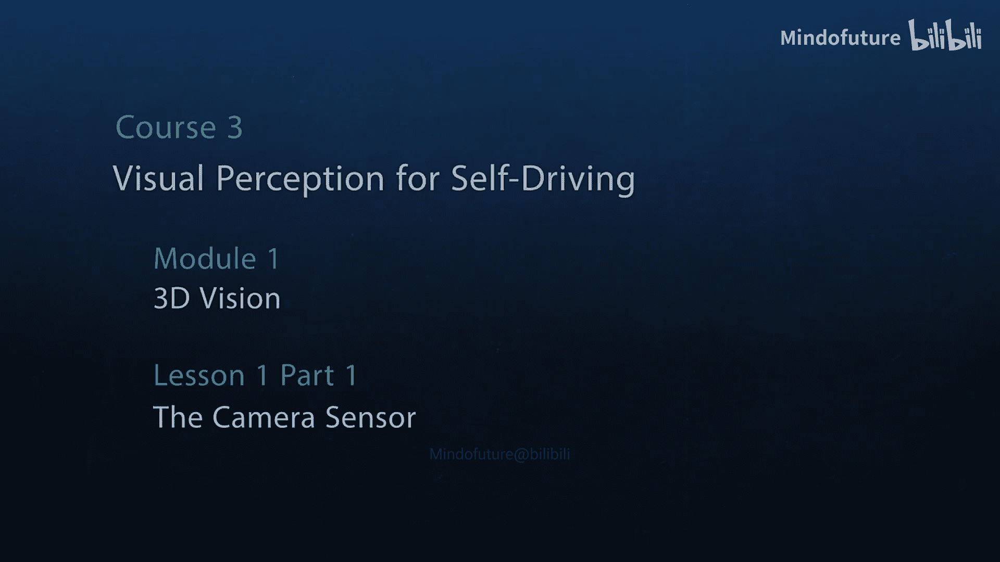
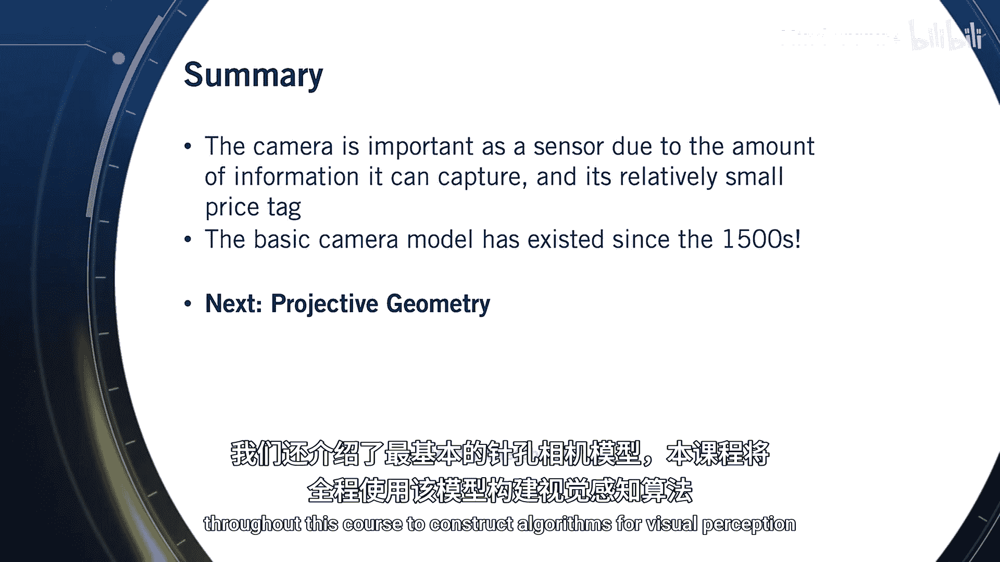

# 【多伦多大学】自动驾驶汽车的视觉感知 ｜ Visual Perception Self Driving Cars p05 P05_第1课第1部分-摄像头传感器_02_01_01 -BV1nDsszQEdf_p5-

。

Hello， everyone， and welcome to the visual perception course of the selfdriving car specialization。

 You've probably noticed that most major players in the autonomous driving industry have a camera as their primary sensor in their vehicle sensor suite。

 The camera is a rich sensor that captures incredible detail about the environment around a vehicle。

 but requires extensive processing to make use of the information that's available in that image throughout this course。

 you will get handson experience on how to algorithmically manipulate camera images to extract information useful not just for autonomous driving。

 but for robotic perception in general。 In the first module in week one of this course will provide you with an overview of important concepts related to cameras and computer vision。

 This module is only meant as a high level summary of the basics of computer vision。

 So will move quickly through a large number of topics。😊。

To develop more in depth knowledge in this area， have a look at the computer vision courses also available on Coursera In this first video。

 we will highlight why the camera is a critical sensor for autonomous driving。

 We will then briefly introduce the concept of image formation and present the pinhole camera model which captures the essential elements of how a camera works in a simple and elegant manner。

 We will then show you an example of a historic camera design。

 which use the pinhole principle to create some of the earliest images ever recorded。😊。

The pinhole model will form the basis of our discussions in the next video where we investigate how to project points from the world into the camera imaging sensor。

Of all the common self driving car sensors， the camera is the sensor that provides the most detailed appearance information from objects in the environment。

 Appearance information is particularly useful for seen understanding tasks such as object detection。

 segmentation and identification。Appearance information is what allows us to distinguish between road signs or traffic light states to track turn signals and resolve overlapping vehicles into separate instances。

Because of its high resolution output， the camera is able to collect and provide orders of magnitude more information than other sensors used in self driving。

While still being relatively inexpensive。The combination of high valued appearance information and low cost make the camera an essential component of our sensor suite。

 Let us see how the camera manages to collect this huge amount of information。A camera is a passive。

 Exoceptive sensor。 It uses an imaging sensor to capture information conveyed by light rays emitted from objects in the world。

 This was originally done with film， but nowadays， we use rather sophisticated silicon chips to gather this information。

😊，Light is reflected from every point on an object in all directions。

 and a portion of these rays travel towards the camera sensor。

Look at the car's reflected rays collected by our imaging surface。

 Do you think we will get a good representation of the car on the image sensor from this ray pattern。

Unfortunately， no， using this basic open sensor camera design。

 we will end up with blurry images because our imaging sensor is collecting light rays from multiple points on the object at the same location on the sensor。

The solution to our problem is to put a barrier in front of the imaging sensor with a tiny hole or aperture in its center。

 The barrier allows only a small number of light rays to pass through the aperture。

 Reding the blurriiness of the image。 This model is called the pinhole camera model and describes the relationship between a point in the world and its corresponding projection on the image plane。

😊，The two most important parameters in a pinhole camera model are the distance between the pinhole and the image plane。

 which we call the focal length。The focal length defines the size of the object projected onto the image and plays an important role in the camera focus when using lenses to improve camera performance。

 the coordinates of the center of the pinhole， which we call the camera center。

These coordinates define the location on the imaging sensor that the object projection will inhabit。

Although the pinhole camera model is very simple， it works surprisingly well for representing the image creation process。

By identifying the focal length and camera center for a specific camera configuration。

 we can mathematically describe the location that array of light emanating from an object in the world will strike the image plane。

😊，This allows us to form a measurement model of image formation for use in state estimation and object detection。

 A historical example of the pinhole camera model is the camera Obcura。

 which translates to dark room camera in English。😊。

Historical evidence shows that this form of imaging was discovered as early as 470 B。

 C in ancient China and Greece。 It simple construction with a pinhole aperture in front of an imaging surface makes it easy to recreate on your own and is。

 in fact， a safe way to watch solar eclipse if you're so inclined。

We have come a long way since the invention of the camera Obscura。

 current day cameras allow us to collect extremely high resolution data。

 They can operate in low light conditions or at long range due to the advanced lens optics that gather a large amount of light and focus it accurately on the image plane。

😊，The resolution and sensitivity of camera sensors continues to improve。

 making cameras one of the most ubiquitous sensors on the planet。

How many cameras do you think you own。You'd be surprised if you stopped to count them all。

You'll have cameras in your phones， in your car， on your laptop。

 they are literally everywhere and in every device we own today。

These advances are also extremely beneficial for understanding the environment around a self driving car。

 As we discussed in course1， cameras specifically designed for autonomous vehicles need to work well in a wide range of lighting conditions and distances to objects。

These properties are essential to driving safely in all operating conditions。

In this introductory lesson， you've learned the usefulness of the camera as a sensor for autonomous driving。

You also saw the pinhole camera model in its most basic form。

 which we'll use throughout this course to construct algorithms for visual perception。

In the next video， we will describe how an image is formed a process referred to as projective geometry。

 which relates objects in the world to their projections on the imaging sensor。

