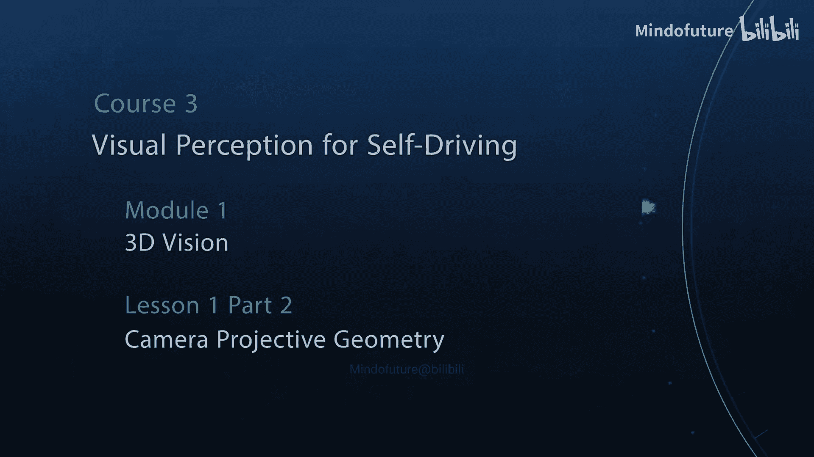
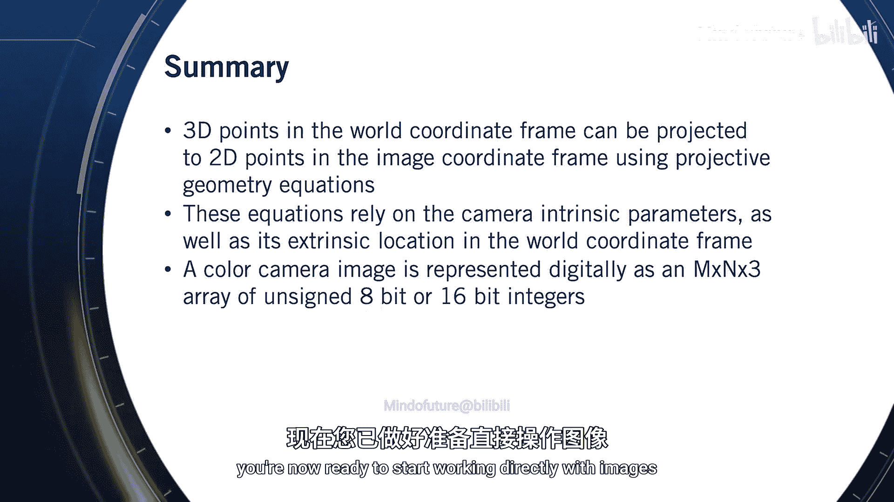
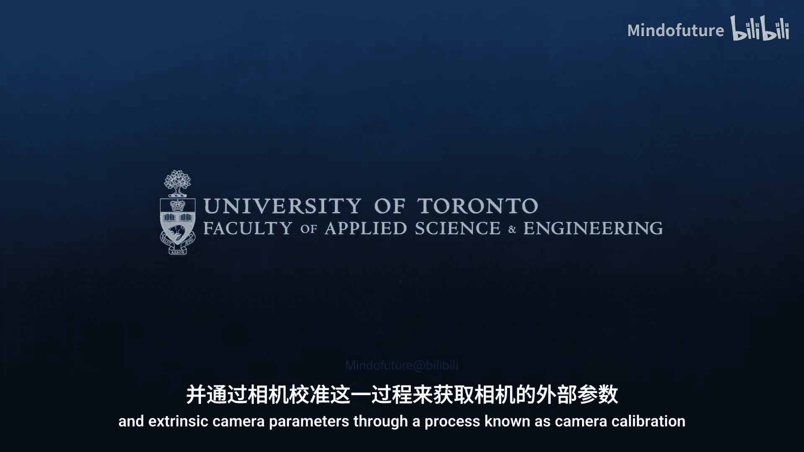

# 【多伦多大学】自动驾驶汽车的视觉感知 ｜ Visual Perception Self Driving Cars p06 P06_第1课第2部分-相机投影几何_02_01_02 -BV1nDsszQEdf_p6-

In this video， you will learn how to model the camera's projective geometry through the coordinate system transformation。

These transformations can be used to project points from the world frame to the image frame。

 building on the pinhole camera model from the previous video。

Recall that you have already used transformations extensively in Co 2。

You will then model these transformations using matrix algebra and apply them to a 3D point to get its 2D projection onto the image plane。

Finally， you will learn how Cam 2D images are represented in software。

Equipped with the projection equations and image definitions。

 you will then be able to create algorithms for detecting objects in 3D and localizing the self driving car later on in the course。

First， let's define the problem we need to solve。Let's start with a point O world defined at a particular location in the world coordinate frame。

We want to project this point from the world frame to the camera image plane。

Light travels from the point O world on the object through the camera aperture to the sensor's surface。

You can see that our projection onto the sensor surface through the aperture results in flipped images of the objects in the world。

To avoid this confusion， we usually define a virtual image plane in front of the camera center。

Let's redraw our camera model with this sensor plane instead of the real image plane behind the camera lens。

We will call this model the simplified camera model and need to develop a model for how to project a point from the world frame coordinates X。

 Y， and Z to image coordinates U and V。We begin by defining the following characteristics of the camera that are relevant to our problem。

First， we select a world frame in which to define the coordinates of all objects and the camera。

We also define the camera coordinate frame as the coordinate frame attached to the center of our lens aperture。

 known as the optical sensor。As we learn from course 2。

 we can define a translation vector and a rotation matrix to model any transformation between a world coordinate frame and another。

 And in this case， we'll use the world coordinate frame and the camera coordinate frame。😊。

We refer to the parameters of the camera pose as the extrinsic parameters。

 as they are external to the camera and specific to the location of the camera in the world coordinate frame。

We define our image coordinate frame as the coordinate frame attached to our virtual image plane emanating from the optical center。

The image Pixel coordinate system， however， is attached to the top left corner of the virtual image plane。

So we'll need to adjust the pixel locations to the image coordinate frame。Next。

 we define the focal length as the distance between the camera。

And the image coordinate frames along the Z axis of the camera coordinate frame。 Finally。

 our projection problem reduces to two steps。😊，We first need to project from the world to the camera coordinates。

Then we project from the camera coordinates to the image coordinates。

We can then transform image coordinates to pixel coordinates through scaling and offset。

We now have the geometric model to allow us to project a point from that world frame to the image coordinate frame whenever we want。

Let us formulate the mathematical tools needed to perform this projection using linear algebra。

 First， we begin with the transformation from the world to the camera coordinateor frame。

This is performed using the rigid body transformation matrix T， which has R and little T in it。

The next step is to transform camera coordinates to image coordinates。To perform this transformation。

 we define the matrix K as a  three by3 matrix。 This matrix depends on camera intrinsic parameters。

 which means it depends on components internal to the camera such as the camera geometry and the camera lens characteristics。

 Since both transformations are just matrix multiplications。

 we can define a matrix P as K times R and T that transforms from the world coordinate frame all the way to the image coordinate frame。

The coordinates of  point0 in the world frame can now be projected to the image plane via the equation O subimage is equal to P times O subworld。

 which is K times R and T of O subworld。So let's see what we're still missing to compute this equation。

When we expect the matrix dimensions， we notice that the matrix multiplication cannot be performed。

To remedy this problem， we transform the coordinates of the 0。0 into homogeneous coordinates。

 and this is done by adding a1 at the end of the 3D coordinates。

 as we saw in the second state estimation course。So now the dimensions work。

 and we're already ready to start computing our projections。Now we need to perform the final step。

 transforming the image coordinates to pixel coordinates。We do so by dividing X and y by Z。

To get homogeneous coordinates in the image plane。You have completed the basic camera projection model。

In practice， we usually model more complex phenomena such as nons pixels， camera access sw。

 distortion and nonunit aspect ratio。Luckily， this only changes the camera K matrix and the equations you have learned can be used as is with a few additional parameters。

Now that we have formulated the coordinates of projection of a 3D point onto the 2D image plane。

 we want to define what values go into the coordinates in a 2D color image。

We will start with a gray scale image。We first define a width n and a height M of an image as the number of rows and columns the image has。

Each point in 3D projects to a pixel on the image defined by the UV coordinates we derived earlier。

Zooming in， we can see these pixels as a grid。In gray scale。

 brightness information is written in each pixel as an unsigned api integer。

Some cameras can produce unsigned 16 bit integers for better quality images。For color images。

 we have a third dimension of value 3， we call depth。

Each channel of this depth represents how much of a certain color exists in the image。

Many other color representations are available， but we will be using the RGB representation， red。

 green， blue throughout this course。In conclusion， an image is represented digitally as an m by n by3 array of pixels with each pixel representing the projection of a 3D point onto the 2D image plane。

So in this video， you learned how to project 3D points in the world coordinate frame to doD points in the image coordinate frame。

You saw that the equations that perform this projection rely on camera intrinsic parameters。

 as well as on the location of the camera in the world coordinate frame。

As we'll see later throughout the course， this projection model is used in every visual perception algorithm we develop from object detection to drivable space estimation。

Finally， you've learned how images are represented in software as an array representing pixel locations。

You're now ready to start working directly with images and software。

 as you'll do in this week's assessments。

In the next video， you will learn how to tailor the camera model to a specific camera。

By computing its intrinsic and extrinsic camera parameters through a process known as camera calibration。

😊。

