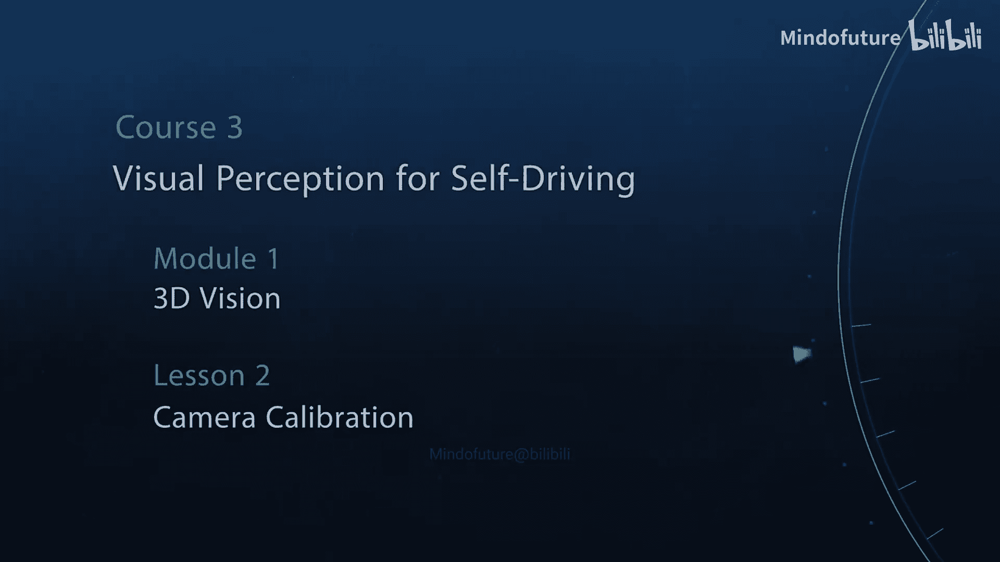
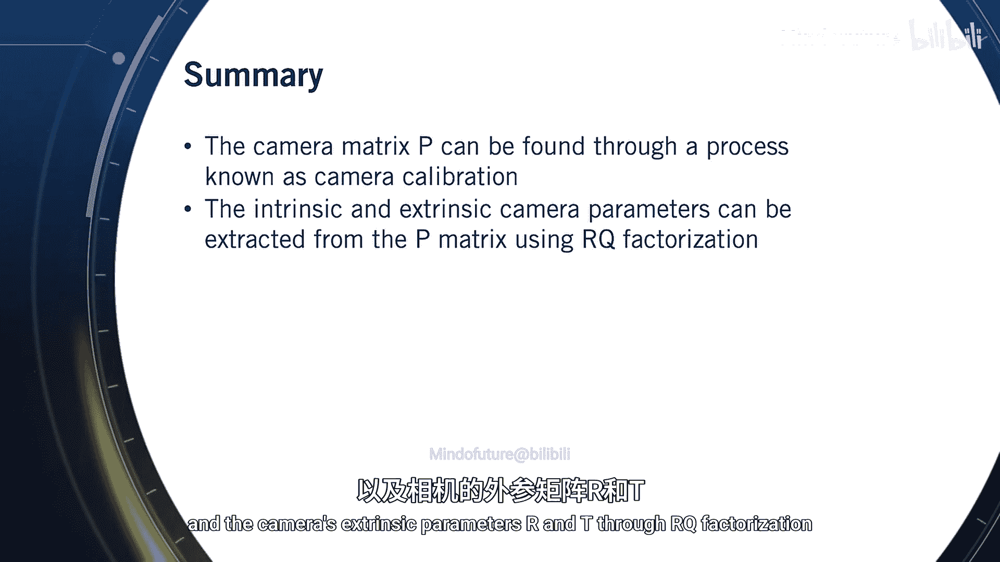

# 【多伦多大学】自动驾驶汽车的视觉感知 ｜ Visual Perception Self Driving Cars p07 P07_第2课-相机校准_02_02_01 -BV1nDsszQEdf_p7-

So far， we have learned which camera parameters are needed for projective geometry to work。

In this video， we will learn how to get these camera parameters using the mathematical tools of calibration。

Let's remember the projection equations we've learned so far。 The homogeneous coordinates of 0。

0 in 3D space can be transformed to the camera plane with the camera projection matrix P。

 which includes both extrinsic and extrinsic parameters。Remember。

 the projected coordinates need to be converted to homogeneous form to get the U and V pixel locations in pixel coordinates。

We do this by dividing the image coordinates by the Z component。Finally。

 U and V can then be multiplied with an arbitrary scale S。 We multiply by S。

 as it will be useful later on when we formulate the calibration problem。

It is important to note that scale plays a challenging role in understanding monocular image information。

 as once points are projected from the 3D world on the 2D image plane， Sc information is lost。

Points in 3D space along a from the camera center all project to the same location on the image plane。

 and it is therefore not possible to directly associate a depth to a point given only image information。

The camera calibration problem is defined as finding these unknown intrinsic and extrinsic camera parameters shown here in red。

 given unknown 3D point coordinates and their corresponding projection to the image plane。

 our approach will comprise of getting the P matrix first and then decomposing it into the intrinsic parameters K and the extrinsic rotation parameters R and translation parameters T。

For calibration， we use a scene with known geometry to get the location of our 3D points from the 2D image。

 resolving the scale issue by measuring the actual 3D distance between the points that are observed in the image。

The most commonly used example would be a 3D checkerboard with squares of known size providing a map of fixed point locations to observe。

We define our world coordinate frame in yellow and compute our 3D point coordinates and their projections in the image。

 Associating 3D points to 2D projections can be done either manually by clicking on the purple points。

 for example， or automatically with checkerboard detectors。

 we can then set up a system of equations to solve for the unknown parameters of P。 Now。

 let us form the system of linear equations that needs to be solved。 First。

 we expand the projection equations to three equations through matrix multiplication to get 0 on the right hand side of these equations。

 We move the right hand side to the left hand side for each one。

 Then we substitute the third equation into equations 1 and 2 and end up with two equations per point。

 Therefore， if we have endpoint， we have two n associated equations。

Putting these equations in matrix form gives us the shown homogeneous linear system。

Since this is a homogeneous linear system， we can use the pseudo inverse or even better the singular value decomposition to get the least squares solution。

 Our simple linear calibration approach has several advantages。 It's easy to formulate。

 has a closeform solution and often provides really good initial points for nonlinear calibration approaches。

 Can you think of some disadvantages of our simple linear system。😊。

One disadvantage of solving for P is that we do not directly get the intrinsic and extrinsic camera parameters。

 Furthermore， our linear model does not take into account complex phenomena。

 such as radial and tangential distortion。 Finally。

 since we are solving via the linear least squares method。

 we cannot impose constraints on our solution， such as requiring the focal length to be non negative。

 The camera projection matrix P by itself， is useful for projecting 3D points into 2D。

 but it has several drawbacks。 It doesn't tell you the camera's pose。

 and it doesn't tell you about the camera's internal geometry。 Fortunately。

 we can factorize P into intrinsic parameter matrix K and extrinsic rotation parameters R and translation parameters T。

 using a linear algebra operation known as the R Q factorization。😊。

Let us see how we perform this factorization。 First。

 we alter the representation of P to be a function of the camera center C C is the point that projects to 0 when multiplied by p。

 We multiply K into the matrix to form two submatrices， K R and minus KRC。

 We will refer to the combination of K and R as the M matrix。

We can now express our projection matrix P as M and minus MC。From here。

 we use the fact that any square matrix can be factored into an upper triangular matrix R and an orthogonal basis to decompose M into upper triangular R and orthogonal basis Q。

In linear algebra， this procedure is known as R Q factorization。

 which is a variant of the more commonly referred to QR factorization in QR factorization。

 we have the orthogonal Q first， and then the upper triangular R。

Note here that the R in the output of RQ factorization is a different variable than our rotation matrix R。

 so don't get those confused。 Let's now see how we can use the output of RQ factorization of the matrix M to retrieve K。

 R and T by aligning these two expressions。The intrinsic calibration matrix K is the output R of the RQ factorization of M。

The rotation matrix R is the orthogonal basis Q。Finally。

 we can extract the translation vector directly from K and the last column of the P matrix。

 R Q factorization is a great tool to compute K， R and T from the camera P matrix。 However。

 some mathematical assumptions need to be performed to guarantee a unique solution for these matrices。

 We will explore these assumptions in further detail， with this lessons' practice Jupiter notebook。😊。

Minnocular camera calibration is a well established tool that has excellent implementations in C++。

 Python and MatTLb。 You can test out some of the most common implementations by following the links we've included in the supplemental materials。

So to summarize in this lesson， you've learned that the camera projection matrix P can be found through a process known as camera calibration。

 you've learned that this matrix can be factored into the camera intrinsic matrix K and the camera's extrinsic parameters R and T through ourQ factorization。

Next up， we'll discuss how to get depth from two camera sensors through stereo visionion。

 we'll see you then。

