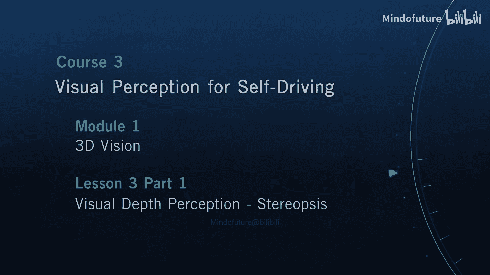
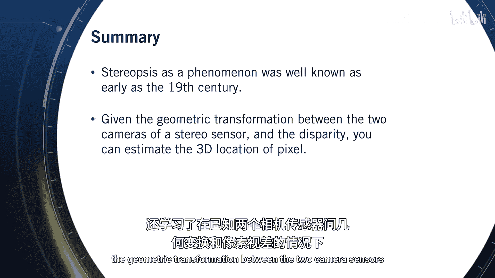
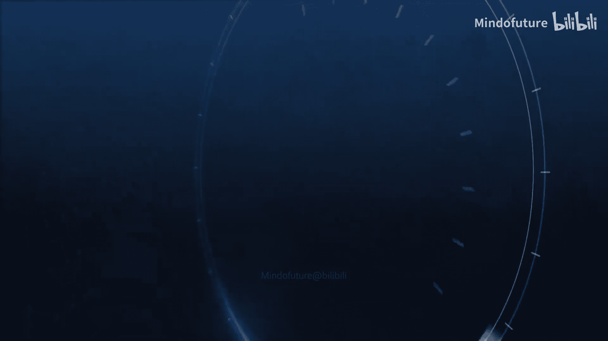

# 【多伦多大学】自动驾驶汽车的视觉感知 ｜ Visual Perception Self Driving Cars p08 P08_第3课第1部分-视觉深度感知_立体视觉_02_03_01 -BV1nDsszQEdf_p8-

Self driving cars require accurate depth perception for the safe operation of our autonomous vehicles。

If you don't know how far away the cars are in front of you， how can you avoid them while driving？

LDarR and radar sensors are usually thought of as the primary 3D sensors available for perception tasks。

 however， we can get depth information from two or more cameras using multi view geometry。

Specifically， we'll be describing the process of getting depth from two axis aligned cameras。

 a setup known as the stereo camera。In this video， we will cover the geometry of the stereo sensor。

As well as how to derive the 3D coordinates of a point given its projection onto two images of the stereo sensor。

Stereopsis， the process of stereovision， was first described by Charles Wheatstone back in 1838。

 He recognized that because each eye views the visual world from a slightly different horizontal position that each eye' image differs from the other objectsject at different distances from the eye project images into the two eyes that different in their horizontal position。

 giving depth cues of horizontal disparity that are also known as binocular disparity。 However。

 historical evidence suggests that stereopsis was discovered much earlier than this。 In fact。

 some drawings by Leonardo da Vinci depict accurate geometry of depths through stereopsis。

 up to the 19th century， the phenomenon of stereopsis was primarily used for entertainment。

 Analyphs were used to provide a stereoscopic 3D effect when viewed with 2D colored glass。

 where each lens employs different chrommatically opposite colors， usually red and cion。 Nowadays。

 we use stereo。😊，Ois with complex algorithms to derive depth from two images。

 using a similar concept to Da Vinci's drawings。 Now。

 let us delve into the geometry of a stereo sensor。

A stereo sensor is usually created by two cameras with parallel optical axes to simplify the problem even more。

 most manufacturers align the cameras in 3D space so that the two image planes are aligned with only an offset in the X axis。

 Given a known rotation and translation between the two cameras。

 and a known projection of a point0 and 3D to the two camera frames resulting in pixel locations O L and O R respectively。

 we can formulate the necessary equations to compute the 3D coordinates of the point0。

To make our computation easier， we will state some assumptions。First。

 we assume that the two cameras used to construct the stereo sensors are identical。Second。

 we will assume that while manufacturing the stereo sensor。

 we tried as hard as possible to keep the two cameras optical axes aligned。

Let's now define some important parameters of the stereo sensor。

The focal length is once again the distance between the camera center and the image plane。Second。

 the baseline is defined as the distance along the shared X axis between the left and right camera centers。

By defining a baseline to represent the transformation between the two camera coordinate frames。

 we are assuming that the rotation matrix is identity。

 and there is only a non0 x component in the translation vector。

The R and T transformation therefore boils down to a single baseline parameter B。Before proceeding。

 we will project the previous figure to B's eye view for easier visualization。Now。

 let's define the quantities we would like to compute。

 We want to compute the x and Z coordinates of the point O with respect to the left camera frame。

The Y coordinate can be estimated easily after the X and Z coordinates are computed。Remember。

 we are given the baseline， focal length， and the coordinates of the projection of the point O onto the left and right image planes。

We can see two similar triangles formed by the left camera measurement as follows。

 the triangle formed by the depth Z and the position X is similar to the triangle formed by the focal length F and the left measurement X component X L。

From this similarity， we can construct the equation Z over f equals x over xl。

The same can be done for the right measurements， but with the offset for the baseline included。

In this case， the two triangles are defined by Z and the distance x minus B。

 and the focal length F and the right measurement x component， X R。Similarly。

 we can get a second equation relating Z to x via the right camera parameters and measurements。

From these two equations， we can now derive the 3D coordinates of the  point。0。

We define the disparity D to be the difference between the image coordinates of the same pixel in the left and right images。

We can easily transform between image and pixel coordinates using the X and Y offsets U n and V n。

We then use the two equations from the similar triangle relations to solve for the value of Z as follows。

From there， we use the value of Z to compute x with the following expression。And finally。

 we can repeat the process in the y direction with the same derivation to arrive at the following expression for why。

The three components of the point position are now explicitly available from the two sets of pixel measurements available to us。

Now that we have established the equations needed for 3D coordinate computation from the stereo sensor。

 two problems arise to be able to perform this computation。First。

 we need to compute the focal length baseline and X and Y offsets。

 that is we need to calibrate the stereo camera system。And second。

 we need to find the correspondence between each left and right image pixel pair to be able to compute their disparity。

Fortunately， the calibration problem can be solved using stereo cameraa calibration。

This is an extension of the monoocular process we discussed in the previous video for which well established implementations are available。

 The correspondence problem， however， requires specialized algorithms to efficiently perform the matching and compute the disparity between left and right image pixels。

 which we'll discuss further in the next video。The output depth from stereopsis suffers from some limitations。

 particularly as points move further away from the stereo camera。 However。

 given a good disparity estimation algorithm， the output is still useful for self driving cars as a dense source of depth information and closer range。

Which exceeds the density we can get from common LA sensors。To summarize this lesson。

 you've learned some historical background on stereopsis。

You also learned the equations required to estimate 3D coordinates of a pixel。

 given the geometric transformation between the two camera sensors and the disparity between pixels。

And in the next lesson， we'll learn more about disparity generating algorithms and show full examples on how to compute that disparity from a stereo image pair using Python and Open CV。

 We'll see you then。

