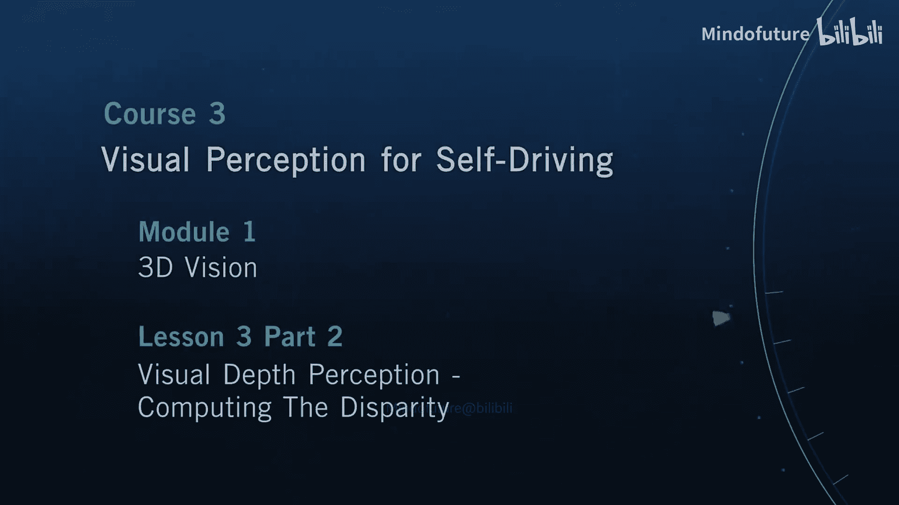
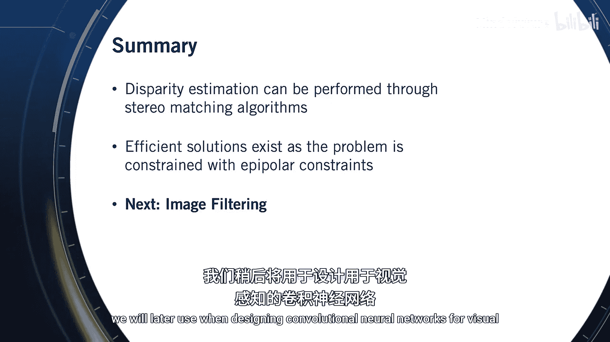

# 【多伦多大学】自动驾驶汽车的视觉感知 ｜ Visual Perception Self Driving Cars p09 P09_第3课第2部分-视觉深度感知_视差计算_02_03_02 -BV1nDsszQEdf_p9-

It's great to see you again。 welcome back。So far， we have learned the essential equations to extract 3D information from a stereo pair。

However， we were faced with some unknown parameters that we have to estimate。In this lesson。

 you will learn how to estimate these missing parameters。

 such as the disparity through stereo matching。You will also learn that efficient disparity estimation is possible due to Epolar constraints。

 let's get started。Recall from the previous video that we identified two primary issues with the visual depth estimation from stereo images。

The first is that the camera parameters， focal length F， baseline B， and camera P centers。

 UO and VN need to be estimated from stereo camera calibration。

Similar to monocular camera calibration， stereo calibration is a well studied problem with lots of user friendly。

 free software capable of performing it。This lesson will be targeting the second problem。

 mainly stereo matching to compute disparities。As a reminder。

 disparity is the difference in the image location of the same 3D point as observed by two different cameras。

To compute the disparity， we need to be able to find the same point in the left and right stereo camera images。

This problem is known as the stereo correspondence problem。

The most naive solution for this problem is an exhaustive search。

 where we search the whole right image for every pixel in the left image。

 such a solution is extremely inefficient and will usually not run in real time to be used on self- driving cars。

It's also unlikely to succeed as many pixels will have similar local characteristics。

 making it difficult to match them correctly。Luckily for us。

 we can use stereo geometrytry to constrain our search problem from 2D over the entire image space to a 1 D line。

Let's revisit our stereo camera setup and see why such a simplification is valid。

We have already determined how a single point is projected to both cameras。 Now。

 let's move our 3D point along the line， connecting it with the left camera center。

 Its projection on the left camera image plane does not change。However。

 what can you notice about the projection on the right camera plane？

The projection moves along the horizontal line。This is called an Epolar line and follows directly from the fixed lateral offset and image plane alignment of the two cameras in a stereo pair。

We can constrain our correspondence search to be along the Eollar line。

 reducing the search from 2D to 1D。One thing to note is that horizontal epicollar lines only occur if the optical axes of the two cameras are parallel。

In the case of non parallel optical axes， the epiollar lines are skewed。 In such cases。

 we will have to resort to multiple view geometry rather than the stereo equations we have developed。

 which is out of the scope of this lesson。In the case of two calibrated views。

 such as our stereo camera， a skewed Epolar line is not a huge problem。 In fact。

 we can warp the optical axes to be parallel through a process known as stereo rectification。

After rectification， we arrive back to our horizontal Eollar line。

We will not go through how to perform rectification as implementations are available in standard computer vision packages such as OpenC and MATLb。

To put it all together， we will go over our first basic stereo algorithm。For each epicpolar line。

 take a pixel on this line in the left image。Compare these left image pixels to every pixel in the right image on the same epicpolar line。

Next， select the right image pixel that matches the left pixel the most closely。

 which can be done by minimizing a cost。For example。

 a very simple cost here can be the squared difference in pixel intensities。Finally。

 we can compute the disparity by subtracting the right image location from the left one。

Steo matching is a very well studied problem in computer vision。

 many more complex costs and search regions can be defined。

 which attempt to improve either computational efficiency or disparity accuracy。

There are a wide range of approaches， including both local and global methods。

 which differ in the main image region considered when identifying correspondences and computing disparities。

As with most problems in computer vision， the stereo vision algorithms are evaluated on a public benchmark。

 the most famous of which is the Middlebury stereo benchmark。 If you are interested。

 many of the top performing stereo matching algorithms have results published there and have code available。

 too。With this lesson， you should now know how a stereo sensor generates depth from images through disparity estimation。

 This week's assignment will give a chance to compute your own disparity maps and to use them to create your own distance to impact driver assist module。

In the next lesson， we will describe image filtering。

 an important concept we will later use when designing convolutional neural networks for visual perception。

 Thanks for watching。 See you next time。

