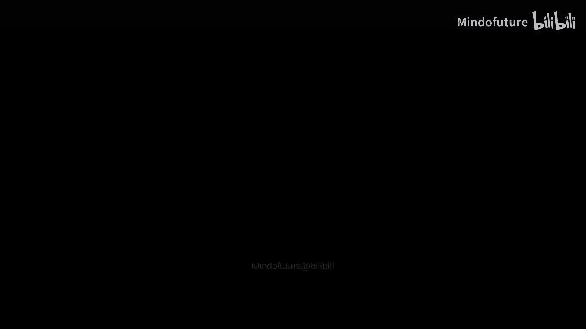
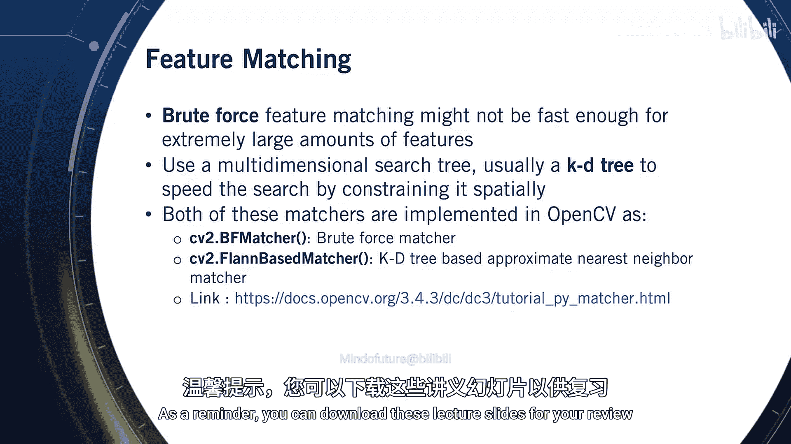

# 【多伦多大学】自动驾驶汽车的视觉感知 ｜ Visual Perception Self Driving Cars p13 P13_第3课第1部分-特征匹配_03_01_04 -BV1nDsszQEdf_p13-

So far， we have learned how to extract feature positions in the image and how to extract descriptors from the local neighborhood of these features。

 This video will teach you about the last step of using features for computer vision applications in autonomous driving。

😊，Feature matching。Specifically， we will cover how to match features based on distance functions。

We will then describe brute force matching as a simple but powerful feature matching algorithm。

But first， let's remind ourselves of how we intend to use features for a variety of perception tasks。

 First， we identify image features， distinctive points in our images。 Second。

 we associate a descriptor for each feature from its neighborhood。Finally。

 we use descriptors to match features across two or more images。Afterwards。

 we can use the matched features for a variety of applications， including state estimation。

 visual autoometry， and object detection。It is essential to identify matches correctly， however。

 as these applications are susceptible to catastrophic failures if incorrect matches are provided too frequently。

As a result， feature matching plays a critical role in robust perception methods for self driving cars。

Here's an example of a feature matching problem。Given a feature and its descriptor in image 1。

 we want to try to find the best match for the feature in image 2。 So how can we solve this problem。

The simplest solution to the matching problem is referred to as brute force feature matching and is described as the following。

First， define a distance function D that compares the descriptors of two features， FI and Fj。

 and defines a distance between them。The more similar the two descriptors are to each other。

 the smaller the distance between them。Second， for every feature F in image 1。

 we apply the distance function D to compute the distance with every feature FJ in image 2。Finally。

 we will return the feature， which we'll call FC from image 2。

 with the minimum distance to the feature FiI in image 1 as our match。

This feature is known as the nearest neighbor， and it is the closest feature to the original one in the descriptor space。

The most common distance function used to compare descriptors is the sum of square distances， or SSD。

 which penalizes variations between two descriptors quadraically。

 making it sensitive to large variations in the descriptor， but insensitive to smaller ones。

Other distance functions， such as the sum of absolute differences or the hamming distance are also viable alternatives。

The sum of absolute difference penalizes all variations equally。

 while the hamming distance is used for binary features for which all descriptor elements are binary values。

We will be using the SSD distance function for our examples to follow。

Our matching technique and distance choices are really quite simple。

But what do you think might go wrong with our proposed nearest neighbor matching technique？

Let's look at our first case and see how our brute force matcher works in practice。

Consider the feature inside the yellow bounding box For simplicity。

 this feature has a four dimensional descriptor， which we'll call F1。

Let's compute the distance between F1 and the first feature in the image2， which will label F2。

 We get a sum of squared difference or SSD value of 9。

We then compute the distance between F1 and the second feature in image 2。

 which will label F3 here we get an SSD of 652。We can now repeat this process for every other feature in the second image and find out that all the other distances are similarly large relative to the first one。

We therefore choose feature F2 to be our match as it has the lowest distance to F1。Visually。

 our brute force approach appears to be working。As humans。

 we can immediately see that feature F1 in the image is indeed the same point of interest as feature F2 in image 2。

Now let us consider a second case where our feature detector tries to match a feature from image 1。

 for which there is no corresponding feature in image 2。

Let's take a look at what the brute force approach will do when our feature detector encounters this situation。

 Following the same procedures as before， we compute the SSD between the descriptors of a feature F1 and image 1。

 and all the features in image 2， assume that F2 and F 3 are the nearest neighbors of F 1。

 and with F 2 having the lowest score， Although at 441。

 it is still rather dissimilar to the F1 feature descriptor from the original image。As a result。

 F2 will be returned as our best match。Clearly， this is not correct because feature F1 is not the same point of interest as feature F2 in the scene。

So how can we solve this problem。We can solve this problem by setting a distance threshold Delta on the acceptance of matches。

This means that any feature in image 2 with a distance greater than delta to F1 is not considered a match。

 even if it has the minimum distance to F1 among all the features in image 2。

Now let's update our brute force matchcher algorithm with our threshold。

We usually define Delta empirically as it depends on the application at hand and the descriptor we're using。

Once again， we define our distance function to quantify the similarity of two feature descriptors。

We also fix a maximum distance threshold Delta for acceptable matches。

 Then for every feature in image 1， we compute the distance to each feature in image 2 and store the shortest distance or nearest neighbor as the most likely match。

 brute force matching is suitable when the number of features we want to match is reasonable。

 but has quadratic computational complexity， Ma it ill suited as the number of features increases。😊。

For large sets of features， special data structures such as Kd trees are used to enhance computation time。

Both brute force and Kd tree based matches are implemented as part of Open CV making them easy for you to try out。

 Just follow the links shown at the bottom of this slide。As a reminder。

 you can download these lecture slides for your review。

By now， you should have a much better understanding of feature detection， description and matching。

 These three steps are required to use features for various self driving applications such as visual oometry and object detection。

Our brute force matcher is pretty neat， but still far from perfect。

We really need precise results to create safe and reliable self driving car perception。

 So in the next lesson， we will learn how to improve our brute force matcher to accommodate some of the troublesome and ambiguous matches that frequently lead to incorrect results。

😊，See you in the next video。

