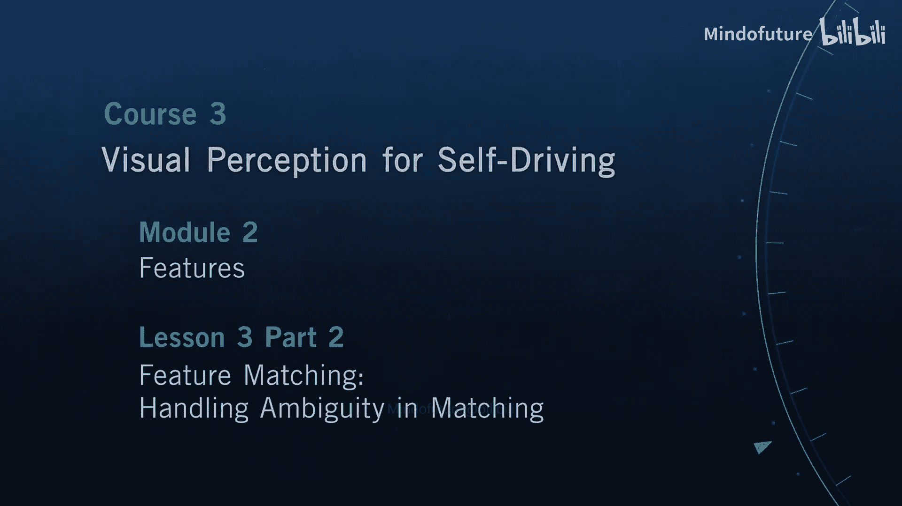
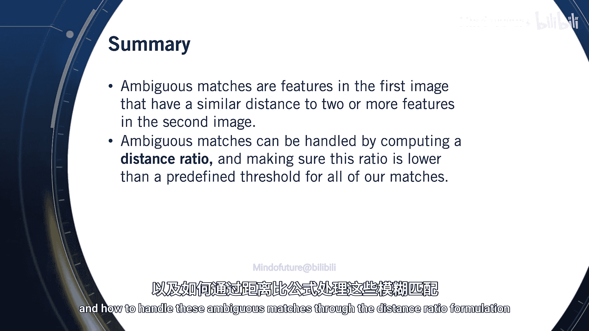

# 【多伦多大学】自动驾驶汽车的视觉感知 ｜ Visual Perception Self Driving Cars p14 P14_第3课第2部分-特征匹配_处理匹配中的歧义_03_01_06 -BV1nDsszQEdf_p14-

So far this week， we have learned how to detect features， compute their descriptors。

 and perform brute force matching using distance functions。

We're almost ready to start applying feature detection。

Description and matching to self driving car perception。In this video。

 we will explore the issue of ambiguous matches and how to make our matches more robust to matching errors caused by similar feature descriptors through the distance ratio formulation。

But first， let's review the two feature matching cases we discussed in the last lesson。

In the first case， we have a useful feature descriptor that clearly gives a small distance to the feature F 2 and a large distance to other features in the second image。

 In this case， we can successfully identify the correct match to the feature F1 in image 1。😊。

Our brute force matching algorithm works well with this descriptor and is seamlessly capable of finding the right match in image 2。

In the second case， the feature F1 in image 1 does not have a match at all in image 2。

 We modified our brute force matching algorithm with a threshold delta to eliminate incorrect matches in this case。

 Since both features in image 2 have a distance greater than the distance threshold Delta。

 The brute force matcher rejects both the features F2 and F 3 as potential matches and no matches returned。

 But let us consider a third case。 Once again， we are trying to match feature F1 in image 1 to a corresponding feature in image 2。

😊，With the feature vectors presented here， feature F1 gets an SSD value of 9 with feature 2 in image 2。

We test another feature F3， and we also get an SSD of9。

 both of these features have an SSD less than deelta， which was 20 in this case。

And as such are valid matches， so what should we do？

We refer to feature F1 in case3 as a feature with ambiguous matches。

 an elegant solution to this problem was proposed by David Lowwe in 1999。

The solution goes as follows。First， we compute the distance between feature FI in image 1 and all the features Fj in image 2。

 similar to our previous algorithm， we choose the feature F C in image 2 with the minimum distance to feature FI in image1 as our closest match。

We then proceed to get feature FS， the feature in image 2 with the second closest distance to the feature FI。

Finally， we find how much nearer our closest match Fc is over our second closest match FS。

This can be done through the distance ratio， the distance ratio can be defined as the distance computed between feature FI and image 1 and FC the closest match in image 2。

Over the distance computed between feature F I and F S， the second closest match in image 2。

If the distance ratio is close to one， it means that according to our descriptor and distance function。

 F I matches both F， S and F， C。In this case， we don't want to use this match in our processing later on。

 as it clearly is not known to our matcher which location in image 2 corresponds to the feature in image 1。

Let us update our brute force matcher algorithm with a distance ratio formulation。

The updates replace the distance with the ratio of distance as our metric to keep matches。

We usually set the distance ratio threshold， which we'll refer to as row somewhere around 0。5。

Which means that we require our best match to be at least twice as close as our second best match to our initial features descriptor。

Revisiting casese3， we can see that using the distance ratio in a corresponding threshold row set to 0。

5， we discard our ambiguous matches and retain the good ones。In this video。

 you have learned what ambiguous matches are and how to handle these ambiguous matches through the distance ratio formulation。

Unfortunately， even with the distance ratio formulation。

 as much as 50% of typical matches can still be wrong when using modern descriptors。

This is because repetitive patterns in images and small variations in pixel values are often sufficient to confuse the matching process。

We call these erroneous matches outliers， and for our next lesson。

 I will describe a method to account for and eliminate outliers before using our matched features for further perception tasks。

