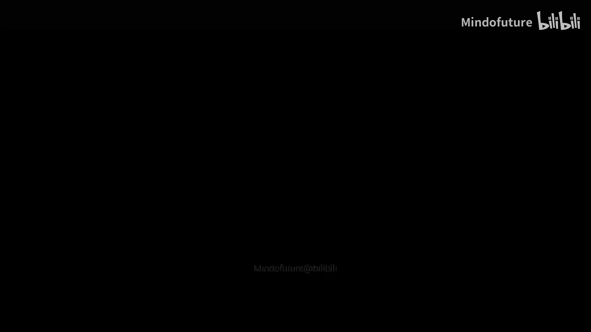
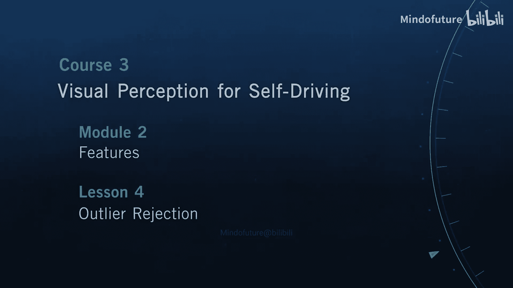

# 【多伦多大学】自动驾驶汽车的视觉感知 ｜ Visual Perception Self Driving Cars p15 P15_第4课-异常值剔除_03_02_01 -BV1nDsszQEdf_p15-

So far， we have described the three steps we need to use image features for autonomous vehicle applications。

 We also mentioned that feature matches are not very robust outliers。In this lesson。

 we will describe what outliers are and how they might affect our usage of image features to solve real world problems。

We will also provide a powerful method to handle outliers called randomom sample Con or Rasack for short。

This method will help us account and eliminate outliers as they can have a strong negative impact on the use of features in other perception tasks。

But first， let us introduce the use of the three step feature extraction framework for the real world problem of vehicle localization。

Our localization problem is defined as follows， given any two images of the same scene from different perspectives。

 find the translation T between the coordinate system of the first image shown in red and the coordinate system of the second image shown in green。

In practice， we'd also want to solve for the scale and skew due to different viewpoints。

 but we'll keep this example simple to stay focused on the current topic。

To solve this localization problem， we need to perform the following steps。First。

 we need to find the displacement of image1 on the U image axis of image 2。

 we call this displacement T sub u。Second， we need to find the displacement of image1 on the V axis of image 2。

 and we'll call this displacement T sub V。We will find T sub and T sub V by matching features between the images and then solving for the displacements that best align these matched features。

We begin by computing features and their descriptors in image 1 and image 2。

 We then match these features using the brute force matcher we developed in the previous lesson。

Do you notice anything a little off in the results from our brute force match？Don't worry。

 we will come back to these results in a little bit。But first。

 let's define the solution of our problem mathematically in terms of our matched features。

We denote a feature pair from images1 and 2 as F1 subi and F2 subi。

 where I ranges between 0 and n the total number of feature pairs returned by our matching algorithm。

Each feature in the feature pair is represented by its P coordinates， UI and VI。

Note that every pixel in image1 should coincide with its corresponding pixel in image2 after application of the translation。

 T sub U and T sub V。We can then use our feature pairs to model the translation as follows。

 The location of a feature in image 1 is translated to a corresponding location in image 2 through model parameters T sub U and T sub V。

Here， the translations on the U image axis T sub U and the V image axis T sub V are the same for all feature pairs since we assume a rigid body motion。

Now we can solve for T sub U and T sub V using least squares estimation。

The solution to the least squares problem will be the values for T sub U and T sub V that minimize the sum of squared errors between all pairs of pixels。

Now that we have our localization problem defined， let's return to the results of our feature matching。

By observing the feature locations visually， it can be seen that the feature pair in the purple circles is actually an incorrect match。

This happens even though we use the distance ratio method and is a common occurrence in feature matching。

We call such feature pairs outliers。And outliers can comprise a large portion of our feature set。

And typically have an outsized negative effect on our model solution。

 especially when using least square's estimation。Let us see if we can identify these outliers and avoid using them in our least square solution。

Outliers can be handled using a model based outlier rejection method called randomom sample consensus or Rasack for short。

Ransack， developed by Martin Fishler and Robert Bulls in 1981。

 is one of the most used model based methods for outlier rejection in robotics。

The Rasack algorithm proceeds as follows。First， given a model for identifying a problem solution from a set of data points。

 find the smallest number M of data points or samples needed to compute the parameters of this model。

In our case， the problem is localization and the model parameters are the T sub and T sub V offsets of the least square solution。

Second， randomly select M samples from your data。Third。

 compute the model parameters using only the M samples selected from your dataset。Fourth。

 use the computed parameters and count how many of the remaining data points agree with this computed solution。

The accepted points are retained and referred to as inliers。Fifth。

 if the number of inliers C is satisfactory， or if the algorithm has iterated a preset maximum number of iterations。

 terminate and return the computed solution and the inlire set else， go back to step 2 and repeat。

 Finally， recompute and return the model parameters from the best inlier set。😊。

The one with the largest number of features。Now we can revisit our localization problem and try to accommodate for the outliers from our feature matchtro。

As a reminder， our model parameters， T sub U and T sub V shift each feature pair equally from the first image to the second。

To estimate T sub U and T sub V， we need one pair of features。Now。

 let us go through the Rasack algorithm for this problem。First。

 we randomly select one feature pair from the matched samples。

Now we need to estimate our model using the computed feature pair。Using the feature pair。

We compute the displacement along the U image axis， T sub U。

And the displacement along the V image axis T sub V。

We now need to check if our model is valid by computing the number of inliers。Here。

 we use a tolerance to determine the inlis， since it is highly unlikely that we satisfy the model with 100% precision。

Unfortunately， our first iteration chose a poor feature match to compute the model parameters。

When using this model to compute how many features in image1 translate to their matched location in image 2。

We notice that none of them do。Since our number of inliers is zero。

 we go back and choose another feature pair at random and restart the Rasack process。Once again。

 we compute T sub and T sub V using a new randomly sampled feature pair。

To get our new model parameters。Using the model， we compute how many features in image1 translate to their match in image 2。

This time we can see that most of the features actually fit this model， in fact。

 11 out of 12 features are considered in liars。Since most of our features are in layersarers。

 we are satisfied with this model and we can stop the RasAC algorithm。At this point。

 you should now understand the proper use of image features for autonomous vehicle applications。

You learned what outliers are within the scope of feature matching and how to handle outliers through the Rasack algorithm。

Outlier removal is a key process in improving robustness when using feature matching and greatly improves the quality of localization results。

In the next video， we will use what we learned so far to estimate the position of our autonomous vehicle using camera image features。

This will help us track our own vehicles motion through the environment。

Which is a process known as visual odoometry and is essential to navigating smoothly and safely。

