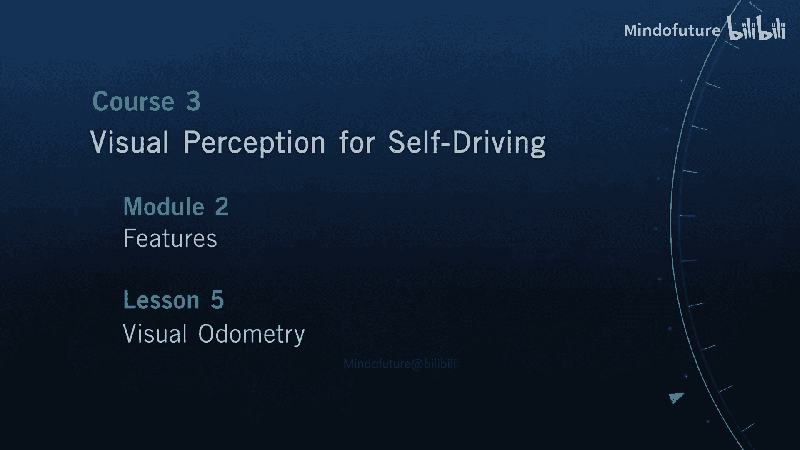
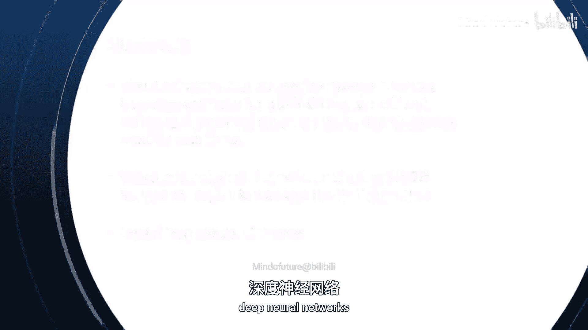

# 【多伦多大学】自动驾驶汽车的视觉感知 ｜ Visual Perception Self Driving Cars p16 P16_第5课-视觉里程计_03_02_03 -BV1nDsszQEdf_p16-

So far in this module， you've learned how to detect， describe and match features。

 as well as how to handle outliers in our feature matching results。

We've also explored an example of how to use features to localize an object in an image。

 which could be used to estimate the depth to the object from a pair of image。In this lesson。

 you will learn how to perform visual oometry， a fundamental task for vision based state estimation in autonomous vehicles。

Visual oometry or Vo for short， can be defined as the process of incrementally estimating the pose of the vehicle by examining the changes that motion induces on the images of its onboard cameras。

 It is similar to the concept of wheel oometry you learned in the second course。

 but with cameras instead of encoders。What do you think using visual oometry might offer over regular wheel oometry for autonomous cars？

Visual oometry does not suffer from wheel slip while turning or an uneven terrain and tends to be able to produce more accurate trajectory estimates when compared to wheel oometry。

This is because of the larger quantity of information available from an image。However。

 we usually cannot estimate the absolute scale from a single camera。

What this means is that estimation of motion produced from one camera can be stretched or compressed in the 3D world without affecting the pixel feature locations by adjusting the relative motion estimate between the two images。

As a result， we need at least one additional sensor。

 often a second camera or an inertial measurement unit。

 to be able to provide accurately scaled trajectories when using VO。Furthermore。

 cameras are sensitive to extreme illumination changes。

 making it difficult to perform VO at night and the presence of headlights and street lightss。

Finally， as seen with other odoometry estimation mechanisms。

 Po estimates from VO will always drift over time as estimation errors accumulate。For this reason。

 we often quote V performance as a percentage error per unit distance traveled。

Let's define the visual odoometry problem mathematically， given two consecutive image frames。

 IK minus1 and IK， we want to estimate a transformation matrix Tk defined by a translation T and a rotation R between the two frames。

Concatenating the sequence of transformations estimated at each time step K from K n to capital K will provide us with the full trajectory of the camera over the sequence of images。

 Since the camera is rigidly attached to the autonomous vehicle。

 This also represents an estimate of the vehicle's trajectory。

Now we'll describe the general process of visual oometry。We are given two consecutive image frames。

 I K and I K -1， and we want to estimate the transformation T K between these two frames。First。

 we perform feature detection and description。We end up with a set of features。

 FK minus1 in image K minus1， and FK in image K。We then proceed to match the features between the two frames to find the ones occurring in both of our target frames。

After that， we use the matched features to estimate the motion between the two camera frames represented by the transformation TK。

Motion estimation is the most important step in VO and will be the main theme of this lesson。

The way we perform the motion estimation step depends on what type of feature representation we have。

In 2D to 2D motion estimation， feature matches in both frames are described purely in image coordinates。

This form of visual odoometry is great for tracking objects in the image frame。

This is extremely useful for visual tracking and image stabilization in videography， for example。

In 3D to 3D motion estimation， feature matches are described in the world 3D coordinate frame。

This approach requires the ability to locate new image features in 3D space and is therefore used with depth cameras。

 stereo cameras and other multicamer configurations that can provide depth information。

These two cases are important and follow the same general visual oometry framework that we'll use for the rest of this lesson。

Let's take a closer look at 3D to 2D motion estimation。

Where the features from frame K -1 are specified in the 3D world coordinates。

 while their matches in frame K are specified in image coordinates。

Here's how 3D to 2D motion estimation is performed。

We are given the set of features in frame K -1 and estimates of their 3D world coordinate。

Furthermore， through feature matching， we also have the 2D image coordinates of the same features in the new frame K。

Note that since we cannot recover the scale from monocular visual autodoometry directly。

 we include a scaling parameter S when forming the homogeneous feature vector from the image coordinates。

We want to use this information to estimate the rotation matrix R and the translation vector T between the two camera frames。

Does this figure remind you of something that we've learned about previously？

If you're thinking of camera calibration， you're correct。In fact。

 we use the same projective geometry equations we used for calibration in visual autoometry as well。

A simplifying distinction to note between calibration and VO is that the camera intrinsic calibration matrix K is already known。

 so we don't have to solve for it again。Our problem now reduces to the estimation of the transformation components R and T from the system of equations constructed using all of our matched features。

One way we can solve for the rotation and translation T is by using the prospective endpoint algorithm。

Given feature locations in 3D， their corresponding projection in 2D。

 and the camera intrinsic calibration matrix K PNP solves for the extrinsic transformations as follows。

First， PNP uses the direct linear transform to solve for an initial guess for R& T。

The DLT method for estimating R&T requires a linear model and constructs a set of linear equations to solve using standard methods such as SVD。

However， the equations we have are nonlinear in the parameters of R& T。In the next step。

 we refined the initial DLT solution with an iterative nonlinear optimization technique。

 such as the Leaveenburg Markard method。The P& P algorithm requires at least three features to solve for R and T。

 When only three features are used， four possible solutions result。

 And so a fourth feature point is employed to decide which solution is valid。Finally。

 RAsack can be incorporated into P&P by assuming that the transformation generated by P&P on four points is our model。

 We then choose a subset of all feature matches to evaluate this model and check the percentage of inliers that result to confirm the validity of the point matches selected。

The PNP method is an efficient approach to solving the visualoometry problem。

But uses only a subset of the available matches to compute the solution。

We can improve on P&P by applying the batch estimation techniques you studied in course2。By doing so。

 we can also incorporate additional measurements from other onboard sensors and incorporate vision into the state estimation pipeline。

With vision included， we can better handle GPS denied environments and improve both the accuracy and reliability of our Po estimates。

There are many more interesting details to consider when implementing VO algorithms。Fortunately。

 the PMP method has a robust implementation available in OpenCV， In fact。

 OpenCV even contains a version of PNP with Rasack incorporated for outlier rejection。

You can follow the link in the supplementary reading for a description on how to use P&P in OpenC。

In this lesson， you learned why visualometry is an attractive solution to estimate the trajectory of a self-driving car and how to perform visual oometry for 3D to 2D correspondences。

Next week， we'll delve into a fundamental approach to extracting information from images for self driving car perception。

 deep neural networks。

By this point， you've now finished the second week of visual perception for self driving cars。

 Don't worry if you did not acquire a full grasp of all the material explained in this week。

In this week's assignment， you'll be gaining hands on experience on all of these topics。

You'll use feature detection， matching， and the PNP algorithm to build your own autonomous vehicle。

 visual autoometry system in Python。See you in the next module。

