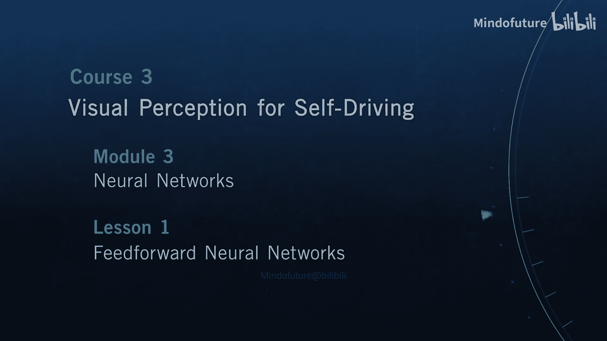
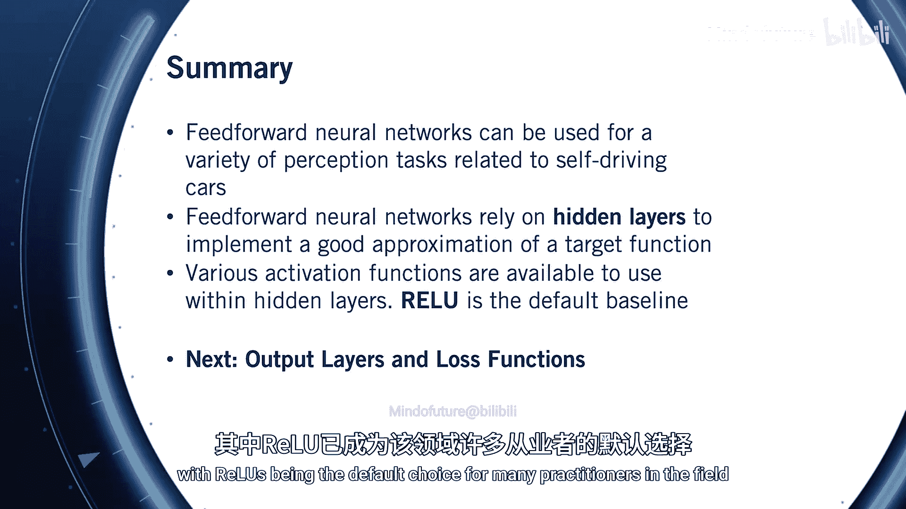

# 【多伦多大学】自动驾驶汽车的视觉感知 ｜ Visual Perception Self Driving Cars p17 P17_第1课-前馈神经网络_04_01_01 -BV1nDsszQEdf_p17-

。

Hello and welcome to week  three of the course This week you will learn about a topic that has changed the way we think about autonomous perception。

Artificial neural networks Throughout this module， you will learn how these algorithms can be used to build a self driving car perception stack。

 and you'll learn the different components to design and train a deep neural network。

Now we won't be able to teach you everything you need to know about artificial neural networks。

 but this module is a good introduction to the field。

If artificial neural networkss is a topic that you're interested in。

 feel free to check out some of the deep learning and machine learning courses offered on Coursera。

In this lesson， you will learn about the building blocks of feed forward neural networks。

 a very useful basic type of artificial neural network。Specifically。

 we'll look at the hidden layers of a feed forward neural network。

The hidden layers are important as they differentiate the mode of action of neural networks from the rest of machine learning algorithms。

 We'll begin by looking at the mathematical definition of feed forwardward neural networks。

 So you can start to understand how to build these algorithms for the perception stack。

 A feed forwardward neural network defines a mapping from an input X to an output Y through a function F of X and theta。

 For example， we use neural networks to produce outputs such as the location of all cars in a camera image。

 The function F takes an input X and uses a set of learned parameters theta to interact with X resulting in the output Y。

😊，The concept of learned parameters is important here。

 as we do not start with the correct form of the function F。

 which maps our inputs to our outputs directly。Instead。

 we must construct an approximation to the true function using a generic neural network。

 This means that neural networks can be thought of as function approximators。

Usually we describe a feed forward neural network as a function composition。 In a sense。

 each function F of I is a layer on top of the previous function， f of I minus-1。Usually。

 we have n functions in our composition where n is a large number。

 stacking layer upon layer for improved representation。

 This layering LED to the name deep learning for the field， describing these sequences of functions。

 Now， let us describe this function composition visually。

 Here you can see a four layer feet forward neural network。😊。

This neural network has an input layer which describes the data input X to the function approximator。

Here， x can be a scalar， a vector， a matrix， or even an ndiional tensor， such as images。

The input gets processed by the first layer of the neural network， the function F1 of x。

We call this layer the first hidden layer。Similarly。

 the second hidden layer processes the output of the first hidden layer through the function F2 of x。

 We can add as many hidden layers as we like， but each layer adds additional parameters to be learned and more computations to be performed at runtime。

We will discuss how the number of hidden layers affects the performance of our system later on in the course。

The final layer of the neural network is called the output layer。

It takes the output of the last hidden layer and transforms it to our desired output y。

Now we should have the intuition on why these networks are called feed Forward。

This is because information flows from the input X through some intermediate steps all the way to the output Y without any feedback connections。

The terms are used in the same way as we use them in course one when describing control for our self driving car。

Now let us go back to the network definition and check out how our visual representation matches our function composition。

In this expression， we see X， which is called the input layer。We see the outermost function F sub M。

 which is the output layer。And we see each of the functions F1 to fn minus1 in between。

 which are the hidden layers。Now， before we delve deeper into these fascinating function approximators。

 let's look at a few examples of how we can use them for autonomous driving。Remember。

 this course is on visual perception， so we'll restrict our input X to always be an image。

The most basic perception task is that a classification。

 here we require the neural network to tell us what is in the image via a label。

We can make this task more complicated by trying to estimate a location as well as a label for objects in the scene。

 This is called object detection。Another set of tasks we might be interested in are pixel wise tasks。

 As an example， we might want to estimate a depth value for every pixel in the image。

 This will help us determine where objects are， or we might want to determine which class each pixel belongs to。

 This task is called semantic segmentation。 And we'll discuss this in depth。

 along with object detection later in the course。In each case。

 we can use a neural network to learn the complex mapping between the raw pixel values from the image to the perception outputs we're trying to generate without having to explicitly model how that mapping works。

 This flexibility to represent hard to model processes is what makes neural networks so popular。😊。

Now let's take a look at how to learn the parameters needed to create robust perception models。

During a process referred to as neural network training， we drive the neural network function。

 f of x and theta， to match a true function， F star of x。

 by modifying the parameters theta that describe the network。

The modification of theta is done by providing the network pairs of input X and its corresponding true output F star of x。

We can then compare the true output to the output produced by the network and optimize the network's parameters to reduce the output error。

Since only the output of the neural network specified for each example。

 the training data does not specify what the network should do with its hidden layers。

The network itself must decide how to modify these layers to best implement an approximation of F star of x。

As a matter of fact， hidden units are what make neural networks unique when compared to other machine learning models。

So let us define more clearly the hidden layer structure。

A hidden layer is comprised of an affine transformation。

 followed by an element wise nonlinear function G。 This nonlinear function is called the activation function。

The input to the n hidden layer is H of n minus1， the output from the previous hidden layer。

In the case where the layer is the first hidden layer， its input is simply the input image X。

The aine transformation is comprised of a multiplicative weight matrix W。

And an additive bias matrix B。These weights and biases are the learned parameters theta in the definition of the neural network。

Finally， the transformed input is passed through the activation function G。 Most of the time。

 G does not contain parameters to be learned by the network。 As an example。

 let us take a look at the rectified linear unit， or Relu。

The default choice of activation functions in most neural networks nowadays。

Res use the maximum between0 and the output of the aine transformation as their element wise nonlinear function。

Since they are very similar to linear units， they're quite easy to optimize。

Let us go through an example of a relu hidden layer computation。

We are given the output of the previous hidden layer Hn -1。

 the weight matrix W and the bias matrix B。 We first need to evaluate the aine transformation。

 Remember， the weight matrix is transposed in the computation。

Let's take a look at the dimensions of each of the matrices in this expression。

H of n -1 is a 2 by 3 matrix。 In this case， W is a 2 by5 matrix。

 The final result of our aine transformation is a  phi by 3 matrix。Now。

 let us pass this matrix through the Relu No linearity。

We can see that the Relu prevents any negative outputs from the aine transformation from passing through to the next layer。

There are many additional activation functions that can be used as element wise nonlinearities in h layers for neural networks。

In fact， the design of hidden units is another extremely active area of research in the field and does not yet have many definitive guiding theoretical principles。

As an example， certain neural network architectures use the sigmoid No nonlinearity。

The hyperbolic tangent No nonlinearity。And the generalization of Relu。

 the max out linearity as their hidden layer activation functions。

If you're interested in learning more about neural network architectures。

 I strongly encourage you to check out some of the deep learning courses offered on Coursera。

 They're amazing。 In this lesson， you learned the main building blocks of feed forward neural networks。

 including the hidden layers that comprise the core of the machine learning models we use。😊。

You also learn different types of activation functions。

 with reus being the default choice for many practitioners in the field。

In the next lesson， we'll explore the output layers and then study how to learn the weights and bias matrices from training data。

 setting the stage for training our first neural network later on in the module。

