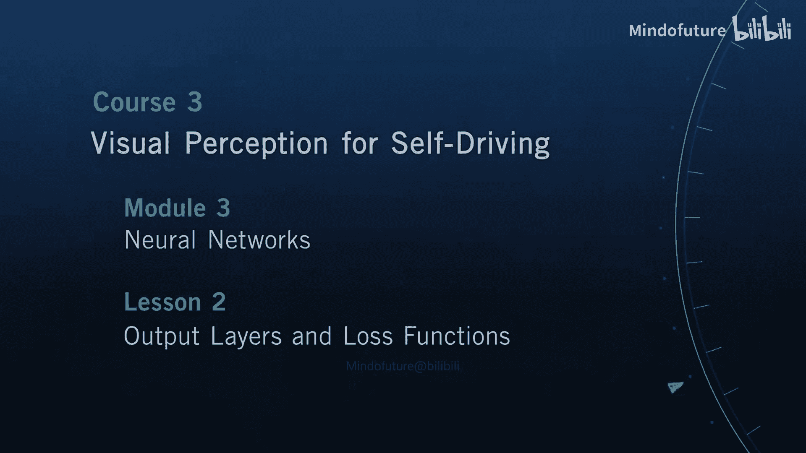
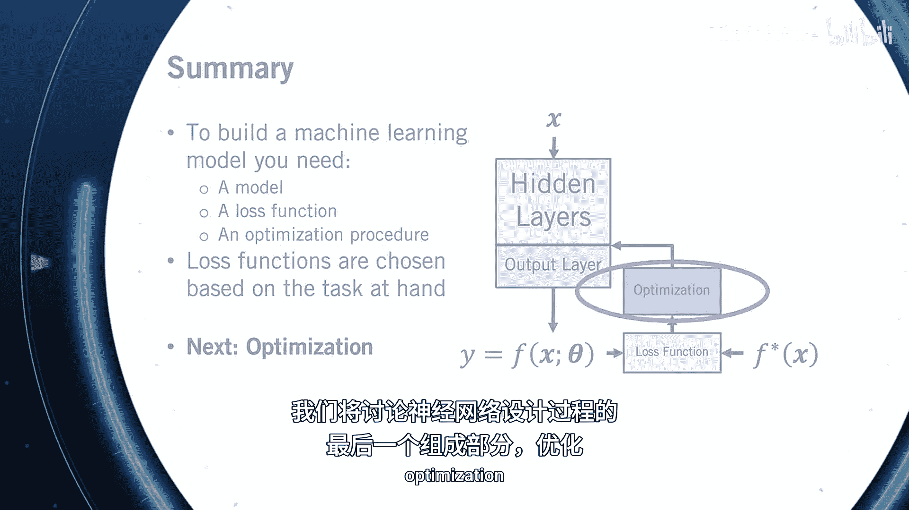

# 【多伦多大学】自动驾驶汽车的视觉感知 ｜ Visual Perception Self Driving Cars p18 P18_第2课-输出层与损失函数_04_01_03 -BV1nDsszQEdf_p18-

In the last lesson， we introduced feed forwardward neural networks。

 a powerful machine learning model。 We saw the tasks we would like this model to perform。

 such as object detection， semantic segmentation and depth estimation。 In this lesson。

 we will first review the general process of designing machine learning algorithms。

 We will then introduce the missing components still required to define a suitable neural network for a specific perception task。

 including the choice of a loss function。😊，Let's begin with the general Ma learning algorithm design process。

Generally， supervised machine learning models， including neural networks。

 have two modes of operation， inference， and training。

Recall our basic neural network formulation given a set of parameters theta。

 the input X is passed through the model F of x in theta to get an output y。

This mode of operation is called inference and is usually the one we use when we deploy the machine learning algorithms in the real world。

The network and its parameters are fixed， and we use it to extract perception information from new input data。

 However， we still need to define how to obtain the parameter set data。

Here we need a second mode of operation involving optimization over the network parameters。

This mode is called training and has the sole purpose of generating a satisfactory parameter set for the task at hand。

Let's see how training is usually performed。 We start with the same workflow as inference。 However。

 during training， we have training data， and as such， we know what F star of x is。

 the expected output of the model。For self driving。

 this training data often takes the form of human annotated images。Which take a long time to produce。

We compare our inference or predicted output Y to the true output F star of x through a loss or a cost function。

 The loss function takes as an input。 the predicted output Y from the network and the true output F star of x and provides a measure of the difference between the two。

We usually try to minimize this measure by modifying the parameterss theta so that the output y from the network is as similar as possible to the F star of x。

 We do this modification to theta via an optimization procedure。

This optimization procedure takes in the output of the loss function and provides a new set of parameters data that provide a lower value for that loss function。

We will learn about this optimization process in detail during the next lesson。But for now。

 let's extend the design process to neural networks。

We discussed in the last lesson a feed forwardwardner network， which takes on input X。

Passes it through a sequence of hidden layers。Then passes the output of the hidden layers through an output layer。

This is the end of the inference stage of the neural network。For training。

 we pass the predicted output through the loss function。

 then use an optimization procedure to produce a new set of parameters theta that provide a lower value for the loss function。

 The major difference between the design of traditional machine learning algorithms and the design of artificial neural networks。

 I that the neural network only interacts with the loss function via the output layer。 Therefore。

 it is quite reasonable that the output layer and the loss function are designed together。

 depending on the task at hand。 Let's delve deeper into the major perception tasks we usually encounter in autonomous driving。

 The first important task that we use for autonomous driving perception as classification。😊。

Classification can be described as taking an input X and mapping it to one of K classes or categories。

Examples include image classification， where we just want to map an image to a particular category to say whether or not it contains cats or dogs。

 for example。And semantic segmentation， where we want to map every pixel in the image to a category。

The second task that we usually use for autonomous driving perception is a regression。In regression。

 we want to map inputs to a set of real numbers。Examples of regression include depth estimation。

 where we want to estimate a real depth value for every pixel in an image。

We can also mix the two tasks together， for example。

 object detection is usually comprised of a regression task where we estimate the bounding box that contains an object and a classification task where we identify which type of object is in the bounding box。

We will now describe the output layer loss function pairs associated with each of these basic perception tasks。

 let's start with the classification task first， usually for K class classification tasks。

 we use the soft max output layer。Softm output layers are capable of representing a probability distribution over K classes。

 The softm output layer takes as input H， the output of the last hidden layer of the neural network。

It then passes it through an aine transformation， resulting in a transformed output vector Z。Next。

 the vector Z is transformed into a discrete probability distribution using the softmax element wise function。

For each element Z I， this function computes the ratio of the exponential of element Z I over the sum of the exponentials of all of the elements of Z。

The result is a value between 0 and 1， and the sum of all of these elements is one making it a proper probability distribution。

 Let's take a look at a numerical example to better explain the softm output layer。In this example。

 we'd like to classify images containing a cat， a dog or a fox。 First。

 we define the first element of our output vector to correspond to the probability that the image is a cat。

 according to our network。The ordering of classes is arbitrary and has no impact on network performance。

Taking the output of the aine transformation， we compute the probability by dividing the exponential of each element of the output by the sum of the exponentials of all of the elements。

Given values of 13-7 and 11 as the outputs of the linear transformation layer。

 we achieve a probability of 88 per that this image is a cat，11。

9% that this image is a fox and a very low probability that this image is dock。 Now。

 let's see how to design a loss function that uses the output of the soft max output layer to show us how accurate our estimate is。

The standard loss function to be used with the softmax output layer is the cross entropy loss。

 which is formed by taking the negative log of the softmax function。

The cross entropy loss has two terms to control how close the output of the network is to the true probability。

 Z I is the output of the hidden layer corresponding to the true class before being passed through the softmax function。

This is usually called the Class Loit， which comes from the field of logistic regression。

When minimizing this loss function， the negative of the class logit Z I encourages the network to output a large value for the probability of the correct class。

The second term， on the other hand， encourages the output of the ae transformation to be small。

The two terms together encourage the network to minimize the difference between the predicted class probabilities and the true class probability。

To understand this loss better， let's take a look at a numerical example on how the cross entropy loss is computed from the output of a classification neural network。

Revisiting our previous example， we first need to choose what our Zed sba is。

Zed subi is the linear transformation output corresponding to the true class of inputs。In this case。

 Z I is the element of the output of the linear transformation corresponding to the CAT class。

Once we determine Z subi， we use the cross entropy to compute the final loss value in this case。

 the network correctly predicts that the input is a cat and sees a loss function value of 0。12。

Let us now do the computation again。 but with an erroneous network output。

 the input to the network is still a cat image。 The network still assigns the value of 13 to the cat entry of the output of the linear transformation。

 But this time， the fox entry will get a value of 14。 Comping the cross entropy loss。

 We find that it evaluates to 1。31。 More than 10 times the value of the previous slide。

Note how the loss function heavily penalizes erroneous predictions。

 even when the difference in output is only one。This difference accelerates the learning process and rapidly steers network outputs to the true values during training。

So far we've presented an output layer and loss function specific to the classification task。

 let's now go through the most common output layer for the regression task。

The linear output layer is mostly used for regression tasks to model statistics of common probability distributions。

The linear output layer is simply comprised of a single affine transformation without any nonlinearity。

The statistics to be modeled with the linear output layer depend on the loss function we choose to go with it。

 For example， to model the mean of a probability distribution。

 we use the mean squared error as our loss function。

 The linear and softm output units described above the most common output layers used in neural networks today and can be coupled with a variety of task specific lost functions to perform a variety of useful perception tasks for autonomous driving。

Many other output layers and loss functions exist， and this remains an active area of research in deep learning。

In this lesson， you learned that to build a machine learning model。

 you need to define a network model， a loss function。

 and an optimization procedure to learn the network parameters。

You also learned what loss function to choose based on the task that needs to be done by the neural network model In the next video。

 we will be discussing the final component of our neural network design process， optimization。

Which involves how to get the best parameter set theta for a specific task， See you next time。

