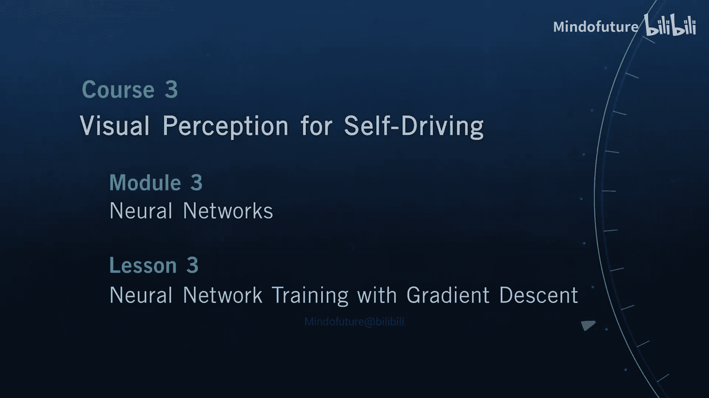
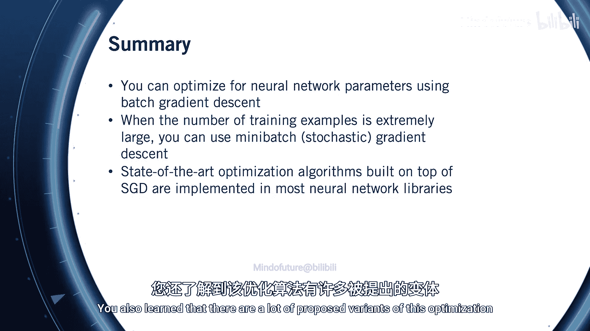

# 【多伦多大学】自动驾驶汽车的视觉感知 ｜ Visual Perception Self Driving Cars p19 P19_第3课-基于梯度下降的神经网络训练_04_01_05 -BV1nDsszQEdf_p19-

So far in this module， we have reviewed what comprises a feed forward neural network model and how to evaluate the performance of a neural network model using loss functions。

 This lesson will explain the final major component of designing neural networks。

 the training process， specifically， we will be answering the following question。

 How can we get the best parameter set theta for a feed forward neural network given training data。

 The answer lies in using an iterative optimization procedure with proper parameter initialization。

Let us first revisit the feed forwardward neural network training procedure we described previously。

Given a training data input X and the corresponding correct output， F star of x。

We first pass the input X through the hidden layers。

Then through the output layer to get the final output Y。

We see here that the output y is a function of the parameterss theta。

 and remember that theta comprises the weights and the biases of our aine transformations inside the network。

Next， we compare our predicted output F of x and theta with the correct output F star of x through the loss function。

Remember that the loss function measures how large the error is between the network output and our true output。

 Our goal is to get a small value for the loss function across the entire data set。

 We do so by using the loss function as a guide to produce a new set of parameters theta that are expected to give a lower value of the loss function。

 specifically， we use the gradient of the loss function to modify the parameters theta。

 This optimization procedure is known as gradient descent。

 Before describing gradient descent in detail， let's take another look at the neural network loss function。

 Usually， we have thousands of training example pairs X and F star of X available for autonomous driving tasks。

 We can compute the loss over all training examples as the mean of the losses over the individual training examples。

😊，We can then compute the gradient of the training loss with respect to the parameters theta。

 which is equal to the mean of the gradient of the individual losses over every training example Here。

 we use the fact that the gradient and the sum are linear operators。

 So the gradient of the sum is equal to the sum of the individual gradients。

 using the formulated gradient equation。 we can now describe the batch gradient descent optimization algorithm。

 batch gradient descent is a linear first order optimization method。

 Iterative means that it starts from an initial guess of parameters theta and improves on these parameters iteratively。

 First order means that the algorithm only uses the first order derivative to improve the parameters theta。

 batch gradient descent goes as follows。 First， the parameters theta of the neural network are initialized。

 Second， a stopping condition is determined， which terminates the algorithm and returns a final set of parameters。

😊，Once the iterative procedure begins， the first thing to be performed by the algorithm is to compute the gradient of the loss function with respect to the parameters theta。

Denoted Dell sub theta。 The gradient can be computed using the equation we derived earlier。 Finally。

 the parameters theta are updated according to the computed gradient here。

 Epsilon is called the learning rate and controls how much we adjust the parameters in the direction of the negative gradient at every iteration。

 Let's take a look at a visual example of batch gradient descent in the 2 D case。 Here。

 we are trying to find the parameters。 Theta 1 and theta 2 that minimize our function J of theta Theta is shaped like an oblong bowl shown here with contour lines of equal value。

😊，Graadient descent iteratively finds new parameters theta that take us a step down the bowl at each iteration。

 The first step of the algorithm is to initialize the parameters theta using our initial parameters。

 we arrive at an initial value for our loss function denoted by the red dot。

 We start gradient descent by computing the gradient of the loss function at the initial parameter values theta 1 and theta 2。

 using the update step。 We then get the new parameters to arrive at a lower point on our loss function。

 We repeat this process until we achieve our stopping criteria。

 We then get the last set of the parameters， Theta 1 and theta 2 as our optimal set that minimizes our loss function。

 Two pieces are still missing from the presented algorithm。

 How do we initialize the parameters theta。😊，And how do we decide when to actually stop the algorithm。

 The answer to both of these questions is still highly based on heuristics that work well in practice for parameter initialization。

 we usually initialize the weights using a standard normal distribution。 and set the biases to 0。

 It is worth mentioning that there are other heuristics specific to certain activation functions that are widely used in the literature。

 We provide some of these heuristics in the supplementary material。

 Def the gradient descent stopping conditions is a bit more complex。

 There are three ways to determine when to stop the training algorithm。

 Most simply we can decide to stop when a predefined maximum number of gradient descent iterations is reached。

 Another heuristic is based on how much the parameters theta change between iterations。

 A small variation means that the algorithm is not updating the parameters effectively anymore more。

 which might mean that a minimum has been reached。😊。

The last widely used stopping criteria is the change in the loss function value between iterations。

 Again， as the changes in the loss function between iterations become small。

 the optimization is likely to have converged to a minimum。

 Choing one of these stopping conditions is very much a matter of what works best for the problem at hand。

 We will revisit the stopping conditions in the next lesson as we study some of the pitfalls of the training process and how to avoid them。

 Unfortunately， the batch gradient descent algorithm suffers from severe drawbacks to be able to compute the gradient。

 we use back propagation。Back propagation involves computing the output of the network for the example on which we would like to evaluate the gradient。

And batch gradient descent evaluates the gradient over the whole training set。

Making it very slow to perform a single update step。Luckily， the loss function。

 as well as its gradient， are means over the training dataset set。 For example。

 we know that the standard error in a mean estimated from a set of n samples is sigma over the square root of n。

Where sigma is the standard deviation of the distribution。

 and N is the number of samples used to estimate the mean。

 That means that the rate of decrease in error in the gradient estimate is less than linear in the number of samples。

 This observation is very important， as we now can use a small subs sampleample of the training data or a mini batch to compute our gradient estimate。

 So how does using mini batches modify our batch gradient descent algorithm。

 The modification is actually quite simple。The only alteration to the base algorithm is at the sampling step。

Here we choose a sub sampleample N prime of the training data as our mini batch。

 We can now evaluate the gradient and perform the update steps in an identical manner to batch gradient descent。

This algorithm is called stochastic or mini batch gradient descent as we randomly select samples to include in the mini batches at each iteration。

 However， this algorithm results in an additional parameter to be determined。

 which is the size of the mini batch that we want to use to pick an appropriate mini batch。

 it has to be noted that some kinds of hardware achieve better runtime with specific sizes of data arrays。

 specifically when using GPus， it is common to use power of two mini batch sizes。

 which match the GPU computing and memory architecture as well， and therefore。

 use the GPU resources efficiently， let's look at some of the factors that drive batch size selection。

 multicore architectures， such as GPus are usually underutilized by extremely small batch sizes。

 which motivates using some absolute minimum batch size below which there's no reduction in the time to process a mini batch。

 Furthermore， large batch sizes usually provide a more accurate estimate of the gradient。

 ensuring descent in a direction that improve。😊，the network performance moreliably。 However。

 as noted previously， this improvement in the accuracy of the estimate is less than linear。

 Small batch sizes， on the other hand， have been seen to offer a regularizing effect。

With the best generalization often seen at a batch size of one。

If you're not sure what we mean by generalization， don't worry。

 as we'll be exploring it more closely in the next lesson。 Furthermore。

 optimization algorithms usually converge more quickly if they're allowed to rapidly compute approximate estimates of the gradients and iterate more often。

 rather than computing exact gradients and performing fewer iterations。

As a result of these trade offs， typical power of two mini batch sizes range from 32 to 256。

 with smaller sizes sometimes being attempted for large models or to improve generalization。

 One final issue to keep in mind is the requirement to shuffle the data set before sampling the mini batch Fail to shuffle the data set at all can reduce the effectiveness of your network。

 There exist many variants of stochastic gradient descent in the literature。

 Each having their own advantages and disadvantages。

 It might be difficult to choose which variant to use and sometimes one of the variants works better for certain problem than another。

 as a simple rule of thumb for atronommous driving applications。

 a safe choice is the atom optimization method。It is quite robust to initial parameters theta。

And widely used， if you're interested in learning more about these variants。

 have a look at the resources listed in the supplemental notes In this lesson。

 you learned how to optimize the parameters of a neural network using batch grading descent。

 You also learned that there are a lot of proposed variance of this optimization algorithm。

 with a safe default choice being atom。 Congratulations。

 you've finished the essential steps required to build and train a neural network。

 In the next lesson， we will discuss how you can choose some of the optimization parameters to improve network training。

 such as the learning rate。 Also， we'll discuss how to evaluate the performance of our neural network using validation sets。

 See you next time。😊。

