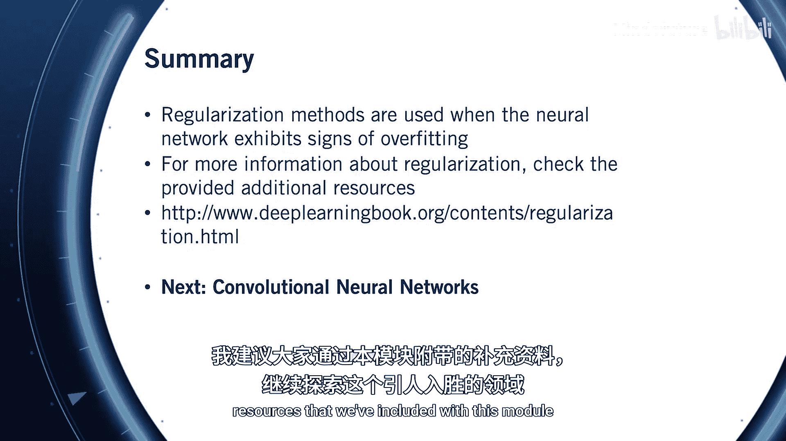

# 【多伦多大学】自动驾驶汽车的视觉感知 ｜ Visual Perception Self Driving Cars p21 P21_第5课-神经网络正则化_04_02_03 -BV1nDsszQEdf_p21-

In the last lesson， we described how to divide data sets into training。

 validation and testing splits and interpret the results of evaluating the loss function on each of these splits。

 We also emphasize that most of the time we tend to suffer from overfitting rather than underfitting after training the network In this lesson。

 well explore some ways to reduce overfitting by applying regularization strategies during training。

 As a result of regularization， our networks were generalize well to new data and we'll be able to use them more effectively outside of the lab。

 Let's walk through an iteration of neural network development on a toy example。

 We want to separate a 2 D Cartesian space into two components， orange and blue。

 Any point belonging to the blue space should be labeled class 1。

 while any point belonging to the orange space should be labeled class 2。 However。

 we do not have direct access to these classes or their boundaries。 Instead。

 we only have access to sensor measurements that provide us with examples of points in their course。

😊，spond in class， unfortunately， our sensor is also noisy。

 That means it sometimes provides the incorrect label。

 La points in the blue space as class 2 and in the orange space as class 1。

 Our problem amounts to finding this space classification from the noisy sensor data。

 We begin by collecting data from the sensor and splitting them into 60。

40 training validation splits。 The training split is shown here as points with white outlines。

 And the validation split is shown here as points with black outlines。

 Let's use a simple neural network with one layer and two hidden units per layer to classify measurements。

😊，Using this design choice， we get the following space classification。The training set loss is 0。264。

 close to the validation set loss of 0。268， but is still much higher than the minimum achievable loss of 0。

1。This is a clear case of underfitting。 When we compare the results of our network classification to the true space classification。

 we see that the neural network failed to capture the complexity of the problem at hand and did not correctly segment the space into four compartments as required to resolve underfitting issues。

 We increase the network size by adding five additional layers and increase the number of hidden units to 6 units per layer。

 Our model is now much more expressive， So it should be able to better represent the true classification。

 We go ahead and train our model again。 Then test to see how well we have done。

 We notice that our validation set loss result of 0。

45 is much higher than our training set loss result of 0。1。😊，The training set loss， however。

 is equal to the minimum achievable loss of 0。1 on this task。

We are in a state of overfitting to the training data。

 Overfitting is caused by the network learning the noise in the training data。

 because the neural network has so many parameters。

 it is able to carve out small regions in the space that correspond to the noisy training examples。

 as shown inside the red circles。 This usually happens when we increase the network size too much for the problem at hand。

 Again， we have learned that one way to remedy overfitting is through regularization。😊。

Let's check out the first regularization method commonly used for neural networks。

 The most traditional form of regularization applicable to neural networks is the concept of parameter norm penalties。

 This approach limits the capacity of the model by adding the penalty omega of theta to the objective function。

We add the norm penalty to our existing loss function using a weighting parameter alpha。

Alpha is a new hyperparameter that weights the relative contribution of the norm penalty to the total value of the loss function。

 Usually omega of theta is a measure of how large the value of theta is。Most commonly。

 this measure is an LP norm， when p is 1， we have an absolute sum， and when p is 2。

 we get the quadratic sum， etc ce。Furthermore， we usually only constrain the weights of the neural network。

 This is motivated by the fact that the number of weights is much larger than the number of biases in a neural network。

 So weight penalties have a much larger impact on the final network performance。

 The most common norm penalty used in neural networks is the L2 norm penalty。

 The L 2 norm penalty tries to minimize the L 2 norm of all the weights in each layer of the neural network。

Let's take a look at the effect of the L2 norm penalty applied to our problem。

 Remember that our latest design resulted in overfitting on the training dataset set。

 addinging the L2 normm penalty to loss function results in a much better estimate of the space classification。

 due to a lower validation set loss over the unregularized network。 However。

 this lower validation set loss is coupled with an increase in the training set loss from 0。1 to 0。

176。 In this case， the decrease in the generalization gap is higher than the increase in the training set loss。

 Do be careful not to regularize too much。 However。

 to avoid falling into the underfitting regime once again。

 addinging a norm penalty is quite easy in most neural network packages。If you suspect overfitting。

 L2 norm penalties might be a very easy remedy that will prevent a lot of wasted time during the design process。

As we mentioned earlier in this video， researchers have developed regularization mechanisms that are specific to neural networks。

One powerful mechanism used regularly is called drop out。

 Let's see how drop out gets applied during network training。

 The first step of drop out is to choose a probability。

 which we'll call P sub keep at every training iteration。

 This probability is used to choose a subset of the network nodes to keep in the network。

These nodes can be either hidden units， output units or input units。

We then proceed to evaluate the output Y after cutting all the connections coming out of these units。

 Since we are removing units proportional to the keep probability P subkeep。

 we multiply the final weights by P subkeep at the end of training。

 This is essential to avoid incorrectly scaling the outputs when we switch to inference for the full network。

 Drop out can be intuitively explained as forcing the model to learn with missing input and hidden units。

 or， in other words， with different versions of itself。

 It provides a computationally inexpensive but powerful method of regularizing a broad family of neural network models during the training process。

 leading to significant reductions in overfitting in practice。😊，Furthermore。

 dropout does not significantly limit the type or model of training procedure that can be used。

 It works well with nearly any model that uses a distributed over parameterized representation。

 and they can be trained with stochastic gradient descent。 Finally。

 all neural network libraries have a drop out layer implemented and ready to be used。

 We recommend using drop out whenever you have dense feet forward neural network layers。

The final form of regularization you should know about is early stopping To explain early stopping visually。

 we look at the evolution of the loss function of a neural network evaluated on the training set。

Given enough capacity， the training loss should be able to decrease to a value close to 0 as the neural network memorizes the training data。

 However， if we have independent training and validation sets。

 the validation loss reaches a point where it starts to increase。

 This behavior is typical during the overfitting regime and can be resolved viamethan known as early stopping。

 We discussed earlier that we can stop the optimization according to various stopping criteria。

Early stopping ends training when the validation loss keeps increasing for a preset number of iterations or epochs。

This is usually interpreted at the point just before the neural network enters the overfitting regime。

After stopping the training algorithm， the set of parameters with the lowest validation loss is returned。

 As a final note， early stopping should not be used as a first choice for regularization。

 as it also limits the training time， which may interfere with the overall network performance。

 Congratulations， you are now ready to start building your own neural networks。😊，In this lesson。

 you learned how to improve the performance of the neural network。 In the case。

 it falls into an overfitting regime。 There are many more interesting aspects to neural network design and training。

 And I urge you to keep exploring this fascinating fields through the additional resources that we've included with this module in the next and final lesson in this module。

 We will talk about a neural network architecture of huge practical and historical importance for vision based perception。

😊。

The convolutional neural network， See you then。

