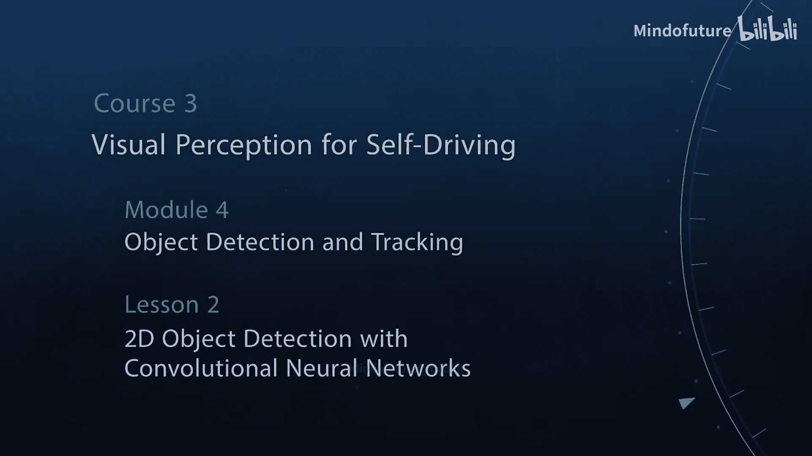

# 【多伦多大学】自动驾驶汽车的视觉感知 ｜ Visual Perception Self Driving Cars p24 P24_第2课-基于卷积神经网络的2D物体检测_05_01_03 -BV1nDsszQEdf_p24-

In the last lesson， we describe the general object detection problem。

 as well as how to evaluate the performance of 2G object detectors using average precision。

This lesson will describe the steps involved in performing 2D object detection using conveants。

Keep in mind that the field of 2D object detection is rapidly changing。

 with new methods emerging every day。What we will be describing is a modern approach to 2D object detection using conveants。

 but without many of the intricacies that allow state of the art detectors to eke out the best possible performance。

 If you find this topic as exciting as we do， check out the list of some of the current top 2D object detection papers we've included in the supplementary material。

😊，In this lesson， you will learn how to build a standard single stage convnet architecture for 2D object detection using the network layers we learned about in module 3。

In addition， we will discuss some common designs that researchers have formulated for congnets used for 2D object detection。

Let's begin by reviewing the 2D object detection problem， given an image as an input。

We want to simultaneously localize all objects in the scene and determine which class they belong to。

Let's see how we can perform this task using a convenet。

This figure shows the basic convnet configuration used for 2D object detection。

We call this configuration a neural network architecture。 The architecture takes as an input。

 an image and a set of manually crafted prior boxes。First。

 the image is processed using a feature extractor。Second。

 a set of fully connected layers take as an input， the output of the feature extractor。

 and provide a location refinement of each 2D prior box as well as a classification。Finally。

 non maximum suppression is performed on the output of the fully connected layers to generate the final detections。

Let's delve deeper into each of these steps。We will begin our discussion with the feature extraction stage。

Feature extractors are the most computationally expensive component of the 2D object detector。

It is typical to have as much as 90% of the total architecture's required computation used at this stage。

The output of feature extractors usually has much lower width and height than those of the input image。

However， its depth is usually two to three orders of magnitude greater than that of the input image。

The design of feature extractors is a very active area of research。

 with new extractors emerging on a regular basis。The most common feature extractors used are VG G。

 resnet， and inception。We will be focusing on the VGG feature extractor as our running example throughout the rest of this lesson。

The VGG feature extractor is based on the convolutional layers of the VGG16 classification network proposed by the Vi Ge group at Oxford University。

It is one of the first feature extractors to be proposed for detection and is quite simple to build。

 As with most conves， the VG G feature extractor is built by alternating convolutional layers and pooling layers。

All convolutional layers are of size 3 by3 by k， with a stride of1 and a0 padding of1。

 by which we mean that the padding of size1 is filled with zeros。

All max pooling layers are of size 2 by 2 with stride 2 and no padding。

These particular hyperparameters were arrived at through intensive experimentation。

And have performed extremely well in a wide range of problems。

 making VG G an extremely popular extractor。Let's see how these layers affect our output volume shape。

Last week， we derived the three equations for the output width， height and depth。

Based on the input volume， after it has been passed through the convolutional layer。

For the V G G feature extractor， all convolutions are of size 3 by 3 by K with a stride of 1 and 0 padding of 1。

 That means that passing an input volume through any of the convolutional layers only changes its depth to K。

On the other hand， the pooling layers of the VGG extractor are two by two with stride 2 and padding。

Repeating the same analysis using the equations for the pooling layer。

 we noticed that the max pooling layers of VGG extractors。

Reduce the width and height of the input volume by two while maintaining the depth constant。

Let's now see how the VGG extractor processes an input image， given an M by n by3 input image。

 we pass it through the first two convolutional layers of depth 64。

Followed by the first pooling layer at this point， the output volume。

 width and height are reduced by a factor of 2， while the depth is expanded to 64。

We can separate the VGG feature extractor into subsections。

 where each subsection ends with a pooling layer。 The first subsection is called the conv1 subsection of the VGG extractor。

We then proceed to pass the output volume through the rest of the five subsections to arrive at our final output volume of shape M over 32 n over 32 and 512。

As an example， if we have a 1240 by 960 by3 image as our input。

 our final output volume shape will be 40 by 30 by 512。

We will be using this output volume to generate our final detections。

The next step to describe in our neural network architecture is the concept of prior boxes。

 also called anchor boxes。To generate 2D bounding boxes。

 we usually do not start from scratch and estimate the corners of the bounding box without any prior。

We assume that we do have a prior on where the boxes are in image space and how large these boxes should be。

These priors are called anchor boxes and are manually defined over the whole image。

 usually on an equally spaced grid。Let's assume that we have a set of anchors close to our ground truth boxes。

During training， the network learns to take each of these anchors。

And tries to move it as close as possible to the ground truth bounding box in both centroid location and box dimensions。

This is termed residual learning， and it takes advantage of the notion that is easier to nudge an existing box a small amount to improve it。

 rather than to search the entire image for possible object locations。In practice。

 residual learning has proven to provide much better results than attempting to directly estimate bounding boxes without any prior。

Many different methods have been proposed in the literature on how to use the anchor bounding boxes to generate the final prediction。

Usually， the anchors interact with the feature map to generate fixed sized feature vectors for every anchor。

We will explain one of the first methods proposed for this interaction by Microsoft Research in their architecture。

 faster R CNN。However， keep in mind that this is not the only way to perform such an interaction。

The faster RCN interaction method is quite simple for every pixel in the feature map。

 we associate K anchor boxes。We then perform a3 by3 by D star convolution operation on that pixel's neighborhood。

This results in a1 by one by D star feature vector for that pixel。

We use this one by one by D star feature vector as the feature vector of every one of the K anchors associated with that pixel。

We then proceed to feed the extracted feature vector to the output layers of the neural network。

The output layers of a 2D object detector usually comprise of a regression head and a classification head。

The regression head usually includes multiple fully connected hidden layers with a linear output layer。

The regressed output is typically a vector of residuals that need to be added to the anchor at hand to get the ground truth bounding box。

Another method to update the dimension of the anchors is to regress a residual from the center of the anchor to the center of the ground truth bounding box。

 in addition to two scale factors that correct the ground truth bounding box width and height。

 when multiplied with an anchors width and height。The classification head is also comprised of multiple fully connected hidden layers。

 but with a final softm output layer。The Softmax output is a vector with a single score per class。

The highest score usually defines the class of the anchor at hand。

You might note that based on what we described so far。

 we will end up with K bounding boxes per pixel of the output feature map。

Even if we consider boxes with high classification score for all classes of interest。

 we still will have many redundant detections in the image。During average precision computation。

 we only consider one detection per ground truth bounding box。

Any redundant detections are considered false positives and results in lower precision and thus a lower average precision overall。

Recall， we're aiming for perfect detection， which means we want。

An output of one box per object in the image。 So we will need to do something to eliminate the many redundant detections produced by our network。

In fact， this is only an issue at inference， and it turns out to be beneficial to drive the network to output the best possible residuals for every anchor during training。

Before going deeper into this issue， let's summarize what you learned this lesson。First。

 you learn that convolutional neural networks can be used to solve the 2D object detection problem and study the details of the VGG feature extractor architecture。

Second， you learned how to use anchor boxes as object location priors and estimate the bounding box residuals to output the final object locations。

In the next lesson， we'll describe how to train 2D object detectors using classification and regression loss functions。

 For that， we will use most of the K output boxes。 Well then return to the challenge of outputting a single bounding box per object and introduce the concept of non maximumim suppression to solve it。

 See then。

