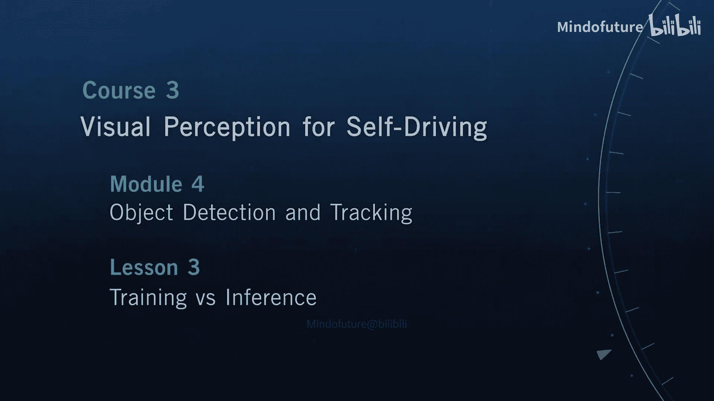
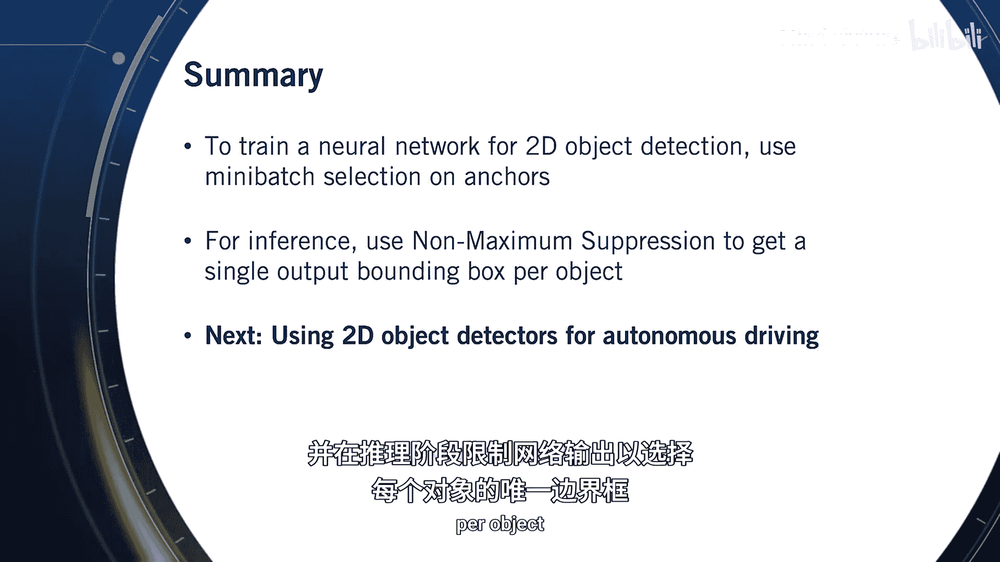

# 【多伦多大学】自动驾驶汽车的视觉感知 ｜ Visual Perception Self Driving Cars p25 P25_第3课-训练与推理_05_01_05 -BV1nDsszQEdf_p25-

Last lesson， we learned a baseline approach to perform object detection using conves。However。

 processing all the anchors in our anchor grid led to multiple bounding boxes being detected per object。

 rather than the expected single box per object。This lesson。

 we will discuss the final components we need to build and train convolutional neural networks for 2D object detection。

Specifically， you will learn how to handle multiple regressed anchors per object during training through mini batch selection。

And during inference through non maximum suppression。

Let's begin by reviewing neural network training。We are given our Con model and training data pairs。

 X， the input image， and F star of X， the bounding box locations and class。

We want to approximate f star of x with our output bounding boxes y equal to f of x and theta。

Recall from last week that we perform training by first evaluating a loss function that measures how similar our predicted bounding boxes are to the ground truth bounding boxes。

Then we feed the resultant loss function to our optimizer that outputs a new set of parameters theta to be used for the second iteration。

Notice that both the feature extractor and the output layers are modified during training。Now。

 if F star of x。If F of x theta are one to one。 Our problem would have been easy。 However。

 the outputs of our network is multiple boxes that can be associated with a single ground truth box。

Let's see how we can work to resolve this issue。Remember that for each pixel in the feature map。

 we associate K anchors。Where do these anchors appear in the original image？

As we have learned earlier， our feature extractor reduces the resolution of the initial input by a factor of 32。

That means that if we associate every pixel in the feature map with a set of anchors。

 these anchors will be transferred to the initial image by placing them on a grid with stride 32。

We can then visualize the ground truth bounding box alongside these anchors。

 You can notice that some anchors overlap， and some don't。

We quantify this overlap with IOU and categorize the anchors into two categories。

 We first specify two IOU thresholds， a positive anchor threshold， and a negative anchor threshold。

Any anchor with an IOU greater than the positive anchor threshold is called a positive anchor。

 and similarly， any anchor with an IOU less than the negative anchor threshold is called a negative anchor。

Any anchor with an IOU in between the two thresholds is fully discarded。

So now how do we use these positive and negative anchors in training？

Let's now see how to assign the classification and regression targets for the positive and negative anchors。

For classification， we want the neural network to predict that the negative anchors belong to the background class。

Background is usually a class we add to our classes of interest to describe anything not included in these classes。

On the other hand， we want the neural network to assign ground truth class to any positive anchor intersecting that ground truth。

For regression， we want to shift the parameters of the positive anchor to be aligned with those of the ground truth bounding box。

 The negative anchors are not used in bounding box regression， as they are assumed to be background。

This approach of handing multiple regressed anchors during training is not free from problems。

The proposed IOU thresholdholding mechanism results in most of the regressed anchors being negative anchors when training with all these anchors。

 the network will be observing far more negative than positive examples。

 leading to a bias towards the negative class。The solution to this problem is actually quite simple。

 instead of using all anchors to compute the loss function。

 we sample the chosen mini batch size with a three to one ratio of negative to positive anchors。

The negatives are chosen through a process called online hard negative mining。

In which negative mini batch members are chosen as the negative anchors with the highest classification loss。

This means that we will be training to fix the biggest errors in negative classification。

As an example， if we have a mini batch of 64 examples。

 the negative mini batch will be the 48 negative examples with the highest classification loss and the 16 remaining anchors will be positive anchors。

If the number of positives is less than 16， we either copy some of the positives to pad the mini batch or fill the remaining spots with negative anchors。

As we described earlier last week， we used the cross entropy loss function for the classification head of our conve。

The total classification loss is the average of the cross entropy loss of all anchors in the mini batch。

The normalization constant and total is the chosen mini batch size。

S I is the output of the classification head。An SI star is the ground truth classification。

 which is set to background for negative anchors and to the class of the ground truth bounding box for the positive anchors。

For regression， we use the L 2 norm loss in a similar manner。 However。

 we only attempt to modify an anchor if it is a positive anchor。

 This is expressed mathematically with a multiplier P I on the L 2 norm that is 0。

 if the anchor is negative and one， if the anchor is positive。To normalize。

 we divide by the number of positive anchors。And just as a reminder。

 B I star is the ground truth bounding box representation。 While B I is the estimated bounding box。

Remember that we don't directly estimate box parameters。

 but rather we modify the anchor parameters by an additive residual or a multiplicative scale。

 So B must be constructed from the estimated residuals。

Let's visualize what we are trying to teach the neural network to learn with these loss functions。

Given an input image， a ground truth bounding box and a set of input anchors from the anchor prior。

We are teaching the neural network to classify anchors as containing background in purple or a car in blue。

This is done by minimizing the cross entropy loss defined above。

Then we want the neural network to move only anchors that contain a class of interest in a way that matches the closest ground truth bounding box。

This is done by minimizing the L2 norm loss defined above。By now。

 you should have a good grasp on how to handle multiple output boxes per object during training。

But what do we do when we run the neural network in real time during inference？Remember。

 during inference， we do not have ground truth to determine positive and negative anchors。

 and we do not evaluate loss functions。 We just want a single output box per object in the scene。

Here is where non max suppression comes into play， an extremely powerful approach to improving inference output for anchor based neural networks。

Nonmax suppression takes as an input a list of predicted bounding boxes B。

And each bounding box is comprised of the regress coordinates and the class output score。

It also needs， as an input， a predefined IOU threshold， which we'll call Ada。

The algorithm then goes as follows。 We first sort the bounding boxes in list B。

 according to their output score。We also initialize an empty set D to hold output bounding boxes。

We then proceed to iterate over all elements in the sortred box list B bar。Inside the for loop。

 we first determine the box B max with the highest score in the list B。

 which should be the first element in B bar。We then remove this bounding box from the bounding box set B bar and add it to the output set D。

Next， we find all boxes remaining in the set B bar that have an IOU greater than Eda with the box B max。

 These boxes significantly overlap with the current maximum box B max。

 Any box that satisfies this condition gets removed from the list B bar。

 We keep iterating through the list B bar until it is empty。 and then we return the list D。

D now contains a single bounding box per object。Let's go through a visual example to understand how non max suppression algorithms work in practice。

Let's assume that we have sorted the bounduning box list in decreasing order。

We also show the score list explicitly here for better visibility on how nonmac suppression works。

BMax will be the first bounding box of the sorted list B bar。

We then proceed to compare each bounding box to BmX In this case。

 only one box B3 has a non zero IOU with BmX。We compute that IOU and compare it with our IOU threshold Eda。

 In this case， the IOU is greater than the threshold Eta， so we remove B 3 from the list B bar。

We repeat the process for the next highest score that remains in the list。Again。

 only one box has a nonze IOU with BMX， box4 in this case。

Computing the IOU and comparing with the threshold。

 we eliminate B 4 from list B bar and add B 2 to the output list D。

We notice that our initial list B bar is now empty。

 so our nonm suppression algorithm exits and returns to the output box list D that contains one bounding box per object as expected。

Congratulations， you have now completed the content required to train and deploy Convenet based 2D object detectors for self driving cars。

In this video， we explored how to adjust network output during training to maintain class balance and to restrict network output during inference to select one output bounding box per object。

In the next lesson we will discuss how we can use the output of these 2D object detectors for a variety of tasks that are important for self-driving cars。

 including transforming 2D object detection to 3D， tracking object motion。

 and applying 2D object detection to traffic sign and signal detection， see you there。

