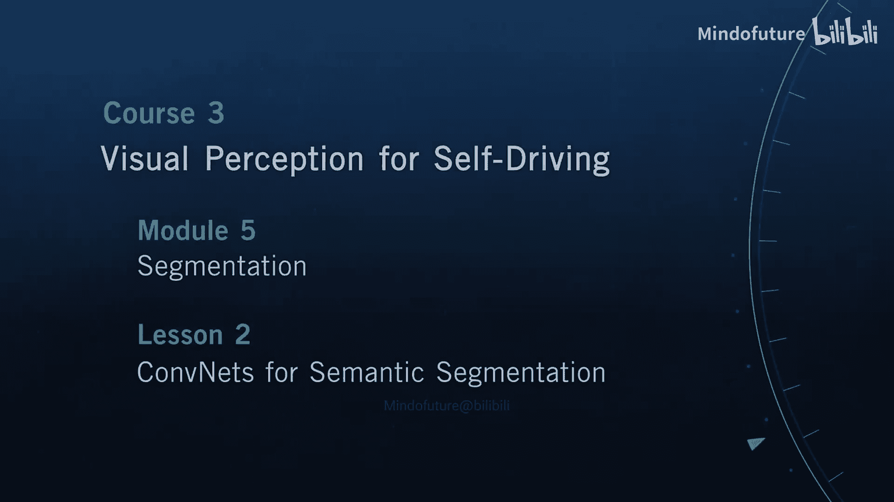
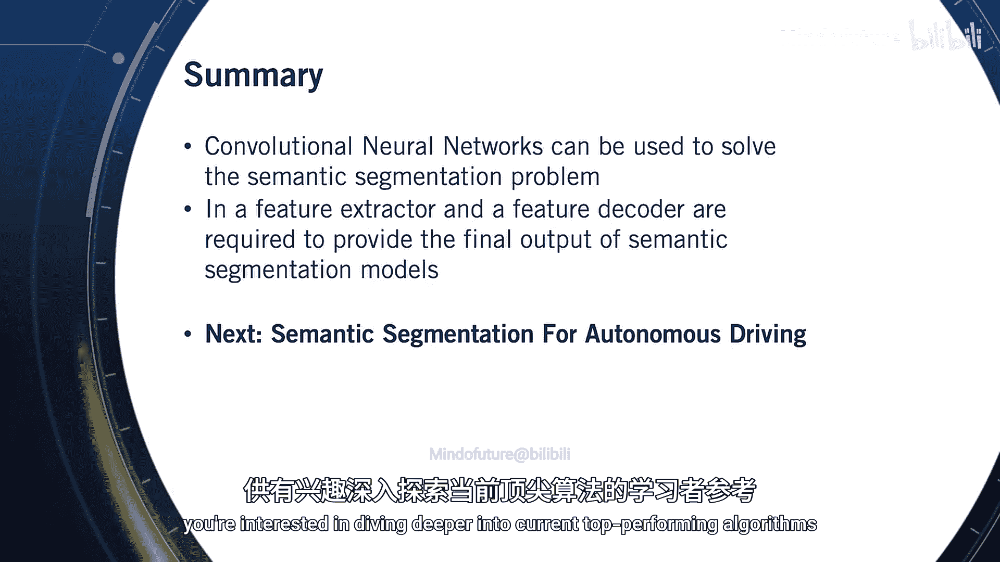

# 【多伦多大学】自动驾驶汽车的视觉感知 ｜ Visual Perception Self Driving Cars p28 P28_第2课-语义分割卷积网络_06_01_03 -BV1nDsszQEdf_p28-

In the first lesson of this module， we defined the semantic segmentation problem and saw how to evaluate the performance of a semantic segmentation algorithm by calculating the class IOU。

In this video， we will learn how to use convolutional neural networks to perform the semantic segmentation task usingsing convvenets for semantic segmentation is actually a little easier than using them for object detection。

 Unlike convenets for object detection， the training and inference stages are practically the same for semantic segmentation。

😊，However， there are some intricacies to semantic segmentation that we need to be aware of。

Let's begin with a quick review of the semantic segmentation problem。

Semantic segmentation takes a camera image's input and provides a category classification for every pixel in that image as output。

This problem can be modeled as a function approximation problem。

 and convnets can once again be used to approximate the required function。

What kind of continent model can we use to perform this function approximation？

One idea is to use the same con model we used for object detection。

 That is a feature extractor followed by an output layer。

We do not need anchors here as we are not trying to localize objects。

Let's see how effective this architecture is for performing semantic segmentation。

We'll start by analyzing the feature extractor。As with the feature extractor used for object detections。

 we can use the VGG architecture。Let's see what happens to the size of our M by n by3 input image as we go through this feature extractor。

As with object detection， our resolution will be reduced by half after every pooling layer。

On the other hand， our depth will increase due to the convolutional layers。

The output feature map of our convolutional feature extractor will be downsled by 16 times。

We can add as many convolutional pooling blocks as needed。

 but that will further shrink our feature map。However。

 we want our output to have a classification for every pixel in the image。So how can we achieve this。

 given a downsled feature map that is 16 times smaller than our original input。

 a simple solution would be the following。 We can first compute the output by passing the 16 times downsd output feature map through a soft max layer。

We can then determine the class of every pixel in the subsampled output by taking the highest class score obtained by the softmax layer。

The final step would be to proceed to upsample the downsled output back to the original image resolution。

How well do you think the described approach will work？

To understand why naive upsampling might produce inadequate results。

 let's take a look at how upsampling increases the image resolution。

We want to use the nearest neighbor upsampling on a two by two image patch。

The color of the pixels of the image patch represent different values of every pixel。

We want to up sampleample our patch to double its original size， so have an ups multiplier S of 2。

Nearest neighbor upsling generates an empty initial unsampled grid by multiplying W N and HN by the upsling multiplier。

Each pixel in the upsled grid is then filled with the value of the nearest pixel in the original image patch。

This process is repeated until all the pixels in the upsampled grid are filled with values from the image patch。

The depth of the output upsled grid remains the same as the input image patch。

The problem induced by upsampling is that the upsamp output image has very coarse boundaries。

As you can remember from the last lesson， one of the most challenging problems in semantic segmentation is attaining smooth and accurate boundaries around the objects。

 Sth boundaries are hard to attain， as in general， boundaries in the image space are ambiguous。

 especially for thin objects such as poles， similar looking objects such as roads and sidewalk and far away objects。

😊，Nive upsling also induces two additional problems。

Any object less than 16 pixels in width or height usually fully disappears in their upsled image。

This affects both thin objects such as poles and faraway objects。

As they are below the minimum dimensions required for the pixels to appear from the original image。

To remedy these problems， researchers have formulated what is commonly referred to as a featured decoder。

The feature decoder can be thought of as a mirror image of the feature extractor instead of using the convolution pooling paradigm to downs sampleample the resolution。

 it uses upsling layers followed by a convolutional layer to ups sampleample the resolution of the feature map。

The ups usually using nearest neighbor methods， achieves the opposite effect to pooling。

 but results in an inaccurate feature map。The following convolutional layers are then used to correct the features in the upsampled feature map with learnable filter banks。

This correction usually provides the required smooth boundaries as we go forward through the feature decoder。

Let's now go through an analysis of the dimensions of the feature map as it travels forward through the feature decoder。

As a reminder， the input feature map is downsampled 16 times with a depth of 512。

Similar to the feature extractor， each upsling convolution block is referred to as a deconvolution。

There is， of course， a debate among current researchers on whether this terminology is accurate。

 but we will use it here to refer to the reverse of the convolutional pooling block。

As we go through the first deconvolution block， our input feature map is upsampled to twice the input resolution。

The depth is controlled by how many filters are defined for each successive convolutional layer。

As we go forward through the rest of the decoder， we finally arrive at a feature map of similar resolution to the input image。

For reduced computational complexity， we usually shrink the depth of the map as we go forward。

 but this is a design choice that depends on your application。Noe。

 this upsling mechanism is the simplest among many of the proposed methods for semantic segmentation。

Please take a look at the supplementary material provided for more efficient。

 powerful and complex upsling models that have been proposed for semantic segmentation。

Now that we have a similar sized feature map to our input image。

 we need to generate the semantic segmentation output。

We can perform semantic segmentation through a linear output layer， followed by a soft max function。

This layer is very similar to the classification output layer we described in object detection。

In fact， this layer provides a k dimensional vector per pixel。

 with the ca element being how confident the neural network is that the pixel belongs to the kith class。

Let's investigate the expected output visually。 Given an image patch in its corresponding ground truth label。

 we can represent each pixel as a K dimensional one hot vector。

A one hot vector assigns the value of one to the correct class and 0 to the remaining classes。

 since only that one value is non zero or hot。In this case。

 we have two classes and a background class， so we are working with a three dimensional ground truth vector per pixel。

The neural network drives the output of the soft max to be as close to one as possible for the correct class and as close to0 as possible for the rest of the classes for each pixel。

We then take the index of the maximum score to recover the required output representation。Note。

 however， that we only perform this step during inference for training。

 we use the Softm output score directly。The problem of semantic segmentation。

 by definition requires the neural network to provide a single class for every pixel classification。

To learn how to perform this task， the cross entropy classification loss is used to train the neural network once again。

This loss is similar to the one we used for the object detection classification head。

Cross entropy drives the neural network to learn a probability distribution per pixel that is closest to the ground truth class probability distribution。

Here in total is the total number of classified pixels in all the images of a mini batch。

Usually a mini batch would comprise of 8 to 16 images。

 and the choice of this number depends on how much memory your GPU has。Finally。

 the cross entropy loss compares S， the output of the neural network for every pixel with S star。

 the ground truth classification for that pixel。In summary。

 we arrived at the following Conve model for semantic segmentation。

The feature extractor takes the image as an input and provides an expressive but low resolution feature map as an output。

The decoder then takes this feature map and ups samplesamples it to get a final feature map of equal resolution to the original input image。

Finally， a linear layer followed by a soft max function。

 generates the class confidence vector for each pixel in the input image。

The architecture we described in this lesson is one of the simpler models that can be used for semantic segmentation。

 A lot of research on the optimal neural network model for semantic segmentation has been performed。

Ideas such as propagating the indices from pooling layers in the extractor to up sampling layers in the decoder have shown to provide a boost in performance。

 as well as computational speed for semantic segmentation models。

We've included a list of recent manuscripts describing architectures used for semantic segmentation in the supplementary material。

Congratulations， you should now have grasped the basics of using convnets to solve the semantic segmentation problem。

Most state of the art segmentation networks share the structure we described in this video with a feature extractor。

 a decoder， and then an output layer as the main building blocks。

We provide some links to recent methods as a reference if you're interested in diving deeper into current top performing algorithms。

In the next lesson， we will describe how to use the semantic segmentation output to help self driving cars perceive a road scene。

 See you next time。

