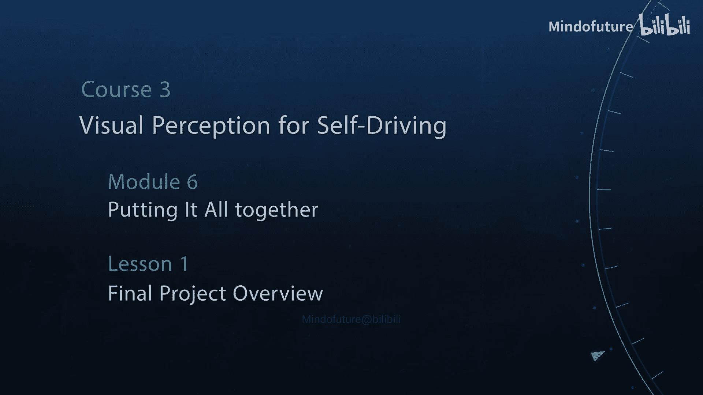
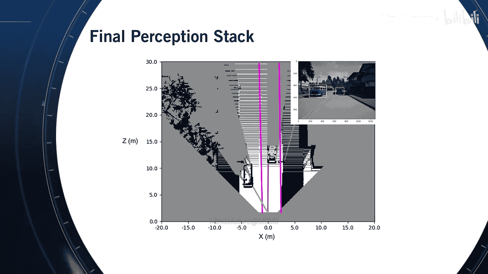

# 【多伦多大学】自动驾驶汽车的视觉感知 ｜ Visual Perception Self Driving Cars p30 P30_项目概述-使用CARLA进行物体检测与分割_07_01_01 -BV1nDsszQEdf_p30-

。

Congratulations for making it this far in the course。 You're almost done。

 Now it's time to take everything you learned and put it together for the final project。😊。

This video will provide you with the requirements needed to complete the final course assessment。

We will also discuss the grading scheme and how to submit the final assessment through the provided YaAmL file。

Let's begin by listing the objectives of this assessment。

The final project requires using what you learn throughout the course to implement an environment perception stack for self driving cars。

Specifically， you will be using the output from semantic segmentation neural networks to implement drivable space estimation in 3D。

Implement lane estimation。And filter out unreliable estimates in the output of 2D object detectors。

Finally， you will use the filtered 2D object detection output to determine how far obstacles are from the self driving car。

By finishing this project， you will be ready to develop baseline perception stacks that would allow a self-driving car to know where it can drive in road scenes。

 what obstacles are within view， which may affect its decision making。

 and how far away these obstacles are。You have already learned how to perform most of the required tasks for this assessment in the previous lessons。

 let us list the reference lessons that can be useful while tackling this assignment。

For drivable space estimation， you can refer to moduled 1 lesson 3 to estimate the X Y Z coordinates of pixels from depth and module 5 lesson3 to estimate the ground plane from semantic segmentation output。

For lane estimation， you can refer to module 5 lesson 3 for estimating lane lines。

For estimating the minimum distance to impact， module 4， lesson 4 will be useful for restaurants。

Now let's describe in detail why the required tasks are important for self driving cars。

Drivable space estimation in 3D is important for self driving cars to safely traverse the environment。

Using the given sensor input as well as semantic segmentation data from a neural network。

 you are required to estimate the equation of the ground plane in 3D。

Then determine pixels belonging to the ground plane based on a distance threshold。

Yellow here specifies the pixels your algorithm should label as a drivable space。

We will provide you with code to visualize the ground plane you estimated in 3D as an occupancy grid。

 a topic that will be covered in the next course in this specialization。

Note that drivable space does not mean road， as you can see。

 a portion of an area behind the sidewalk was labeled as divable space too。

Drivable space based on ground plane estimation provides the 3D space where the car is physically capable of driving。

To specify where the car is legally allowed to drive。

 you are required to perform lane boundary estimation。To perform this task。

 you are provided with the output of semantic segmentation。

You are required to use this output to estimate the left and right lane boundaries for your current lane。

The final task for this assessment requires you to estimate the distance to impact to objects in the scene provided by an object detection neural network。

The problem is that the neural network model has a high recall。

 but a low precision and provides some errors in its output。

You are required to first use the output of the semantic segmentation network to filter out erroneous results from the object detection network。

Then you are required to compute the minimum distance to impact with every obstacle in the scene。

Let's check what the final output of the whole system would look like。

Using the estimated ground plane， the self driving car will be able to determine where it can physically drive in the environment。

Using the estimated lane boundaries， the self driving car will be able to abide by the rules of the road。

And finally， using the filtered object detection output。

 along with the distance to impact estimation， the self driving car will be able to localize obstacles on the road to determine if any obstacles are blocking its path。

For the final project， keep in mind that the provided algorithmic guidelines are not rigid。

 and there exist many alternative approaches that you could use at each step of the assessment。

You are encouraged to diverge from the provided algorithm outlines wherever you believe you could do better in terms of results or efficiency。

If you have any questions that I didn't answer in this video。

 there are further instructions in the Jupiter notebook itself。

And don't be afraid to ask in the discussion forums as well。

 I hope you have fun with this final project， and I'll see you once again once it's complete to close out the course。

😊，Good luck。 and have fun。

