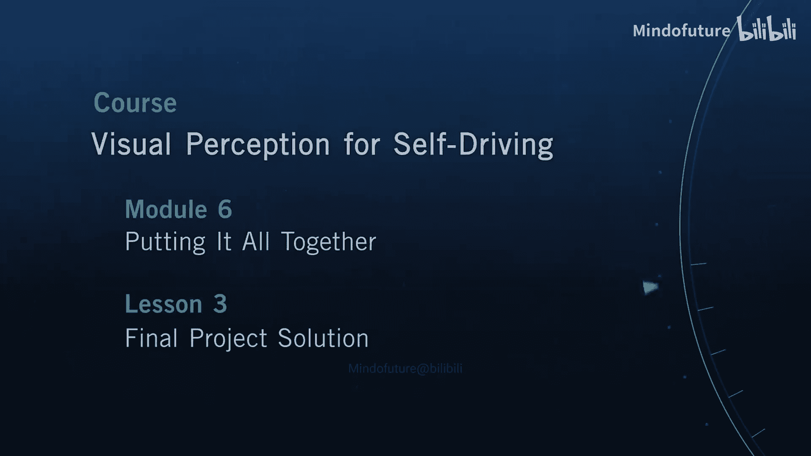
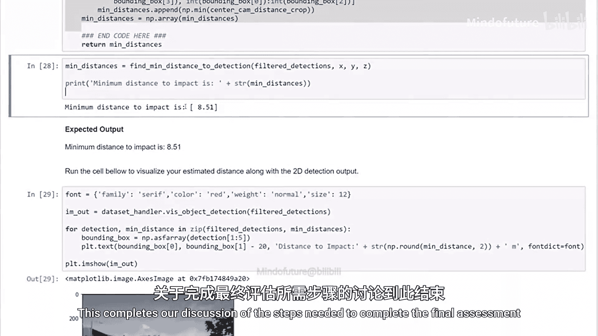
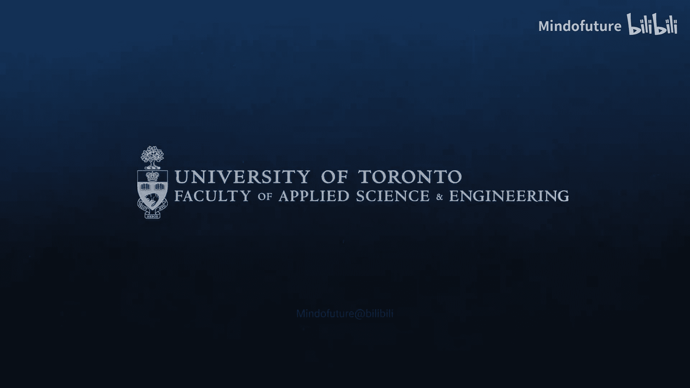

# 【多伦多大学】自动驾驶汽车的视觉感知 ｜ Visual Perception Self Driving Cars p32 P32_最终项目解决方案（已锁定）_07_01_03 -BV1nDsszQEdf_p32-

Now that you've had the chance to implement a baseline environmental perception stack。

 we present to you our solution for the final project for this course。

In this video we will walk through the solutions required to complete all the graded functions in the assessment。

 let's begin with the first task required to complete the final assessment ground plane estimation。

To estimate the ground plane， the X， Y and Z coordinates of every pixel in the scene need to be estimated。

We start by first implementing the XY from depth function。

This function takes as input the depth map and the calibration matrix K provided by the dataset handler。

And outputs the X Y coordinates of every pixel in the scene。

The Z coordinate of each pixel is drawn from the depth map value itself。

 so the function does not need to compute this quantity。

First we grab the focal length and the camera center parameters from the calibration matrix。

Then we create a grid of U and V coordinates for every pixel in the image。

 it is also possible to simply iterate over every pixel in the depth map。

 but the array structure simplifies storage and processing instructions。Third。

 we use Numpy's broadcasting functionality to estimate and return X and Y coordinates of every pixel in the scene over the UV grid。

 using the equations provided in the Jupiter notebook and videos。To test the function。

 we use a few test points in frame0 and notice that we arrive at the correct results for each point。

Now that we have the XY and Z coordinates of every pixel in the scene。

 we can get the XY and Z coordinates of pixels belonging to the road using semantic segmentation outputs。

The code for this is provided for you。After that， we implement Rasack to estimate the plane parameters in the graded function。

 Rasack plane fit。 The function takes as input。 the X， Y。

 Z point coordinates of pixels belonging to the road。😊。

The first step of Rasack requires setting the termination criteria。

We set the maximum number of iterations to 100， the minimum number of inliers to 45000。

 and the distance threshold of a point to be considered an inlier to 0。1 m。

 Then we begin the main ransack loop。Inside the loop。

 we first choose 15 points at random from the input to the function。

These 15 points are used to compute a plane model using the provided function compute plane。

We then get the number of inliers using the distance to the plane threshold and check if the number of inliers is greater than the number of inliarers in all previous iterations to update the inlire set。

Finally， we check our minimum number of inliers termination criteria to terminate if the number of inliers is greater than the required threshold。

The function returns a recomputed plane model using all the points in the best inlyar set。

We now test our function and conclude that we get values very close to the expected results。

Now that the ground plane has been estimated， we move on to lane boundary estimation。 again。

 using the output from semantic segmentation。As described in the Jupiter notebook。

 the first step is to determine lane boundary proposals by detecting all lines belonging to suspected lane boundaries。

We implement this within the estimate lane lines function。This function takes as an input。

 the semantic segmentation output from the data handler and creates a new segmentation image containing output of the classes belonging to lane boundaries。

 such as lane markings， curbs and sidewalks。To estimate lane line proposals。

 we can apply canny edge detection， followed by Hoff transform line estimation。

 The output is then reshaped to guarantee and by four output tensor dimensions。

Visualizing the output lane proposals， we can see that the boundary proposals contain horizontal lines。

Furthermore， there are 16 output line proposals。 However， looking at the image， we can see only 8。

 This means that there are redundant lines that need to be merged。

Mering and filtering need to be implemented in the mergege La lines function。

The function takes as an input the lane proposals estimated by the previous function filters out horizontal lines based on their slope。

 and then merges the remaining lines based on their slopes and intercepts。

We define similarity thresholds for the slope and the intercepts to decide which lines should be merged。

In addition， horizontal lines in the image space tend to have zero slope。

 and so we determine a minimum slope threshold under which lines are considered too slanted to be part of our lane boundaries。

The first step of implementing this function is to compute the slope and the intercept of all the lines in the input。

Second， we filter out lines based on the minimum slope threshold to eliminate horizontal lines。Third。

 we cluster the lines using the slope and intercept thresholds。

There are multiple ways to perform this clustering that will result in the same solution。

For each line in the set of lines， we identified all other lines in the set that fall within a slope threshold and then check that the intercepts fall within an intercept threshold as well。

Any lines that meet both conditions are clustered and removed from the set。Finally。

 we merged the clustered proposals to get one line per cluster by computing the cluster's mean slope and intercept。

Visualizing the output of our function， we can see that each lane boundary has one line estimate associated with it。

Finally， we extend the lane boundary to the extent of the drivable space by implementing the provided function extrapolate lines and find the closest lines to the center of the current lane。

The result is the left and right lane boundaries of the current lane。

The final component required to finish this assessment is the computation of the distance to impact with every object in the scene。

 using the output from the object detection algorithms。However。

 the specific algorithm that provides this output is not very precise。

 as such before estimating the depth of the obstacles in the scene。

 the output of the object detection needs to be filtered using the output from semantic segmentation。

This is performed through the filter detections by segmentation function。

This function takes as an input， the initial detections and the output from the semantic segmentation。

It then iterates over every detection and crops the segmentation output to pixels located inside the detection bounding box。

The number of pixels with the same category as the detection output is counted。

And then normalized by the bounding box area。Bounding boxes are finally filtered out if the computed normalized count is less than a threshold of 0。

3。This means that we eliminate a bounding box if less than a third of the bounding box area is occupied by the predicted class pixels。

Visualizing the remaining bounding boxes， we can see that only the one fully containing a car remains after the filtering process。

Finally， we need to write up a function called fine Min distance to detection to get the minimum distance to impact with every object in the scene。

This function takes as an input to filter detections， along with the X。

 Y and Z coordinates of all pixels in the image。During its first step。

 the distance is computed to each pixel in the filtered detection。

Then the minimum distance in each detection is computed to be returned by the function。

Testing our function demonstrates that we got the correct minimum distance to impact。

This completes our discussion of the steps needed to complete the final assessment。

Before we conclude， I recommend you take the time to compare the approaches we presented for tackling these tasks versus what you have designed。

 Let us know how you did it。 Congratulations， you have now completed the final assessment for the third course in our self driving car specialization。

😊，You should now be able to produce baseline perception stacks that are capable of guiding the self drivinging car to drive safely in its environment。

 This is a critical skill for aspiring self driving car engineers。 So keep up the great work。😊。

Remember that there's always more to learn in this ever changing field。

