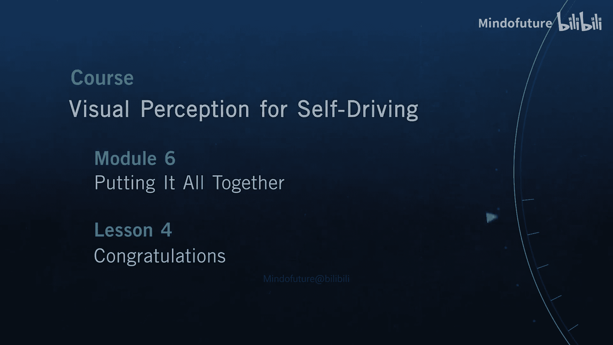
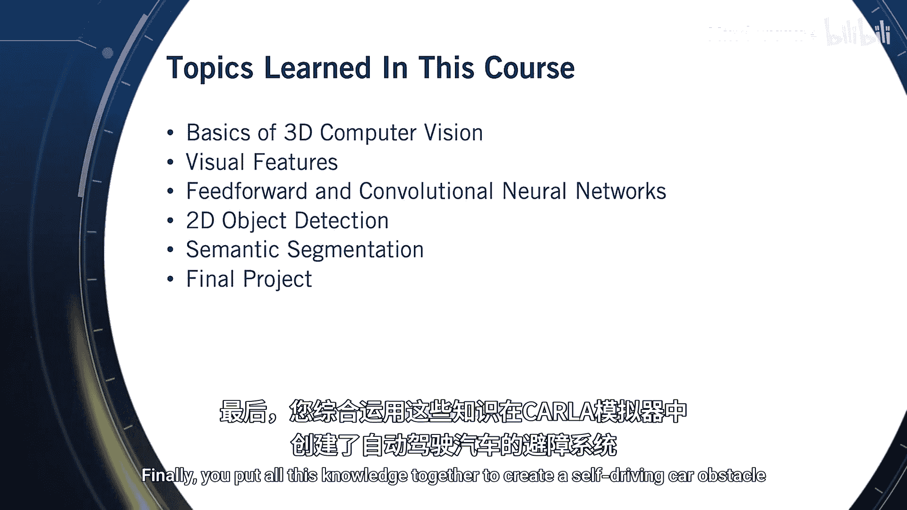

# 【多伦多大学】自动驾驶汽车的视觉感知 ｜ Visual Perception Self Driving Cars p33 P33_恭喜完成本课程_07_02_01 -BV1nDsszQEdf_p33-

。

Congratulations on finishing the visual perception for self driving Cars course。

 The concepts that you have learned in this course are a fundamental part of any self driving car software stack。

😊，Let us summarize what you have learned so far。During the first week of this course。

 you have learned the fundamentals of 3D computer vision and how to perform filtering operations using the cross correlation and convolution operators。

You also use these fundamental operations to create a baseline obstacle avoidance software。

During the second week of the course， you learned how to distill useful information from the images through feature detection and description。

You then learned how to use these features to get odoometry estimates using visual oometry。

Due to the limitations of the classical approaches to visual perception。

 we targeted deep neural networks during week three。

You learned the basic building blocks of deep neural networks and how to train them。

 You then learned about a special type of feed forward neural network。

 the convolutional neural network。You explored convenets for 2D object detection in the fourth week of the course。

You learned the 2D object detection problem formulation， how to train a 2D object detector。

 and how to use 2D object detection output to augment the perception stack of a self driving car。

The final topic you studied in this course was semantic segmentation。During week five。

 you learned how to formulate the semantic segmentation problem。

How to use convenets to perform semantic segmentation using the feature decoder model。

And how to use the output of semantic segmentation to perform drivable surface estimation and lane segmentation。

Finally， you put all this knowledge together to create a self driving car obstacle avoidance system in the carless simulator。

The concepts introduced in this course are a very active area of research。

And I encourage you to dig deeper into these fascinating topics by reading the latest papers and following announcements within the field。

To get started， I've provided you with a list of supplementary materials that will expand your understanding of the rich field of visual perception for self driving cars。

In the next course， I will introduce the final set of components in the self driving car stack。

 motion planning。As you'll learn， motion planning is a complex。

 multi scale problem with many interesting challenges for you to explore。

So join me in the next step of your journey towards mastering the tech behind self driving cars。

