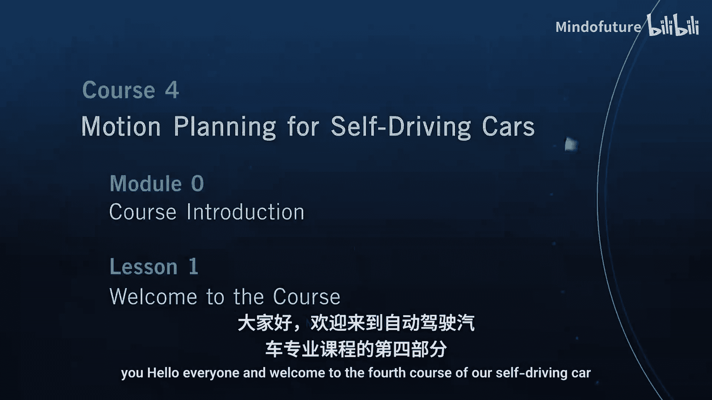

# 【多伦多大学】自动驾驶汽车的运动规划 ｜ Motion Planning Self Driving Cars p02 P02_欢迎学习本课程_01_01_02 -BV1kusszSEwn_p2-

嗯。

Hello everyone， and welcome to the fourth course of our self driving car specialization In this course。

 we're going to focus on motion planning problems， as well as some of the techniques we can use to solve them。

😊，At a very high level， the motion planning problem is the task of generating the path and velocities required to get the autonomous car from point A to point B。

To do this， we will require the perception and sensing information we described in previous courses。

 as motion planning requires having knowledge of the surrounding cars。

 pedestrians and other obstacles in the environment。Because of the complexity of the problem。

 it is common to decompose the planning problem into smaller sub problems。In this course。

 we will focus on three stage hierarchy of mission planning， which involves map level navigation。

 which you are likely familiar with from planning trips with online mapping tools。Behavior planning。

 which ensures our driving behavior， follows the rules of the road and local planning。

 which ensures our paths are smooth and collision free。

Once we've introduced the motion planning problem as well as our planning hierarchy in module1。

 we will focus on methods to solve each of the planning subproblem throughout the rest of the course。

In module2， we will discuss mapping in the context of autonomous driving as well as how we represent static obstacles that our planner must avoid during the planning process。

Both of these maps are necessary components for generating a safe trajectory for our autonomous vehicle。

Next， we will focus on mission planning in module 3。

 which is the highest level part of our planning problem。

We will use the maps generated in module 2 to navigate as efficiently as possible to our destination。

Moving to moduleule4， we will focus on how the autonomous vehicle interacts with other moving agents in the driving scene。

Which is a complex task that is essential to ensuring safety during the planning process。In module5。

 we will focus on the subproblem of behavioral planning。

 which is the task of determining which behaviors the autonomous vehicle should exhibit depending on the vehicle's surrounding environment。

From here， we will move to local planning in moduleule 6。

 where we introduce a reactive planner to generate trajectories for a bicycle model which we introduced in course1。

And finally， in moduledule7， we conclude by creating a decoupled path planner and velocity profile generator。

That builds upon our reactive planner。It can generate paths and velocity profiles that can be used by an autonomous vehicle for on road driving。

Throughout this course， we will be giving you assignments that will test your ability to implement the subcompents of our hierarchical motion planner。

 This will give you the hands-on experience required to develop a fully integrated motion planning system in the final course project。

Where you will develop a full motion planning system in the carless simulator。

I hope you're as excited as I am to dive into the motion planning problem， so let's get started。

