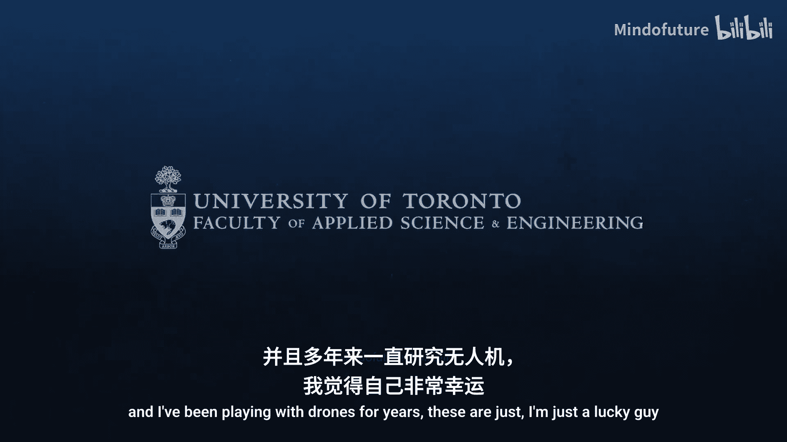

# 【多伦多大学】自动驾驶汽车的运动规划 ｜ Motion Planning Self Driving Cars p03 P03_认识讲师史蒂文·瓦斯兰德_01_01_03 -BV1kusszSEwn_p3-

🎼。

I was a generalist as a kid， I loved all kinds of stuff I thought I could be a scientist。

 I thought maybe a physicist， maybe a chemist， no idea really， I really was clueless as I grew up。

 I was a heavy athlete and I loved doing cross countryry skiing and mountain biking these were the things I spent my time on I didn't worry about the future I had an idyllic childhood right and then you know he turned 16 or 17 or 18 he start to think I got to do something fun with my life and that's where I started picking up these challenges and realizing what it was that kept driving me so I loved solving math problems so I loved you know doing chemistry or doing calculus challenges with my friends after school this is the kind of stuff I did just on the side with no real focus and so it wasn't until I really started to try to pick something to do that I found these specific applications where the things I like doing actually come up all the time。

So as I graduated from university I actually took a job at Pratt Whitney Canada which is one of our small jet engine manufacturing companies and while I worked attt Whitney it was fascinating。

 we got to do things like test out jet engine controls and so I had all this fun exposure to aeronautics but the challenging part about aeronautics is that know there's an extremely strong safety requirements and so everything you do has to be buttoned down and has to work precisely every time you do it and so the development in that area really is dictated by 30 year old technology that's been vetted over and over and over and so it was really frustrating for me as a young engineer trying to get things moving and trying to change the world so I took those wonderful experiences from the aerospace industry and that focus on safety and I turned it into a graduate career where I entered aeronautics and astronautics and started building drones。

Yeah it's problem solving it's algorithm development' you know it's taking a robot task。

 something like landing a drone on a moving car or trying to get a self-driving car to park itself or navigate through an obstacle field right all of these problems are really practical really applied and you can really see the results of them as you're building them you can see how well it's working you know if the drone misses the car it crashes and fails there's sort of a you know there's an exciting aspect to that that's really fun right so to make a self-driving car you have to first start by turning a regular automobile into a drive bywi vehicle this means that you can plug a computer into the car and send commands to the gas steering and brakes and the car will actually execute those maneuvers once you've got that capability you can literally start to program it to do whatever you want。

From there you have to add a whole suite of sensors and a computation in the trunk and with all these pieces you can start to build up your own self-driving vehicle so my research lab is built around the idea that if we have a real test bed and we put it in real situations we'll learn a lot more quickly what the limitations are in current methods what we're looking at really is finding research problems that are particularly suited to the academic community so we're looking at those problems like dealing with adverse weather conditions。

Dealing with some of these edge cases or trying to theoretically demonstrate that the methods we're using have a safety aspect that we can quantify so there's really lots of specific problems that we can work on in academia。

 we can try a bunch of crazy ideas we can explore the space of possible solutions a little bit faster than you know or maybe a little less guided than you might do in industry definitely going see increased performance from these vehicles we're going to see things like the Tesla autopilot just getting better and better every year and we're going to see fleets of vehicles that really are autonomous working in restricted domains where they know they're safe to operate but I still think that we have a lot of work to do to get that final。

Full autonomy anywhere you want to drive the level this is just because there's so many different ways that the cars can fail。

 there's so many different situations that they have to understand so many strange conditions that you know just can't predict ahead of time so if you're new to self-driving and you think this is a wonderful area and you want to try it I think the first thing you want to do obviously is follow this Coursera specialization but from there there's hundreds of ways that you can enrich your knowledge。

and get a better sense of how to get into this area so you know this whole field depends on the fundamentals of robotics。

 the fundamentals of computer vision， the fundamentals of neural networks and deep learning and these are areas that you can study extensively and what's really fun about those is they also apply to other wonderful applications so think robot manipulators think you know cell phone camera systems and improved features for for taking videos drone flight and tracking of objects there's there's tons of things you can do with this stuff and for those of you thinking about whether or not self-driving is a direction to go in and it's a good avenue to explore。

It's absolutely clear that this market is just going to keep growing this's just an insatiable demand for the students that are coming out of our programs it's pretty amazing yeah it's been a long time since I played with random math problems after school right and so to think that I'm now working on self-driving cars and I've been playing with drones for years are these are just I'm just a lucky guy。

