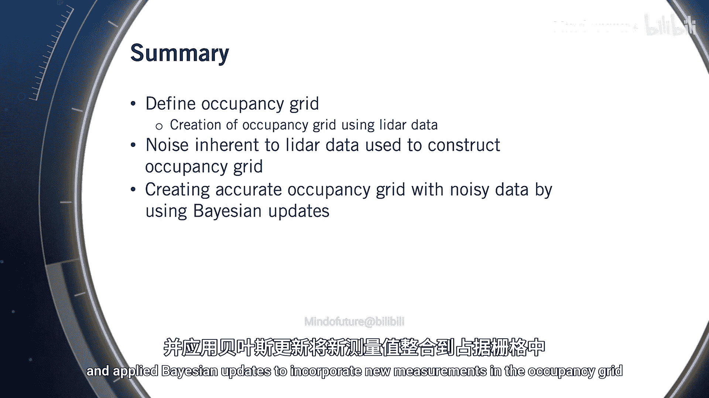

# 【多伦多大学】自动驾驶汽车的运动规划 ｜ Motion Planning Self Driving Cars p09 P09_第一课_占据栅格_03_01_01 -BV1kusszSEwn_p9-

。

Welcome， everyone to the second module of this course。In this module。

 we will discuss the creation of two environmental maps。

 the occupancy grid map and the high definition roadmap。

Both of the maps we will discuss play a critical role in the task of motion planning。

 as we will see throughout this course。We will start by defining the occupancy grid map in detail and understand how it can be created on an autonomous vehicle。

We will then try to understand the noise inherent in measurement data used for the creation of an occupancy grid mapap。

Finally， you will see how to handle this noise in the measurement data by learning about Bayesian updates of occupancy grid beliefs。

 Let's get started。An occupancy grid is a discretized grid which surrounds the current ego vehicle position。

This discretization can be done in two or three dimensions。

 and the methods we discuss can be applied to both two and three dimensional problems。However。

 to simplify both the explanations as well as the computational requirements in this module。

 we will only be focusing on the 2D version。Each grid square of the occupancy grid indicates if a static or stationary object is present in that grid location。

If so， that grid location is classified as occupied。

An example of static objects that would be classified as occupying a grid cell can include trees。

 buildings， road signs， and light poles。In the domain of autonomous vehicles。

 other objects which you might not think of as obstacles。

 should also be classified as occupying space， including all nondrivable surfaces such as lawns or sidewalks。

Each square of the occupancy grid noted by MI maps to a binary value in which one indicates that the square is occupied by a static object and zero indicates that it is not。

In this map， we can see that the squares with trees and grass cover are labeled as one。

 whereas the road is labeled as zero。The resulting map looks like this。

 all the occupied squares of the grid are purple and the rest of the map corresponding to the drivable surfaces is left transparent。

We will now look at the set of assumptions that are made in order to create an accurate occupancy grid。

First， the environment that is currently measured to create this occupancy grid only corresponds with static objects。

 meaning all dynamic objects or moving objects must be removed from the sensor data before it is used for occupancy grid mapping。

Second， each grid cell is independent of all others。

This assumption is made to simplify the update functions needed to create the occupancy grid。

And finally， the current vehicle state is exactly known in relation to the occupancy map at every time step。

In the domain of self driving cars to observe distance between the car and the current state of the world。

 the LiDarR sensor is used most frequently。As a quick reminder。

 the LDarR sensor uses pulses of light to measure the distance to all objects surrounding the car and returns a point cloud of measurements throughout its field of view。

In this video， we can see the output of the LDar sensor。

 Several components of the LDarR data need to be filtered out before this data can be used to construct an occupancy grid。

The first step is to filter all Liar points， which comprise the ground plane。 In this case。

 the ground plane is the road surface， which the autonomous car can safely drive on。Next。

 all points which appear above the highest point of the vehicle are also filtered out。

 This set of Lidar points can be ignored as they will not impede the progression of the autonomous vehicle。

Finally， all non static objects， which have been captured by the Ldar need to be removed。

 This includes all vehicles， pedestrians， bicycles and animals。

Once all filtering of the LiAA data is complete， the 3D LiDarR data will need to be projected down to a 2D plane to be used to construct our occupancy grid。

The filtering and compression of the LiDar data to create accurate occupancy grids for autonomous cars will be covered in a later video in this module。

The LDarR data， which is now filtered and compressed。

 resembles data from a high definition 2D range sensor。

 which accurately measures distance to all static objects around the vehicle in the plane。However。

 there is still a problem， after all the filtering has been completed。

 there are still major map uncertainties due to the filtering methods used on the data。

The complexity of the data at hand and most of all， environmental and sensor noise。

In order to handle this noise， the occupancy grid will be modified to be probabilistic。

 Instead of cell I storing a binary value for occupied。 Now。

 each cell I will store a probability between 0 and 1 corresponding to the certainty that the given square is occupied。

The higher the value stored， the higher the probability that the given square is occupied。

To use this set of probabilities， the occupancy grid can now be represented as a belief map denoted by the term B。

 EL or be。To keep notation simple， MI represents a single square of the occupancy grid where I can be constructed from measurements Y and the vehicle location X。

The belief over MI is equal to the probability that the current cell MI is occupied given the sensor measurements gathered for that cell location。

To convert back to a binary map， a threshold value can be established at which a given belief is confident enough to be classified as occupied。

Any value below the set threshold will be set to free。As an example。

 the occupied square in the figure to the left has a probability of 0。94。

 which classifies the square as occupied。On the other hand。

 the square found on the street only has a probability of 0。

12 of being occupied and thus will be classified as a free location。

Multiple sets of measurements can be combined from time1 to time T to achieve far more accurate belief of occupancy。

 In fact， we can update beliefs in a recursive manner so that at each time step T。

 we use all prior information from time1 onward to define our belief。

The belief at time T over the map cell MI is defined as the probability that MI is occupied given all measurements and the vehicle position from time 1 to T。

To combine multiple measurements into a single belief map， Bay's theorem can be applied。

In the case of the occupancy grid， we get a Bayesian update step that takes the following form。

The distribution P of YT given MI is the probability of getting a particular measurement given a cell MI is occupied。

This is known as the measurement model， which you've studied in detail in Co 2。

The belief at time t 1 over MI corresponds to the prior belief stored in our occupancy grid from the previous time step。

We rely on the Markov assumption that all necessary information for estimating cell occupancy is captured in the belief map at each time step。

 so no earlier history needs to be considered in the cell update equations。Finally。

 Ada in this case corresponds to a normalizing constant applied to the belief map。

 This is needed to scale the results to make sure it remains a probability distribution。

Let's see an occupancy grid in action。In this video。

 we will follow the autonomous vehicle as it drives out of a driveway and down a road while the occupancy grid is updating in real time。

The lighter grid cells represent free squares， whereas the black grid cells represent occupied squares。

We can also see the raw lidDar data in red and the filtered outputs in orange。

 noticeice how the map tracks the vehicle motion， which is estimated using the same techniques as we presented in course 2。

In this video， the threshold of belief needed for an object to be classified as obstructing is set to very high。

 Thus， only large static objects are getting identified as occupied。

 Lowing this threshold value will result in more cells to be tagged as occupied。

 but will lead to noisier maps as well。All right， so let's summarize what you've just learned。

In this video， you learn the basic definition of the occupancy grid map。

And saw how the LiDar sensor data can be filtered and compressed to create an occupancy grid。

You then learned how to represent the occupancy grid as a belief map。

And applied Bayesian updates to incorporate new measurements in the occupancy grid。

In the next video， we will discuss some of the numerical problems with our belief space map representation。

And introduce the Loit function as a solution to this problem。

We will also look at an inverse measurement model which is needed to create the occupancy map grid from 2D LiDarR data using the Loit function。

See you there。

