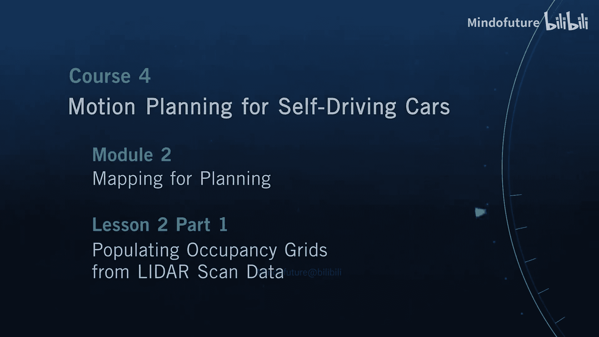
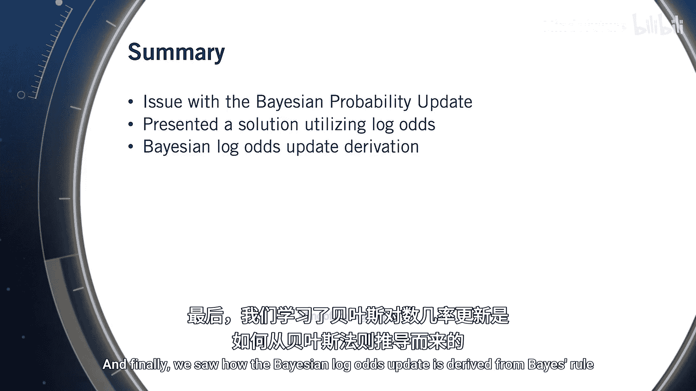

# 【多伦多大学】自动驾驶汽车的运动规划 ｜ Motion Planning Self Driving Cars p10 P10_第二课_根据激光雷达扫描数据构建占据栅格第一部分_03_01_02 -BV1kusszSEwn_p10-

Hello， everyone。 Welcome to the second lesson of this module。 In this video。

 we will identify the issues with the Bayesian probability Up step。

 which we saw in the previous lesson。😊，We will then present a solution to the issues highlighted using a law God's representation。

Finally， in this video， we will see the derivation of the Bayesian Lagos update step required to update the belief map。

As we have seen in the previous video， we can apply base theorem to combine the previous belief map with the current measurement information to create a highly accurate occupancy grid at each time step。

This is achieved by the following function in which n represents a normalizing constant。

P of Y T given M is the current measurement received。

 and the belief at time T minus1 over MI is the previous belief map。There is， however。

 a problem with using this simple Bayesian update。To demonstrate the issue。

 we will look at an example of an update to an unoccupied cell of the occupancy grid with a new unoccupied measurement。

Let's suppose we have a cell which previously had a low belief of occupation， 6。

38 times 10 to the minus4。And the new measurement results in a low probability as well， 1。

2 times 10 to the minus5。This means that the resulting belief would be very low or 8。

0 times 10 to the minus7。As you can see， all of these beliefs are quite close to zero。

Mulipplication of floating point numbers on a computer， however。

 can lead to significant rounding error when multiplying small numbers。

 which in turn can lead to instability in the estimate of the probabilities。Further。

 the multiplication of probabilities turns out to be an inefficient way to perform the belief update。

 and so our basic application of Bayase rules to update beliefs over the occupancy cells is not looking good。

There is， however， a solution， instead of storing the belief map with the values ranging from zero to 1。

 we can convert our beliefs into log odds probabilities using the Loitit function。

We first saw this Loit function in Co three。This leads to cell values ranging from negative infinity to positive infinity。

 avoiding the issue with numbers close to 0。The logit function takes the natural logarithm of the ratio of the probability P and 1 minus P。

 So it takes probability values from 0 to 1 and maps them to the entire real axis。

It is also possible to transition from the log Os domain back to probabilities。

 This is done by taking the ratio of E raised to the logit of P divided by1 plus E to the logit of P。

We now have an alternative representation for our cell probabilities。

 so let's see how this affects our Bayesian update equation。

We will start this derivation by the application of Bayase rule to P of MI given y1 to T。

Where MI is the current occupancy grid map square at location I。

 and Y1 to T are the sensor measurements of that cell from time 1 to time T。

Writing out the full Bayesian update for incorporating the latest measurements into our occupancy belief。

 we get the following equation， The first term in the numerator is the probability of getting measurement YT given the cell state at all previous measurements。

The second term in the numerator is the probability a cell is occupied。

 given all measurements to time t minus1， and the nominator is the probability of getting the measurements Y t given all previous measurements up to time t 1。

It should be noted that the measurement Yt is separated from the rest of the measurements of y1 to t minus1。

This is done， as we would like to update the occupancy grid with only the most recent sensor measurement。

 rather than storing all measurements and applying them again every time。Next。

 we will apply the Markov assumption， which ensures the current measurement is independent of previous measurements if the map state MI is known。

The next step is to expand the measurement model， P of Y given M。

By the application of Bayes rule once again， this results in the probability of map cell M I being the current measurement multiplied by the probability of getting that measurement divided by the probability a grid cell M I is occupied。

We now substitute the expanded measurement model in blue into the main Bayesian inference equation shown here。

This leaves us with three terms in the numerator and two terms in the denominator。

We'll now pass this expanded form through the Loit function and then start simplifying the resulting expression。

Let's rearrange the term 1 minus P before we write out the resulting expression。

The denominator portion of the log gods ratio，1 minus PMI。

 given y1 to T can be constructed by negating the expression for the probability of a cell being occupied。

 which is， of course， the probability that a grid cell is not occupied。Next。

 we form the log gods ratio， which is simply the log of the ratio of the probability a cell is occupied to the probability it is not。

There are many like terms in this expression， which we can now cancel out as follows。

We arrive at the following simplified expression for the odds ratio with only three terms each in the numerator and denominator。

We rewrite the expression in the original 1 minus P notation。As you may have noticed。

 this equation is better viewed as three ratios， the ratio of the probabilities to one minus the same probability。

The first ratio is the probability of a cell being occupied， given a measurement Y。

The second is the probability a cell is not occupied。

 and the third is the prior belief that a cell is occupied， given all measurements up to time t 1。

Finally， we apply the log to our series of probability ratios to arrive at the addition of three Loit functions。

This is our final update equation and has the nice property of simply requiring addition when a new measurement is required。

The three terms can be written in a convenient shorthand。

 where L t minus1 I is the logit of the belief that cell I is occupied at time t minus1。

 and similarly L0 I at time 0 and L TI at time T。We now arrive at the convenient Logos update Rule for Bayesian inference on occupancy grid Maps。

It is made up of the three terms that are combined at each time step based on the latest measurement data。

The first term the logit of the probability of MI given YT is the logit formed using new measurement information。

The probability distribution P of MI given Yt is known as the inverse measurement model。

And we'll study how to do this in the next video for LDarR data。

L t minus1 I is the previous belief at time t minus1 for cell I。

 and L0 I is the initial belief at time zero for the same cell。

The initial belief represents the baseline belief that a grid cell is occupied。

 which is usually set to 50% uniformly， as we don't expect to have prior information that improves on this value。

It shows up in this equation at every time step， which is a bit surprising。

 but is simply a result of the derivation that we studied in this video and adjusts the addition of the first two terms to ensure the updated belief is consistent with the log gods form。

The Bayesian log odds has two strong advantages over directly updating probabilities。

The update is numerically stable due to the logit mapping of 01 probabilities to the entire real axis。

And computationally， it is also significantly more efficient as it relies exclusively on addition to complete all updates of the occupancy grid。

Let's summarize what we learned in this video。We first identified some issues with storing and updating the occupancy grid with a straightforward Bayesian probability update。

We then saw how this issue could be solved by employing the lawgo's representation of the probability space。

And finally， we saw how the Bayesian log Os update is derived from Bayes rule。

In the next video， we will learn how to take the Bayesian loggos update and build the required inverse measurement model to update the occupancy grid using filtered to dear data。

See you there。